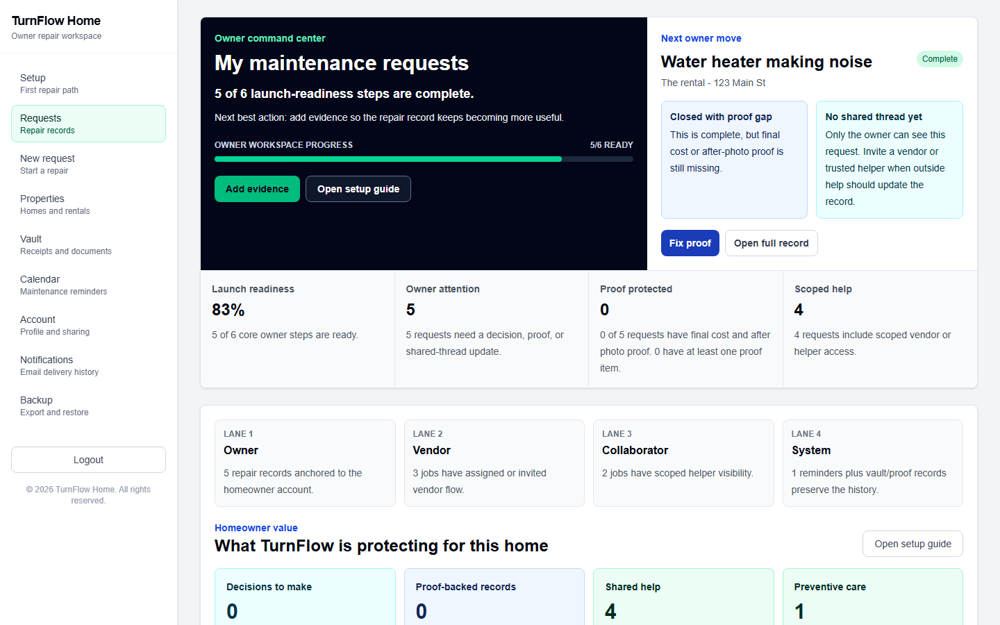
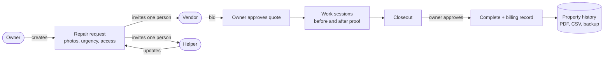
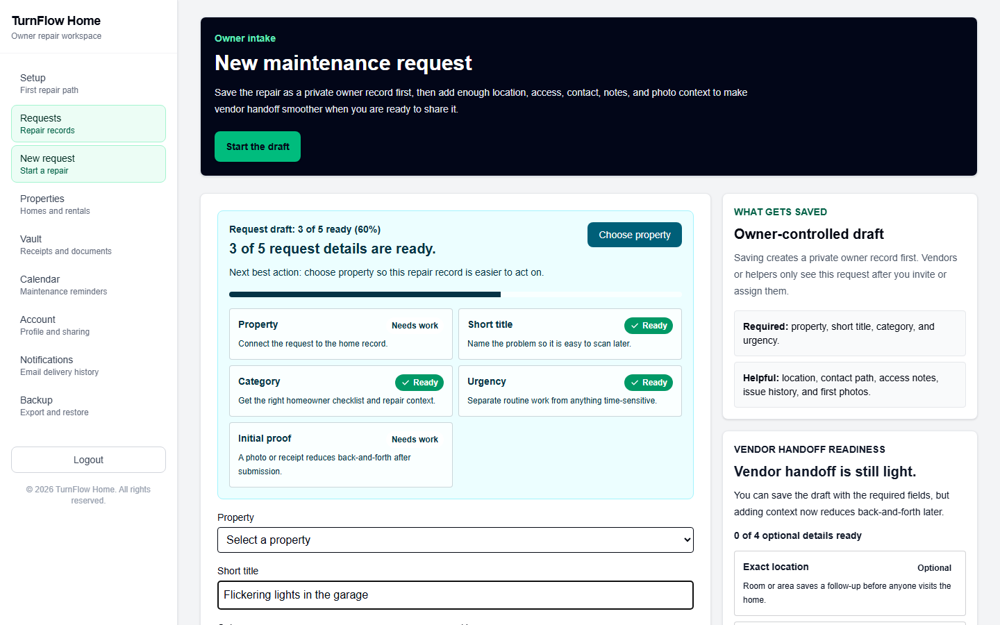
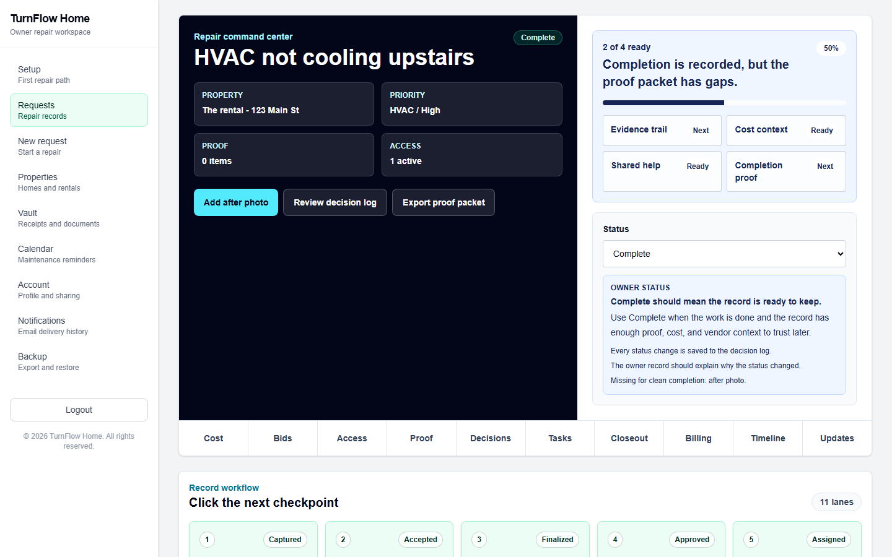
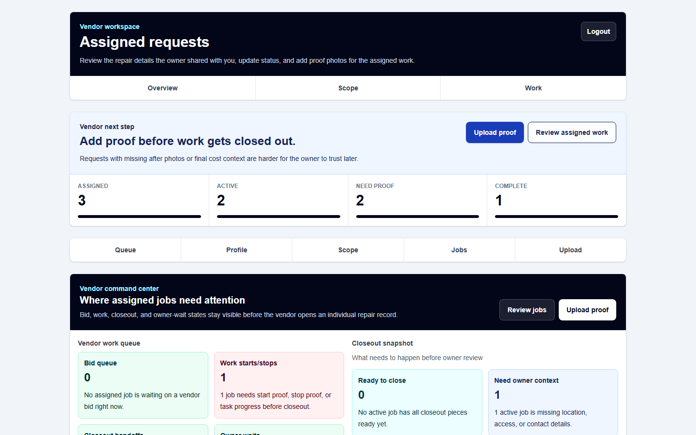
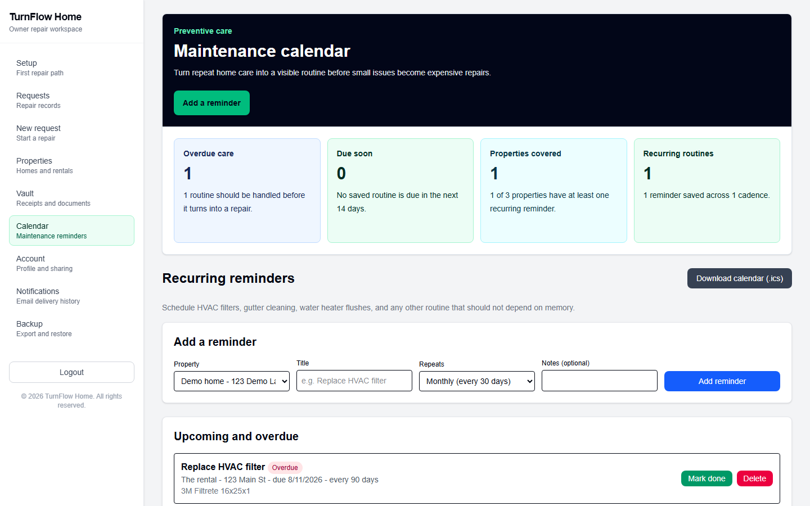

# TurnFlow Home

**One calm record for every home repair: capture it, share just that job, prove the work, keep the history.**



## What it is

Homeowners who manage their own repairs live in text threads, camera rolls and
receipt drawers. TurnFlow Home gives each property one shared record. You log
an issue with photos, compare quotes, invite a vendor or trusted helper to
**that one request only**, and get before/after proof, a decision history and
a cost record that stays with the house.

It is intentionally **homeowner-first**: not property-management dispatch
software, and not a payment processor.

## How it works



Key steps (status changes, invites, quote and closeout decisions) write an
entry to a decision log, and helpers only ever see the request shared with
them.

| Guided intake | Request detail | Vendor portal | Maintenance calendar |
|---|---|---|---|
|  |  |  |  |

## Status

- **Built:** owner, vendor and collaborator workflows end to end, with 34 unit-test files (318 tests) and 6 browser smoke loops. CI runs lint, typecheck, tests, audit, schema-drift check and build.
- **Hardened on 2026-09-28:** private file access, strict status rules, login limits, and a private demo password ([what changed](docs/09-changes/2026-09-28-p0-security.md)).
- **Next:** invited vendors and helpers can sign up from their invite, transactional writes, and moderated homeowner testing ([roadmap](docs/07-refinement/findings-and-roadmap.md)).

## Read more

| I want to… | Go to |
|---|---|
| Start with the visual and narrative system guide | [PROJECT_SYSTEM_GUIDE.md](PROJECT_SYSTEM_GUIDE.md) |
| Understand the project in 10 minutes | [docs/README.md](docs/README.md) → [Problem](docs/01-problem/problem.md) → [System map](docs/00-overview/system-map.md) |
| See how each feature works (algorithm, pseudocode, flowchart) | [docs/04-algorithms/](docs/04-algorithms/README.md) |
| Find a file | [Code map](docs/05-implementation/code-map.md) |
| Read the latest review (PDF) | [docs/review/](docs/review/2026-09-28-repo-review.pdf) |
| Deploy or operate it | [Deployment](docs/DEPLOYMENT.md) · [P0 rollout runbook](docs/08-operations/p0-rollout-runbook.md) |
| See the history of changes | [Build log](docs/07-refinement/build-log/README.md) |
| Read the previous (long) README | [docs/history/README-2026-09-18.md](docs/history/README-2026-09-18.md) |

## Quickstart

```bash
npm install
cp .env.local.example .env.local   # fill in DATABASE_URL, BLOB_READ_WRITE_TOKEN, AUTH_SECRET, SEED_PASSWORD...
npm run db:migrate
npm run db:seed                    # demo accounts; needs SEED_PASSWORD unless the DB is on localhost (see docs/DEPLOYMENT.md)
npm run dev
```

Before deploying:

```bash
npm run poc:ready   # checks env values, including private file storage
npm run verify      # lint, typecheck, tests, audit, schema drift, build
```

The curated investor demo (`npm run db:seed:investor`) needs
`INVESTOR_DEMO_PASSWORD` set. The password is shared privately and never
committed.

## Tech stack

Next.js 16 (App Router, Server Actions, TypeScript) · Neon Postgres + Drizzle
ORM · Auth.js v5 · Vercel Blob · Resend · Vercel Cron · Tailwind CSS v4 ·
Vitest · Playwright.

This is the fourth iteration. It was rebuilt from a static Firebase MVP onto a
real server boundary with relational data and server-side authorization
([why it was rebuilt](docs/history/README-2026-09-18.md#why-it-was-rebuilt)).
