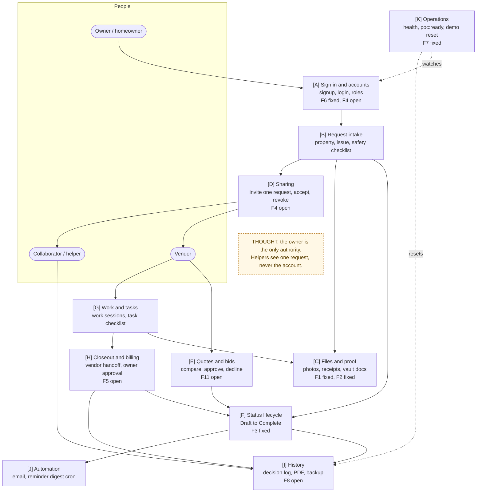
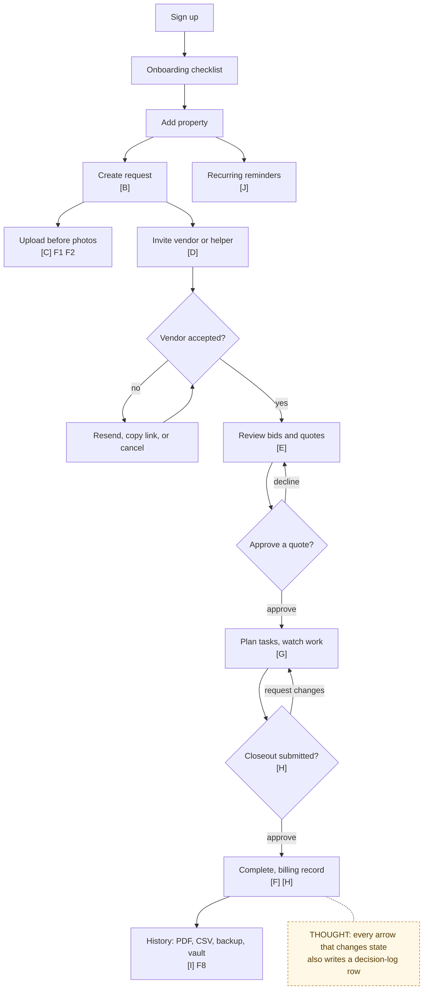
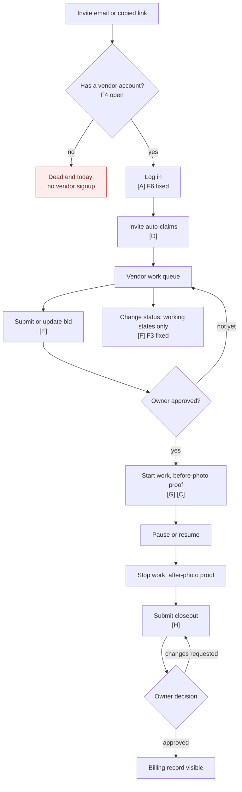
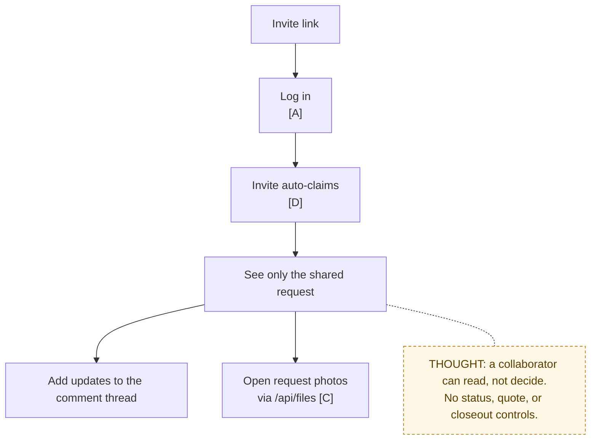
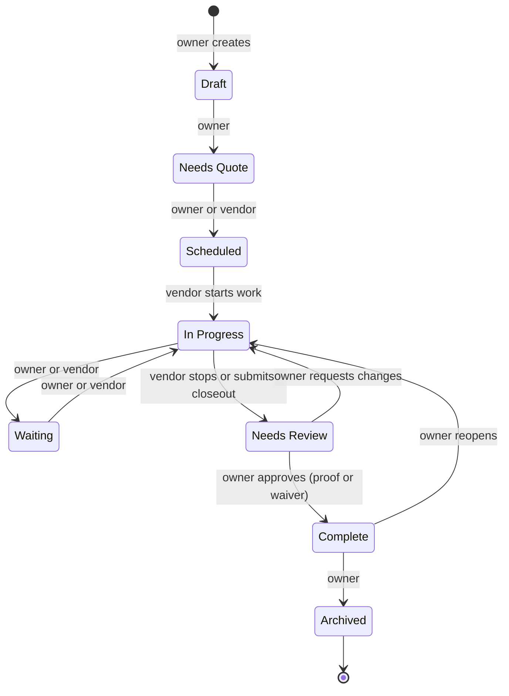
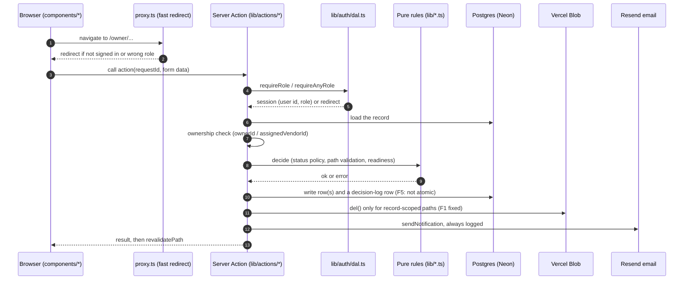
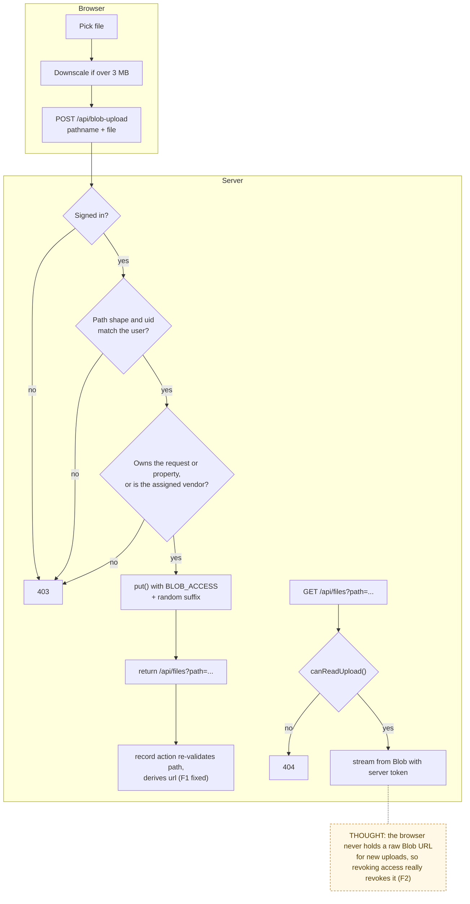

# System Map

> Sequence: **the big picture**, a zoomable map of the whole product.
> Level 0 is one page long. Each lane is zoomed in on at Level 1. Level 2 focuses on the path a single click takes through the code. Each flow document in
> [`04-algorithms/`](../04-algorithms/README.md) is given a name for its location on this map.
>
> **Finding pins** (`F1`–`F12`) mark where each issue from the
> [2026-09-28 review](../review/2026-09-28-repo-review.md) lives. Status for
> each one is in the [findings register](../07-refinement/findings-and-roadmap.md).

## Legend

| Mark | Meaning |
|---|---|
| `[A]`…`[K]` | Map node IDs, used by every flow doc |
| **F#** fixed | Fixed in the 2026-09-28 P0 change (commit on `main`) |
| **F#** open | Still open, planned in the roadmap |
| THOUGHT | Why a box or decision exists |

---

## Level 0 — the whole product on one page

**In one sentence:** a homeowner opens a repair record, shares just that record
with a vendor or helper, the work and money get proven step by step, and the
finished record becomes permanent property history.

**How to read it:** follow the arrows left to right. Every box is one core
flow with its own design doc:

| Node | Flow doc |
|---|---|
| `[A]` Sign in and accounts | [01 Auth and rate limiting](../04-algorithms/01-auth-and-rate-limiting.md) |
| `[C]` Files and proof | [02 File upload and access](../04-algorithms/02-file-upload-and-access.md) |
| `[B]` Request intake | [03 Request intake](../04-algorithms/03-request-intake.md) |
| `[F]` Status lifecycle | [04 Request status lifecycle](../04-algorithms/04-request-status-lifecycle.md) |
| `[D]` Sharing | [05 Invite and access](../04-algorithms/05-invite-and-access.md) |
| `[E]` Quotes and bids | [06 Bid and quote decision](../04-algorithms/06-bid-and-quote-decision.md) |
| `[G]` Work and tasks | [07 Work sessions and tasks](../04-algorithms/07-work-sessions-and-tasks.md) |
| `[H]` Closeout and billing | [08 Closeout and billing](../04-algorithms/08-closeout-and-billing.md) |
| `[K]` Operations, demo | [09 Investor demo reset](../04-algorithms/09-investor-demo-reset.md) |
| `[J]` Automation | [10 Reminder digest and notifications](../04-algorithms/10-reminders-and-notifications.md) |
| `[I]` History | [11 Backup, restore and exports](../04-algorithms/11-backup-restore-and-exports.md) |
| all | [12 Guidance layer](../04-algorithms/12-guidance-layer.md) (the "what to do next" helpers) |

---

## Level 1 — the three lanes

### 1a. Owner lane

### 1b. Vendor lane

### 1c. Collaborator lane

### 1d. Request lifecycle (all lanes meet here)

The detailed transition table is in
[04 Request status lifecycle](../04-algorithms/04-request-status-lifecycle.md).

---

## Level 2 — how one click travels through the code

Every write in the app follows this same path. This is where the security
boundary lives.

### Level 2b — file upload and read path

---

## Where each finding lives

| ID | Finding | Map node | Status | Flow doc |
|---|---|---|---|---|
| F1 | Any user could delete other people's files via a client-supplied blob path | `[C]` | fixed | [02](../04-algorithms/02-file-upload-and-access.md) |
| F2 | All uploads were public, forever | `[C]` | fixed in code; ops step to switch store | [02](../04-algorithms/02-file-upload-and-access.md) |
| F3 | Vendors could complete, waive, archive or reopen | `[F]` | fixed | [04](../04-algorithms/04-request-status-lifecycle.md) |
| F4 | Invited vendors and helpers cannot create an account | `[A]` `[D]` | open (P1) | [05](../04-algorithms/05-invite-and-access.md) |
| F5 | Multi-step writes are not atomic | `[H]` `[D]` `[E]` | open (P2) | [08](../04-algorithms/08-closeout-and-billing.md) |
| F6 | No login/signup limits; account existence could be timed | `[A]` | fixed (reset and verification still open) | [01](../04-algorithms/01-auth-and-rate-limiting.md) |
| F7 | Demo password published in README | `[K]` | fixed; ops step to rotate | [09](../04-algorithms/09-investor-demo-reset.md) |
| F8 | Decision log deleted along with its request | `[I]` | open (P2) | [11](../04-algorithms/11-backup-restore-and-exports.md) |
| F9 | Tests cover guidance helpers, not the server boundary | all | partly fixed (pure P0 rules tested) | [Test strategy](../06-testing/test-strategy.md) |
| F10 | Upload type allowlist skipped empty types | `[C]` | fixed | [02](../04-algorithms/02-file-upload-and-access.md) |
| F11 | Several quotes can be approved at once | `[E]` | open | [06](../04-algorithms/06-bid-and-quote-decision.md) |
| F12 | Smaller items: stale JWT role, request edit validation, cron open without secret, repo weight | `[A]` `[B]` `[J]` | mixed | [Findings register](../07-refinement/findings-and-roadmap.md) |
