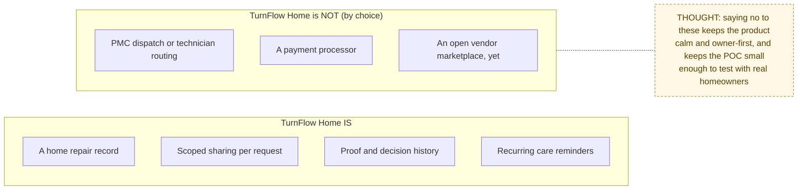

# Problem

> Chain step: **Problem**, the first link. Everything else in these docs
> exists to solve what is written here.

## The problem in one paragraph

Homeowners who manage their own repairs run them through text messages,
photos in a camera roll, receipts in a drawer, and memory. When something
breaks they cannot easily show a vendor what they saw, compare prices, prove
what was agreed, or remember what was done to the house last year. Property
management companies solve this with heavy software and a fee. Self-managing
homeowners have nothing in between.

## Who has the problem

| Person | What they are trying to do | What goes wrong today |
|---|---|---|
| **Homeowner** (primary) | Get a repair done at a fair price and keep a record | Context is scattered; no proof of before and after; costs and decisions are forgotten; the whole account ends up shared with helpers |
| **Vendor** (plumber, handyman) | Understand the job, quote it, do it, get paid | Missing address, access or scope details; unclear approval; "was this approved?" disputes |
| **Collaborator** (family, a friend, a tenant) | Help with one job | Either sees nothing or sees everything |

## Jobs to be done

1. "When something breaks, help me capture it once, completely, so I don't have to explain it five times."
2. "Help me compare prices and remember which one I approved."
3. "Let me share one repair with one person without giving them my whole house record."
4. "Prove the work happened: before, during, and after."
5. "Keep the history of my home, exportable, even after the repair is done."
6. "Remind me about maintenance before it turns into a repair."

## What TurnFlow Home is (and is not)

## How we will know it is solved

| Signal | Target for the POC |
|---|---|
| Time from "something broke" to a complete request | under 5 minutes |
| Invited vendors who accept and act | most of them, without coaching |
| Requests closed with proof (after photo + final cost) | the majority, without waivers |
| Testers who can answer "what happens next?" on every screen | all of them ([user testing protocol](../USER_TESTING.md)) |

**Next:** [Requirements →](../02-requirements/README.md)
