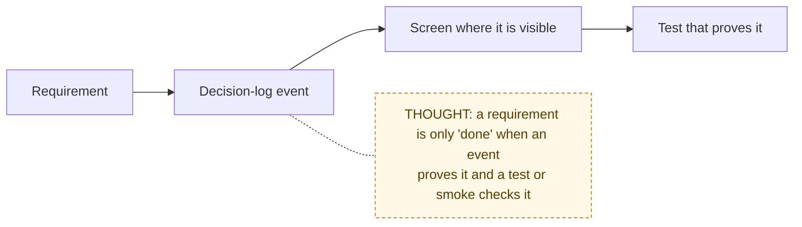

# Requirements

> Chain step: **Requirements**. What the product must do, stated so it can be tested.

The detailed requirements were already written before this folder existed.
They stay where they are so existing links keep working:

| Document | What it defines | Status |
|---|---|---|
| [User requirements and event matrix](../USER_REQUIREMENTS_EVENT_MATRIX.md) | Per-role requirements, a "done when" statement for each, and the decision-log event each one produces | **Current**, the source of truth |
| [Endpoint experience map](../ENDPOINT_EXPERIENCE_MAP.md) | Per-route goal, primary action, success/empty/error states, trust cues, POC score | **Current** |
| Flow docs, section 2 of each | Numbered `R1…Rn` requirements per core flow | **Current**, see [`04-algorithms/`](../04-algorithms/README.md) |

## Cross-cutting requirements (apply to every flow)

| ID | Requirement | Enforced in |
|---|---|---|
| X1 | Every write re-checks role **and** record ownership on the server | every `lib/actions/*` function (see [system map, Level 2](../00-overview/system-map.md#level-2--how-one-click-travels-through-the-code)) |
| X2 | Every meaningful state change writes an append-only decision-log row | actions; see the event catalog in the matrix |
| X3 | Helpers see only the requests shared with them | page queries filter by `assignedVendorId` / `collaboratorId` |
| X4 | The browser never decides what the server stores (paths, URLs, statuses) | [02 Files](../04-algorithms/02-file-upload-and-access.md), [04 Status](../04-algorithms/04-request-status-lifecycle.md) |
| X5 | Email failures never break a flow; every attempt is logged | [10 Notifications](../04-algorithms/10-reminders-and-notifications.md) |
| X6 | No payment processing in the POC | [Constraints](../03-design/constraints.md) |

**Previous:** [Problem](../01-problem/problem.md) · **Next:** [Inputs and outputs →](../03-design/inputs-outputs.md)
