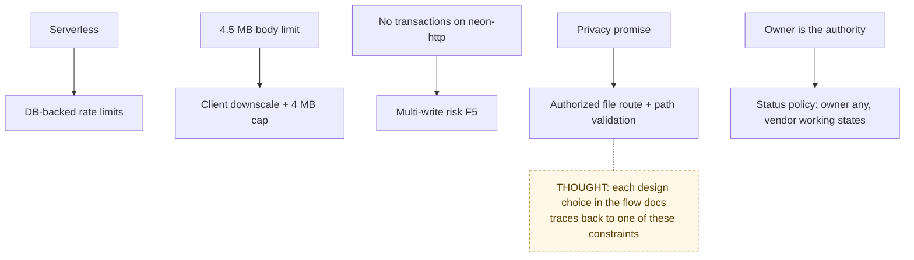

# Constraints

> Chain step: **Constraints**. The limits every algorithm has to respect. Some
> come from the platform, some from privacy, and some are product choices.

## Platform constraints

| Constraint | Consequence in the design |
|---|---|
| Vercel serverless functions, no shared memory between instances | Rate-limit counters live in Postgres (`auth_attempts`), not in memory |
| Request body limit about 4.5 MB | Browser downscales images above 3 MB; the server rejects files over 4 MB |
| Browser → Blob direct upload is CORS-blocked | Uploads go through `/api/blob-upload` |
| `neon-http` driver has no interactive transactions | Multi-write actions are not atomic (**F5**); fixing it means switching to `neon-serverless` |
| Vercel Cron is daily, in UTC | Reminder digest 13:00 UTC; demo reset 08:00 UTC |
| Auth.js v5 JWT sessions | Role is baked into the token until it expires (**F12**) |
| Next.js 16 `proxy.ts` is an optimistic check only | Every real authorization happens in the data-access layer and server actions |

## Privacy and trust constraints

| Constraint | How it is met |
|---|---|
| Helpers see one request, never the account | Page queries filter by assignment; actions re-check assignment |
| Vendors never see competing prices | The vendor page loads only `submittedByVendorId = me` |
| Files readable only by people on the record | `/api/files` + `canReadUpload` (with `BLOB_ACCESS=private`) |
| No secrets in the repo | Demo password moved to env (2026-09-28) |
| Decision history is append-only | By convention in code; not enforced by the database yet (**F8**) |

## Product constraints (chosen)

- Homeowner-first. No PMC dispatch, technician routing, payroll, or company reporting.
- No payment processing in the POC. Billing records say "paid outside TurnFlow".
- Public signup is for owners only. Vendors and helpers create their account from an invite, with email and role locked to the invite (F4 fixed 2026-10-25).
- Guidance explains and policy enforces (see [12 Guidance layer](../04-algorithms/12-guidance-layer.md)).

**Previous:** [Inputs and outputs](inputs-outputs.md) · **Next:** [Data model →](data-model.md) → [Algorithms](../04-algorithms/README.md)
