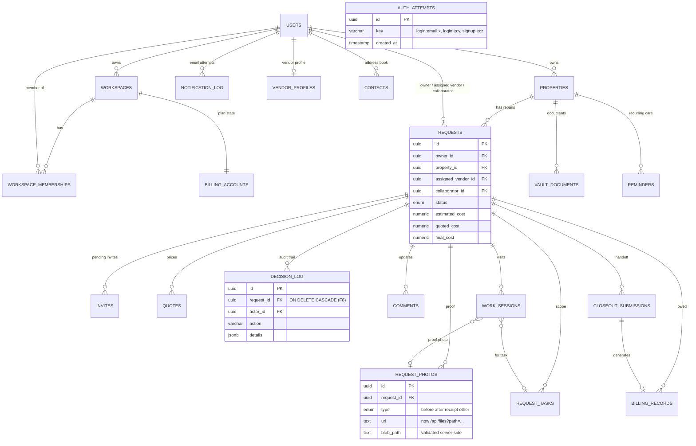
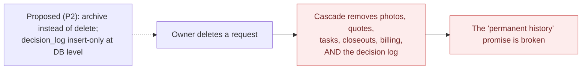

# Data Model

> Chain step: **Inputs/Outputs + Constraints**, i.e. where the records live.
> Source of truth: `lib/db/schema.ts` (Drizzle) and the SQL migrations in
> `drizzle/` (latest: `0012_clumsy_ozymandias.sql`, which adds `auth_attempts`).

## Entity relationship diagram (core)

`AUTH_ATTEMPTS` stands alone on purpose. It has no foreign keys, so a
counter can exist for an email that has no account.

## Delete behavior (why F8 matters)

| When this is deleted… | …these go with it (`ON DELETE CASCADE`) |
|---|---|
| a user | their workspaces, properties, requests, invites, contacts, notification log, vendor profile |
| a property | its requests, vault documents, reminders |
| a request | its photos, quotes, **decision log**, comments, tasks, work sessions, closeouts, billing records |

## Status enums

| Enum | Values |
|---|---|
| request status | Draft, Needs Quote, Waiting, Scheduled, In Progress, Needs Review, Complete, Archived ([policy](../04-algorithms/04-request-status-lifecycle.md)) |
| photo type | before, after, receipt, other (upload folders add `quote`) |
| quote status | pending, approved, declined |
| task status | todo, in_progress, blocked, done (+ `acceptedAt`) |
| closeout status | pending, approved, changes_requested |
| billing record status | recorded, paid, disputed, void |
| invite status | pending, accepted (canceled invites are deleted) |

**Previous:** [Constraints](constraints.md) · **Next:** [Algorithms →](../04-algorithms/README.md)
