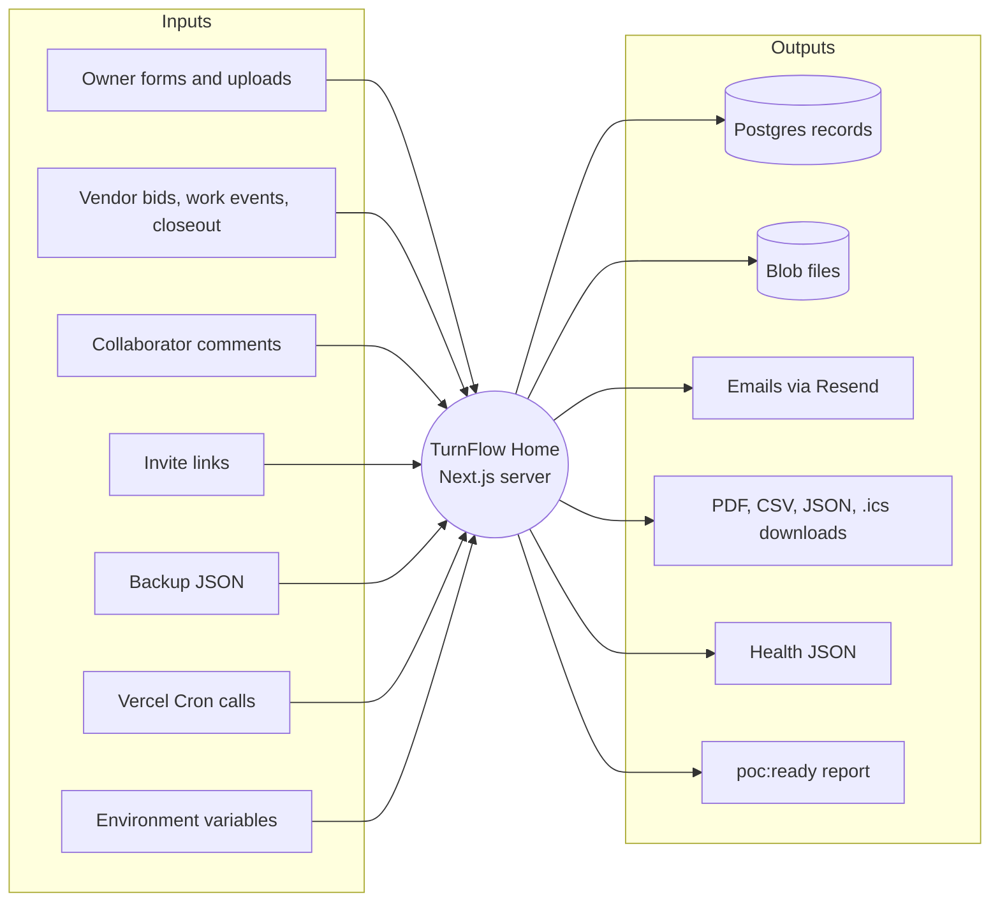

# Inputs and Outputs

> Chain step: **Inputs/Outputs**. Everything that enters the system, and
> everything it produces. Details for each flow are in section 3 of its
> [flow doc](../04-algorithms/README.md).

## System context

## Input catalog

| Input | Entry point | Validated by | Flow |
|---|---|---|---|
| Signup / login | `/signup`, `/login`, `/api/auth/*` | zod, rate limits, bcrypt | [01](../04-algorithms/01-auth-and-rate-limiting.md) |
| File + target path | `POST /api/blob-upload` | type, size, path shape, ownership | [02](../04-algorithms/02-file-upload-and-access.md) |
| Request fields | `createRequestAction` | required fields, enums, property ownership | [03](../04-algorithms/03-request-intake.md) |
| Status change | `updateRequestStatusAction` | status policy | [04](../04-algorithms/04-request-status-lifecycle.md) |
| Invite email / accept | invite actions, `/accept-invite` | ownership, expiry, role and email match | [05](../04-algorithms/05-invite-and-access.md) |
| Quote / bid | quote and bid actions | amounts, attachment path, assignment | [06](../04-algorithms/06-bid-and-quote-decision.md) |
| Work event + proof | `recordWorkSessionEventAction` | proof photo rules | [07](../04-algorithms/07-work-sessions-and-tasks.md) |
| Closeout / review / billing | closeout and billing actions | readiness, decision, notes | [08](../04-algorithms/08-closeout-and-billing.md) |
| Cron calls | `/api/cron/*` | `authorizeCronRequest` | [09](../04-algorithms/09-investor-demo-reset.md), [10](../04-algorithms/10-reminders-and-notifications.md) |
| Backup JSON | `restoreBackupAction` | per-row validation, remapping | [11](../04-algorithms/11-backup-restore-and-exports.md) |

## Environment variables

| Variable | Required | Purpose |
|---|---|---|
| `DATABASE_URL` | yes | Neon Postgres (pooled) |
| `AUTH_SECRET`, `NEXTAUTH_SECRET` | yes | session signing (same value) |
| `AUTH_URL`, `NEXTAUTH_URL`, `APP_URL` | yes | redirects and email links |
| `BLOB_READ_WRITE_TOKEN` | yes | Vercel Blob |
| `BLOB_ACCESS` | recommended: `private` | storage privacy mode (added 2026-09-28) |
| `CRON_SECRET` | yes in production | cron bearer; production refuses cron without it |
| `HEALTHCHECK_SECRET` | yes | `/api/health/deep` |
| `RESEND_API_KEY`, `NOTIFICATIONS_FROM_EMAIL` | for real email | otherwise log-only |
| `INVESTOR_DEMO_PASSWORD` | demo only | 12+ characters (added 2026-09-28) |
| `INVESTOR_DEMO_RESET_ENABLED` | demo deployment only | `true` enables the nightly reset |
| `SEED_PASSWORD` | optional | local seed password override |

**Previous:** [Requirements](../02-requirements/README.md) · **Next:** [Constraints →](constraints.md)
