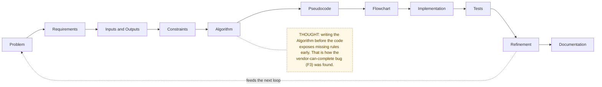

# Flow Design Doc Template

Copy this file when adding a new flow. Keep every heading, even when a section
is one line. The fixed order is what makes the docs quick to scan.

```markdown
# NN — Flow name

> Map node: `[X] Box name` on the [system map](../00-overview/system-map.md)
> Roles: owner / vendor / collaborator
> Findings: F# (status)

## 1. Problem
What goes wrong for a real person if this flow does not exist? Two to four
sentences, no jargon.

## 2. Requirements
Numbered, testable "must" statements (R1, R2...).

## 3. Inputs / Outputs
| Input | From | Validation |   and   | Output | To | Notes |

## 4. Constraints
Platform limits, privacy rules, performance, things we chose not to do.

## 5. Algorithm
Numbered plain-English steps. Anyone should be able to follow it.

## 6. Pseudocode
Strict pseudocode that mirrors the real code (see conventions in README).

## 7. Flowchart
Mermaid flowchart. Add at least one dashed THOUGHT box explaining a "why".

## 8. Implementation
| Step | File | Function |   plus anything surprising in the code.

## 9. Tests
What is covered (unit / smoke), and what is not yet covered.

## 10. Refinement
History of changes, known gaps, and the next improvement.

## 11. Documentation
Links to related docs, build-log entries, and change records.
```

## Why this order


