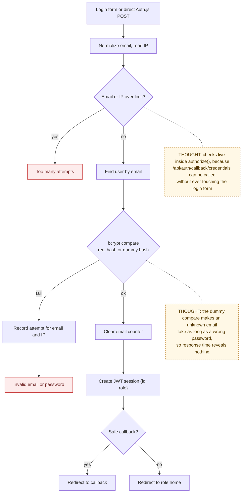

# 01 — Auth and Rate Limiting

> Map node: `[A] Sign in and accounts` on the [system map](../00-overview/system-map.md)
> Roles: everyone (owner signup is public; vendor/collaborator accounts are seeded today)
> Findings: **F6 fixed** (attempt limits, timing-safe compare) · **F4 fixed 2026-10-25** (signup from invite, see [flow 05](05-invite-and-access.md)) · **F12** stale JWT role (open)

## 1. Problem

Every other flow trusts "who is this user and what role do they have?". If
sign-in can be guessed at unlimited speed, or if the login response reveals
which emails have accounts, an attacker can take over a homeowner's record,
including their address, access instructions, and receipts.

## 2. Requirements

- **R1** A homeowner can create an owner account with name, email and password (8+ characters).
- **R2** Any user can sign in with email and password; the session carries `id` and `role`.
- **R3** Wrong credentials give one generic message: "Invalid email or password."
- **R4** An unknown email and a wrong password take about the same time to answer.
- **R5** At most **5 failed logins per email per 15 minutes** and **20 per IP per 15 minutes**.
- **R6** At most **5 signup attempts per IP per hour**.
- **R7** The limits apply to *every* sign-in path, including direct POSTs to the Auth.js endpoint.
- **R8** If the limiter's table is missing or the DB fails, sign-in still works (fail open) and the error is logged.
- **R9** Redirect after login only to same-site relative paths (no open redirect).

## 3. Inputs / Outputs

| Input | From | Validation |
|---|---|---|
| `email`, `password`, `name` | signup form | zod: email format, password ≥ 8, name ≥ 2 |
| `email`, `password`, `callbackUrl` | login form | trimmed, lower-cased email; callback must start with `/` and not `//` |
| client IP | `x-forwarded-for` (first entry) or `x-real-ip` | falls back to `"unknown"` |

| Output | To | Notes |
|---|---|---|
| JWT session cookie `{ id, role }` | browser | Auth.js v5, `strategy: "jwt"` |
| `auth_attempts` rows | Postgres | one row per counted attempt, pruned after 24 h |
| error message | form | generic, or "Too many attempts. Wait a few minutes, then try again." |

## 4. Constraints

- Serverless: there is no shared memory between instances, so counters live in Postgres (`auth_attempts`).
- The `neon-http` driver has no transactions; counting is "good enough", not exact under a burst.
- Only owners can sign up publicly. Vendors and collaborators sign up from their invite ([flow 05](05-invite-and-access.md)); the same signup rate limit applies there.
- There is no email verification or password reset yet (roadmap P1).

## 5. Algorithm

**Login**
1. Normalize the email (trim, lower-case). Read the caller's IP.
2. If the email counter or the IP counter is at its limit, stop with the rate-limit message.
3. Look up the user by email.
4. Compare the password with bcrypt. If the user does not exist, compare against a fixed dummy hash so the time spent is the same.
5. If it fails, record one attempt for the email and one for the IP, and return the generic error.
6. If it succeeds, clear the email counter and create the session. Redirect to the safe callback or the role's home page.

**Signup**
1. Validate the fields. Read the caller's IP.
2. If the IP's signup counter is at its limit, stop. Otherwise record one attempt.
3. Reject if the email already has an account.
4. Hash the password (bcrypt, cost 10), insert the owner, and create the default workspace.
5. Sign in and send the new owner to onboarding.

## 6. Pseudocode

```text
RULES:
  LOGIN_EMAIL = { limit: 5,  window: 15 min }
  LOGIN_IP    = { limit: 20, window: 15 min }
  SIGNUP_IP   = { limit: 5,  window: 60 min }

FUNCTION isRateLimited(rule, subject) -> bool
  TRY
    n = COUNT auth_attempts WHERE key = rule.scope + ":" + lower(subject)
                              AND created_at >= now - rule.window
    RETURN n >= rule.limit
  CATCH error
    LOG error; RETURN false                      -- fail open (R8)

FUNCTION verifyPasswordTimingSafe(password, hash?) -> bool
  IF hash is missing THEN
    bcrypt.compare(password, DUMMY_HASH)          -- same cost as a real compare (R4)
    RETURN false
  RETURN bcrypt.compare(password, hash)

FUNCTION authorize(credentials, request) -> user | null      -- the one gate (R7)
  REQUIRE credentials match { email, password } ELSE RETURN null
  email = lower(credentials.email); ip = clientIp(request.headers)
  IF isRateLimited(LOGIN_EMAIL, email) OR isRateLimited(LOGIN_IP, ip) THEN RETURN null
  user = FIND users WHERE email = email
  IF NOT verifyPasswordTimingSafe(credentials.password, user?.passwordHash) THEN
    recordAttempt(LOGIN_EMAIL, email); recordAttempt(LOGIN_IP, ip)
    RETURN null
  clearAttempts(LOGIN_EMAIL, email)
  RETURN { id, email, name, role }

FUNCTION loginAction(form) -> error | redirect
  same limit check as authorize  -> "Too many attempts..."
  same timing-safe check         -> "Invalid email or password." (records attempts)
  safeCallback = callbackUrl IF startsWith("/") AND NOT startsWith("//") ELSE null
  signIn(credentials, redirectTo = safeCallback OR roleHome(user.role))   -- calls authorize()

FUNCTION signupAction(form) -> error | redirect
  REQUIRE fields valid ELSE fieldErrors
  ip = clientIp(headers)
  REQUIRE NOT isRateLimited(SIGNUP_IP, ip) ELSE "Too many attempts..."
  recordAttempt(SIGNUP_IP, ip)
  REQUIRE no user with this email ELSE "An account already exists for that email."
  WRITE users(email, bcrypt(password, 10), role = owner, name)
  ensureDefaultWorkspaceForOwner(user.id)
  signIn(credentials, redirectTo = "/owner/onboarding")
```

## 7. Flowchart



## 8. Implementation

| Step | File | Function |
|---|---|---|
| Rules and IP parsing (pure) | `lib/auth/rate-limit-policy.ts` | `LOGIN_EMAIL_RULE`, `isOverLimit`, `clientIpFromHeaders` |
| Counter against Postgres | `lib/auth/rate-limit.ts` | `isRateLimited`, `recordAttempt`, `clearAttempts` |
| Timing-safe compare | `lib/auth/password.ts` | `verifyPasswordTimingSafe` |
| The gate | `lib/auth/config.ts` | `Credentials.authorize` |
| Forms | `lib/actions/auth.ts` | `loginAction`, `signupAction` |
| Table | `lib/db/schema.ts`, `drizzle/0012_clumsy_ozymandias.sql` | `authAttempts` |
| Role checks after sign-in | `lib/auth/dal.ts`, `proxy.ts` | `requireRole`, `requireAnyRole`, route redirects |

## 9. Tests

- **Unit:** `__tests__/rate-limit-policy.test.ts` (limits, key normalization, window math, IP parsing); `__tests__/auth-forms.test.ts` (field validation).
- **Smoke:** every `ux:*` script signs in through the real form.
- **Not yet covered:** an integration test that hammers `authorize()` against a real database (see [test strategy](../06-testing/test-strategy.md)).
- **Operator note:** repeated local runs of `ux:owner-flow` create accounts. After 5 per hour per IP, signup is limited; clear with `DELETE FROM auth_attempts;` on a dev database.

## 10. Refinement

| Date | Change |
|---|---|
| 2026-08 | Auth.js v5 credentials + JWT replaces Firebase Auth |
| 2026-09-28 | **F6 fixed:** attempt limits and timing-safe compare ([change record](../09-changes/2026-09-28-p0-security.md#3-login-and-signup-limits-f6)) |
| 2026-10-25 | Invite-based vendor/collaborator signup (**F4**) shipped; uses `SIGNUP_IP_RULE` |
| next (P1) | Password reset, optional email verification |
| next (P3) | Refresh `role` from the database on each request, or shorten JWT lifetime (**F12**) |

## 11. Documentation

- [Change record: P0 security](../09-changes/2026-09-28-p0-security.md)
- [Invite and access flow](05-invite-and-access.md) (where F4 lives)
- [Deployment runbook](../DEPLOYMENT.md), [P0 rollout runbook](../08-operations/p0-rollout-runbook.md)
