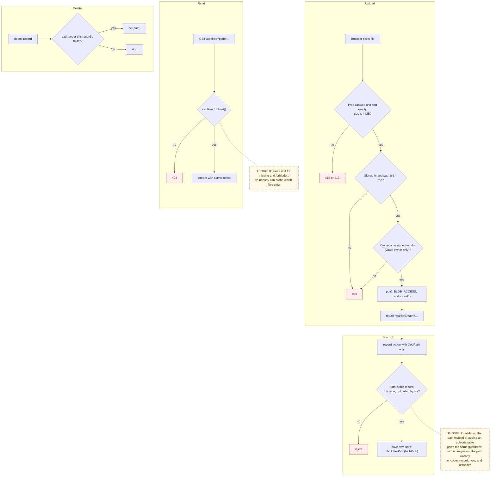

# 02 — File Upload and Access

> Map node: `[C] Files and proof` on the [system map](../00-overview/system-map.md)
> Roles: owner (request + vault files), assigned vendor (request files), collaborator (read request files)
> Findings: **F1 fixed** (cross-account delete) · **F2 fixed in code** (private storage + authorized reads; ops step to switch store) · **F10 fixed** (empty type)

## 1. Problem

Proof is the product: before/after photos, receipts, warranties, invoices.
These files show the inside of someone's home and what they paid. Before the
2026-09-28 fix, two things were wrong. The browser told the server which blob
path to store, so any account could point a record at someone else's file and
then delete it (**F1**). And every file was public forever to anyone holding
its URL, including a vendor after their access was removed (**F2**).

## 2. Requirements

- **R1** Only signed-in users may upload, and only into a folder they are allowed to write to.
- **R2** Request files: owner or assigned vendor may write. Vault files: owner only.
- **R3** Allowed types are JPEG, PNG, WebP, HEIC and PDF. A file with no declared type is rejected. Maximum about 4 MB.
- **R4** The server, not the browser, decides the stored URL.
- **R5** Recording a file checks the path belongs to *this* record, *this* type folder, and *this* uploader.
- **R6** Deleting a record deletes only files whose path lives under that record's folder.
- **R7** Reading a file re-checks access every time: request files → owner, assigned vendor, collaborator; vault → owner.
- **R8** Missing and forbidden files answer the same (404), so file names cannot be probed.
- **R9** The store can run `private` (recommended) or `public` (legacy) via `BLOB_ACCESS`, without code changes.

## 3. Inputs / Outputs

| Input | From | Validation |
|---|---|---|
| `file` | multipart form | type in allowlist (non-empty), size ≤ 4 MB |
| `pathname` | built by `requestPhotoPath()` / `vaultDocumentPath()` in the browser | exact segment count, no `.`/`..`/empty segments, uid = session user, type folder known |
| `blobPath` | record actions | `validateRequestUploadPath()` / `validatePropertyUploadPath()` |
| `path` query | `GET /api/files` | parsed, then `canReadUpload()` |

| Output | To | Notes |
|---|---|---|
| Blob object | Vercel Blob | `access` from `BLOB_ACCESS`, random suffix added |
| `{ url: "/api/files?path=…", pathname }` | browser | raw Blob URL is never returned |
| `request_photos` / `vault_documents` / `quotes.attachment*` rows | Postgres | `url` derived by `fileUrlForPath()` |
| file stream | browser | `Cache-Control: private, no-store`, `nosniff`, `inline` |

**Path shapes**

```text
turnflow/{requestId}/{type}/{uploaderId}/{timestamp}_{safeName}-{random}   (5 segments)
turnflow-property/{propertyId}/{ownerId}/{timestamp}_{safeName}-{random}   (4 segments)
type ∈ { before, after, receipt, other, quote }
```

## 4. Constraints

- Vercel functions cap request bodies near 4.5 MB, so the browser downscales images above 3 MB (`lib/blob-upload-client.ts`).
- Browser → Blob direct upload is CORS-blocked on Vercel today, so uploads go through the server proxy route.
- Existing rows created before the fix keep their absolute public URLs and still display. New rows use `/api/files`.
- A Blob token belongs to one store. Switching to a new Private store means old public files stay in the old store (see the [rollout runbook](../08-operations/p0-rollout-runbook.md)).

## 5. Algorithm

**Upload** (`POST /api/blob-upload`)
1. Reject if the server has no Blob token (503), the form is malformed (400), the type is not allowed or empty (415), or the file is too big (413).
2. Require a session. Parse the path. Reject unless the path shape is valid and the uploader segment equals the session user.
3. For a request path: the type folder must be known, and the user must be the request's owner or assigned vendor. For a property path: the user must own the property.
4. Store the file with the configured access mode and a random suffix.
5. Return the same-origin `/api/files?path=…` URL and the final pathname.

**Record** (`recordRequestPhotoAction`, `createVaultDocumentAction`, `createQuoteAction`)
1. Re-check the role and record ownership, as before.
2. Validate the path: same record, same type folder, uploader = me.
3. Store the row with `url = fileUrlForPath(blobPath)`. The browser's URL is never used.

**Read** (`GET /api/files?path=…`)
1. Require a session. Parse the path.
2. Load the request or property it names and apply `canReadUpload()`.
3. Stream the file from Blob with the server token. Otherwise answer 404.

**Delete** (request, property, vault document, quote)
1. For each stored path, delete it only if it lives under the folder of the record being deleted.

## 6. Pseudocode

```text
FUNCTION parseUploadPath(p) -> Parsed | unknown
  parts = split(p, "/")
  IF any part is "" or "." or ".." or contains "\" THEN RETURN unknown
  IF parts[0] = "turnflow"          AND len(parts) = 5 THEN RETURN request(parts[1..4])
  IF parts[0] = "turnflow-property" AND len(parts) = 4 THEN RETURN property(parts[1..3])
  RETURN unknown

FUNCTION uploadRoute(pathname, file, session) -> { url, pathname } | error
  REQUIRE token configured                          ELSE 503
  REQUIRE file.type IN ALLOWED (non-empty)          ELSE 415
  REQUIRE file.size <= 4 MB                         ELSE 413
  REQUIRE session                                   ELSE 403
  parsed = parseUploadPath(pathname)
  REQUIRE parsed != unknown AND parsed.uid = session.user.id    ELSE 403
  IF parsed is request THEN
    REQUIRE parsed.type IN {before, after, receipt, other, quote} ELSE 403
    req = FIND requests(parsed.requestId)
    REQUIRE req AND (req.ownerId = me OR req.assignedVendorId = me) ELSE 403
  ELSE
    prop = FIND properties(parsed.propertyId)
    REQUIRE prop AND prop.ownerId = me              ELSE 403
  blob = PUT(pathname, file, access = BLOB_ACCESS, randomSuffix = true)
  RETURN { url: "/api/files?path=" + encode(blob.pathname), pathname: blob.pathname }

FUNCTION recordRequestPhoto(requestId, type, blobPath, session)
  REQUIRE role IN {owner, vendor}
  req = FIND requests(requestId)
  REQUIRE req AND (req.ownerId = me OR req.assignedVendorId = me)
  REQUIRE type IN {before, after, receipt, other}
  REQUIRE validateRequestUploadPath(blobPath, requestId, uid = me, type)   -- F1 fix
  WRITE request_photos(requestId, type, url = fileUrlForPath(blobPath), blobPath, uploadedBy = me)

FUNCTION readFile(path, session) -> stream | 401 | 404
  REQUIRE session ELSE 401
  parsed = parseUploadPath(path);  REQUIRE parsed != unknown ELSE 400
  record = FIND request or property named by parsed
  REQUIRE canReadUpload(parsed, me, record) ELSE 404                      -- F2 fix
  RETURN GET(path, access = BLOB_ACCESS, token).stream

FUNCTION canReadUpload(parsed, me, record) -> bool
  IF record is null OR parsed.kind != record.kind THEN RETURN false
  IF request  THEN RETURN me IN {record.ownerId, record.assignedVendorId, record.collaboratorId}
  IF property THEN RETURN me = record.ownerId

FUNCTION deleteRequest(requestId)
  FOR EACH photo IN request_photos(requestId)
    IF isRequestScopedPath(photo.blobPath, requestId) THEN DEL(photo.blobPath)    -- F1 fix
  DELETE requests(requestId)
```

## 7. Flowchart



## 8. Implementation

| Step | File | Function |
|---|---|---|
| Path build / parse / validate (pure) | `lib/blob-paths.ts` | `requestPhotoPath`, `parseUploadPath`, `validateRequestUploadPath`, `validatePropertyUploadPath`, `isRequestScopedPath`, `isPropertyScopedPath`, `fileUrlForPath`, `blobAccessMode` |
| Read rule (pure) | `lib/file-access.ts` | `canReadUpload` |
| Upload proxy | `app/api/blob-upload/route.ts` | `POST` |
| Authorized read | `app/api/files/route.ts` | `GET` |
| Browser helper | `lib/blob-upload-client.ts` | `uploadFileToBlob` (downscale + POST) |
| Record actions | `lib/actions/requests.ts`, `vault.ts`, `quotes.ts` | `recordRequestPhotoAction`, `createVaultDocumentAction`, `createQuoteAction` |
| Scoped deletes | `lib/actions/requests.ts`, `properties.ts`, `vault.ts`, `quotes.ts` | `deleteRequestAction`, `deletePropertyAction`, `deleteVaultDocumentAction`, `deleteQuoteAction` |
| Readiness | `lib/poc-readiness.ts` | `BLOB_ACCESS` item (warning until `private`) |

## 9. Tests

- **Unit:** `__tests__/blob-paths.test.ts` (shape rules, traversal, validators, delete scoping, URL encoding, access mode); `__tests__/file-access.test.ts` (who may read what, removed-vendor case, fail-closed cases); `__tests__/poc-readiness.test.ts` (`BLOB_ACCESS` warning).
- **Smoke:** `npm run ux:owner-flow` uploads a before-photo end to end; `ux:full-loop` covers vendor proof.
- **Not yet covered:** a route-level test for `/api/files` with a real session (planned in the authorization matrix, [test strategy](../06-testing/test-strategy.md)).

## 10. Refinement

| Date | Change |
|---|---|
| 2026-09-02 | Browser → Blob upload replaced with a server proxy (CORS); store switched to Public (UX-001) |
| 2026-09-28 | **F1, F2, F10 fixed** ([change record](../09-changes/2026-09-28-p0-security.md#1-uploads-and-deletes-f1-f10)) |
| next | Operator switches to a Private store (`BLOB_ACCESS=private`); optional one-time copy of legacy public files |
| later | Delete quote attachments when a request is deleted (today only photos are removed) |

## 11. Documentation

- [P0 rollout runbook](../08-operations/p0-rollout-runbook.md), which covers switching to a private store
- [Build log 2026-09: Blob Upload Proxy](../07-refinement/build-log/2026-09.md)
- [UI/UX finding UX-001](../UI_UX_FINDINGS.md)
