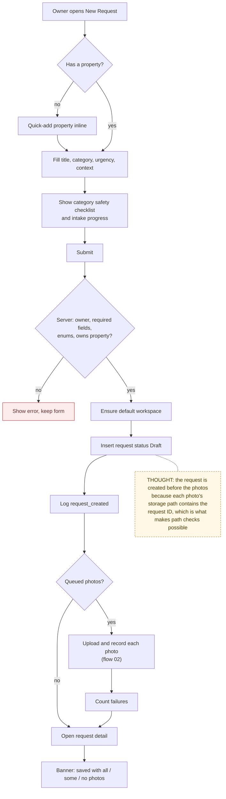

# 03 — Request Intake

> Map node: `[B] Request intake` on the [system map](../00-overview/system-map.md)
> Roles: owner
> Findings: **F12 (part) fixed** (request edits now validate category and urgency)

## 1. Problem

"The faucet is leaking" sent as a text message loses the address, the unit,
where the leak is, how to get in, how urgent it is, and the photo. The vendor
calls back to ask, and months later nobody remembers what was done. Intake
turns that message into one structured record that everything else hangs on.

## 2. Requirements

- **R1** Only an owner can create a request, and only on a property they own.
- **R2** Required: property, title, category (from a fixed list), urgency (from a fixed list).
- **R3** Optional: location, contact method (from a fixed list), access instructions, notes, and up to one photo per type (before, after, receipt, other).
- **R4** A new request always starts in `Draft` and writes a `request_created` decision-log row.
- **R5** Photos are uploaded *after* the request exists, because their storage path needs the request ID.
- **R6** If some photos fail, the request is still saved, and the detail page says which part failed.
- **R7** Category-specific safety checklists (for example, shut off water for plumbing) guide the owner while typing.
- **R8** An owner with no property can create one inline without leaving the form.

## 3. Inputs / Outputs

| Input | From | Validation |
|---|---|---|
| `propertyId` | select | must exist and belong to the owner |
| `title` | text | required, trimmed |
| `category`, `urgency` | selects | must be in `REQUEST_CATEGORIES` / `REQUEST_URGENCIES` |
| `location`, `accessInstructions`, `notes` | text | trimmed, empty → null |
| `contactMethod` | select | in `CONTACT_METHODS`, else null |
| queued photos | file inputs | see [02 File upload](02-file-upload-and-access.md) |

| Output | To | Notes |
|---|---|---|
| `requests` row, status `Draft` | Postgres | `workspaceId` = property's workspace or the owner's default |
| `decision_log` row `request_created` | Postgres | records which optional fields were filled in (not their text) |
| `request_photos` rows | Postgres | one per uploaded photo |
| redirect to `/owner/requests/{id}?created=1&photos=…` | browser | the banner shows the upload result |

## 4. Constraints

- Two-step create (row first, then files) is not atomic. A crash between steps leaves a request without photos, which is visible and recoverable, so it is acceptable.
- Checklist text is guidance, not validation. It never blocks submit.

## 5. Algorithm

1. The owner fills the form. The page shows intake progress and the checklist for the chosen category.
2. On submit, the server re-checks the role and required fields, the enum values, and that the property belongs to the owner.
3. Make sure the owner has a default workspace (creating it on first use).
4. Insert the request as `Draft` and log `request_created`.
5. Back in the browser, upload each queued photo and record it (flow 02). Count failures.
6. Redirect to the request detail page with an upload status: all, partial, or failed.

## 6. Pseudocode

```text
FUNCTION createRequestAction(form, session) -> { requestId } | { error }
  REQUIRE session.role = owner
  REQUIRE form.propertyId AND form.title AND form.category AND form.urgency
      ELSE "Property, title, category, and urgency are required."
  REQUIRE form.category IN REQUEST_CATEGORIES ELSE "Invalid category."
  REQUIRE form.urgency  IN REQUEST_URGENCIES  ELSE "Invalid urgency."
  property = FIND properties(form.propertyId)
  REQUIRE property AND property.ownerId = me ELSE "Invalid property."
  workspace = ensureDefaultWorkspaceForOwner(me)
  request = WRITE requests(owner = me, workspace = property.workspaceId OR workspace.id,
                           status = "Draft", ...fields)
  LOG decision_log("request_created", { title, category, urgency, hasLocation, ... })
  RETURN { requestId: request.id }

FUNCTION submitNewRequest(form)                          -- browser
  result = createRequestAction(form)
  IF result.error THEN SHOW error; RETURN
  failed = 0
  FOR EACH (type, file) IN queuedPhotos
    TRY
      path = requestPhotoPath(result.requestId, type, me, file.name)
      blob = uploadFileToBlob(path, file)
      recordRequestPhotoAction(result.requestId, type, blob.pathname)
    CATCH
      failed = failed + 1
  GO TO requestDetailPathAfterCreate(result.requestId, photoUploadStatus(count, failed))

FUNCTION updateRequestAction(requestId, form)            -- edit
  REQUIRE owner of request
  REQUIRE title, category, urgency present
  REQUIRE category IN REQUEST_CATEGORIES AND urgency IN REQUEST_URGENCIES   -- added 2026-09-28
  WRITE requests(requestId, fields)
```

## 7. Flowchart



## 8. Implementation

| Step | File | Function |
|---|---|---|
| Form, checklist, upload loop | `components/NewRequestForm.tsx` | `handleSubmit` |
| Intake progress (pure) | `lib/request-intake.ts` | `requestIntakeSteps`, `requestIntakeHandoffChecks` |
| Upload result copy (pure) | `lib/request-submit.ts` | `photoUploadStatus`, `requestDetailPathAfterCreate` |
| Create / edit | `lib/actions/requests.ts` | `createRequestAction`, `updateRequestAction` |
| Enums and checklists | `lib/utils.ts` | `REQUEST_CATEGORIES`, `REQUEST_URGENCIES`, `CONTACT_METHODS`, `checklistForCategory` |
| Workspace | `lib/workspace.ts` | `ensureDefaultWorkspaceForOwner` |

## 9. Tests

- **Unit:** `__tests__/request-intake.test.ts`, `__tests__/request-submit.test.ts`, `__tests__/request-guidance.test.ts`, `__tests__/workspace-model.test.ts`.
- **Smoke:** `npm run ux:owner-flow` creates a property and a request with a before photo on a real deployment.
- **Not yet covered:** a server-side test that a request cannot be created on another owner's property.

## 10. Refinement

| Date | Change |
|---|---|
| 2026-08 | Guided intake, safety checklist, inline property creation |
| 2026-09-28 | Edit path validates category and urgency (part of **F12**) |
| later | Save the checklist answers as structured data instead of guidance only |

## 11. Documentation

- [Requirements matrix, owner rows](../USER_REQUIREMENTS_EVENT_MATRIX.md)
- [Endpoint map: `/owner/requests/new`](../ENDPOINT_EXPERIENCE_MAP.md)
