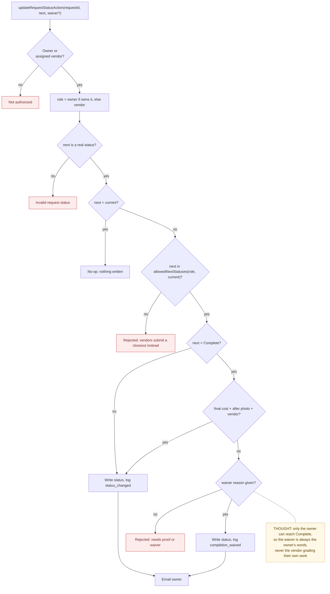
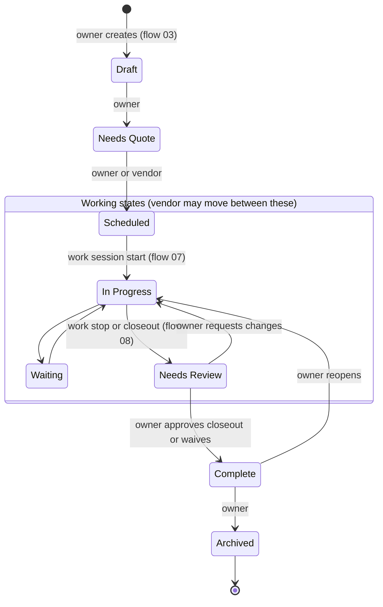

# 04 — Request Status Lifecycle

> Map node: `[F] Status lifecycle` on the [system map](../00-overview/system-map.md)
> Roles: owner (full authority), assigned vendor (working states only)
> Findings: **F3 fixed** (vendors could complete, waive, archive, or reopen)

## 1. Problem

A request's status is the shared answer to "where is this job?". Before
2026-09-28 there was no transition model: the owner **or the vendor** could
move a request from any status to any other. That included marking it
`Complete` with a waiver the vendor wrote themselves, or archiving it. The
completion proof rule (final cost + after photo + vendor) could be bypassed by
the person being paid. That breaks the product's core promise: the owner
decides when work is done.

## 2. Requirements

- **R1** There are eight statuses: `Draft`, `Needs Quote`, `Waiting`, `Scheduled`, `In Progress`, `Needs Review`, `Complete`, `Archived`.
- **R2** The **owner** may move to any other status.
- **R3** The **vendor** may only move between the *working* states `Waiting`, `Scheduled`, `In Progress` and `Needs Review`, and only while the request is open (not `Complete` or `Archived`).
- **R4** Moving to `Complete` needs clean proof (final cost + "after" photo + assigned vendor) **or** a written waiver reason. Only the owner can reach `Complete`, so only the owner can waive.
- **R5** Every real change writes one decision-log row: `status_changed`, or `completion_waived` with the reason.
- **R6** Choosing the current status again is a no-op: nothing is written and no email is sent.
- **R7** The owner gets an email when status changes.
- **R8** The vendor UI only shows moves the vendor is allowed to make.
- **R9** System transitions follow the same rules: a work-session start sets `In Progress`, a stop or closeout sets `Needs Review`, and closeout approval (owner) sets `Complete`.

## 3. Inputs / Outputs

| Input | From | Validation |
|---|---|---|
| `requestId` | UI | request exists; caller is owner or assigned vendor |
| `status` | select | in `REQUEST_STATUSES` and in `allowedNextStatuses(role, current)` |
| `waiverReason` | owner's completion-waiver dialog | non-empty after trim, only needed when proof is missing |

| Output | To |
|---|---|
| `requests.status` updated | Postgres |
| `decision_log` `status_changed` / `completion_waived` | Postgres |
| status email to owner | Resend / notification log |

## 4. Constraints

- The rules must be one pure function, so the server, the vendor UI, the tests, and these docs all read the same table.
- Owner freedom is intentional. The owner is the authority on their own record, and restricting the owner would add friction without protecting anyone.
- The status update and its log row are two writes and not atomic yet (**F5**).

## 5. Algorithm

1. Load the request. The caller must be its owner or its assigned vendor. The role for the decision is `owner` if the caller owns it, otherwise `vendor`.
2. If the target is `Complete`, load the photos to check completion proof.
3. Ask the policy: is `current → next` allowed for this role?
   - An unknown status means reject.
   - The same status means no-op: stop quietly.
   - Not in the allowed list means reject with a role-specific message.
   - `Complete` without proof and without a waiver reason means reject.
   - `Complete` without proof but with a waiver reason: allowed, logged as `completion_waived`.
   - Otherwise: allowed, logged as `status_changed`.
4. Write the new status and the log row. Email the owner.

### Transition table

| From ↓ / To → | Draft | Needs Quote | Waiting | Scheduled | In Progress | Needs Review | Complete | Archived |
|---|---|---|---|---|---|---|---|---|
| **Draft** | — | O | O V | O V | O V | O V | O* | O |
| **Needs Quote** | O | — | O V | O V | O V | O V | O* | O |
| **Waiting** | O | O | — | O V | O V | O V | O* | O |
| **Scheduled** | O | O | O V | — | O V | O V | O* | O |
| **In Progress** | O | O | O V | O V | — | O V | O* | O |
| **Needs Review** | O | O | O V | O V | O V | — | O* | O |
| **Complete** | O | O | O | O | O | O | — | O |
| **Archived** | O | O | O | O | O | O | O* | — |

`O` = owner may, `V` = vendor may, `O*` = owner only, and needs proof or a waiver reason.

## 6. Pseudocode

```text
WORKING = [Waiting, Scheduled, In Progress, Needs Review]
CLOSED  = [Complete, Archived]

FUNCTION allowedNextStatuses(role, current) -> list
  IF role = owner THEN RETURN ALL_STATUSES - {current}
  IF current IN CLOSED THEN RETURN []
  RETURN WORKING - {current}

FUNCTION evaluateStatusChange(role, current, next, meetsProof, waiverReason) -> decision
  IF next NOT IN ALL_STATUSES THEN RETURN reject("Invalid request status")
  IF next = current           THEN RETURN noop
  IF next NOT IN allowedNextStatuses(role, current) THEN
    RETURN reject(role = vendor ? "Vendors cannot move ... Submit a closeout ..." : "Cannot move ...")
  IF next = Complete AND NOT meetsProof THEN
    IF trim(waiverReason) = "" THEN RETURN reject("Cannot mark Complete without ... unless a waiver reason")
    RETURN change(log = completion_waived, reason = trim(waiverReason))
  RETURN change(log = status_changed)

FUNCTION updateRequestStatusAction(requestId, next, waiverReason?, session)
  REQUIRE role IN {owner, vendor}
  req = FIND requests(requestId)
  REQUIRE req AND (req.ownerId = me OR req.assignedVendorId = me) ELSE "Not authorized"
  photos = (next = Complete) ? FIND request_photos(requestId) : []
  d = evaluateStatusChange(me = req.ownerId ? owner : vendor, req.status, next,
                           meetsCompletionRequirements(req, photos), waiverReason)
  REQUIRE d.ok ELSE d.error
  IF d is noop THEN RETURN
  WRITE requests(requestId).status = next
  LOG decision_log(d.logAction, { from: req.status, to: next, reason? })
  NOTIFY owner("\"title\" is now next")
```

## 7. Flowchart

### Decision flow



### State diagram (vendor moves in the shaded working area)



## 8. Implementation

| Step | File | Function |
|---|---|---|
| Transition table and decision (pure) | `lib/request-status-policy.ts` | `allowedNextStatuses`, `statusOptionsFor`, `evaluateStatusChange` |
| Server action | `lib/actions/requests.ts` | `updateRequestStatusAction` |
| Proof rule | `lib/utils.ts` | `meetsCompletionRequirements` |
| Vendor UI (legal moves only) | `components/VendorPortal.tsx` | `statusOptionsFor("vendor", r.status)` |
| Owner UI + waiver dialog | `components/RequestDetailView.tsx`, `components/CompletionWaiverReview.tsx` | `applyStatusChange` |
| Vendor copy | `lib/status-handoff.ts` | vendor `Complete` / `Archived` guidance now says "only the owner" |
| System transitions | `lib/actions/work-sessions.ts`, `lib/actions/closeout-submissions.ts` | `nextStatusForEvent`, `submitCloseoutAction`, `reviewCloseoutSubmissionAction` |

## 9. Tests

- **Unit:** `__tests__/request-status-policy.test.ts` (owner freedom; vendor limited to working states; vendor blocked from Complete / Archived / Draft / reopen; waiver rules; no-op; unknown status); `__tests__/status-handoff.test.ts`.
- **Smoke:** `ux:full-loop` drives work start (→ In Progress), closeout (→ Needs Review), and approval (→ Complete).
- **Not yet covered:** calling `updateRequestStatusAction` as a vendor against a real database (authorization matrix, P3).

## 10. Refinement

| Date | Change |
|---|---|
| 2026-08 | Completion gating with owner/vendor waiver, server-side |
| 2026-09-28 | **F3 fixed:** transition table, vendor waiver removed, same-status no-op ([change record](../09-changes/2026-09-28-p0-security.md#2-status-transitions-f3)) |
| next (P2) | Status write and log row in one transaction (**F5**) |

## 11. Documentation

- [System map, Level 1d](../00-overview/system-map.md#1d-request-lifecycle-all-lanes-meet-here)
- [Requirements matrix: `status_changed`, `completion_waived`](../USER_REQUIREMENTS_EVENT_MATRIX.md)
