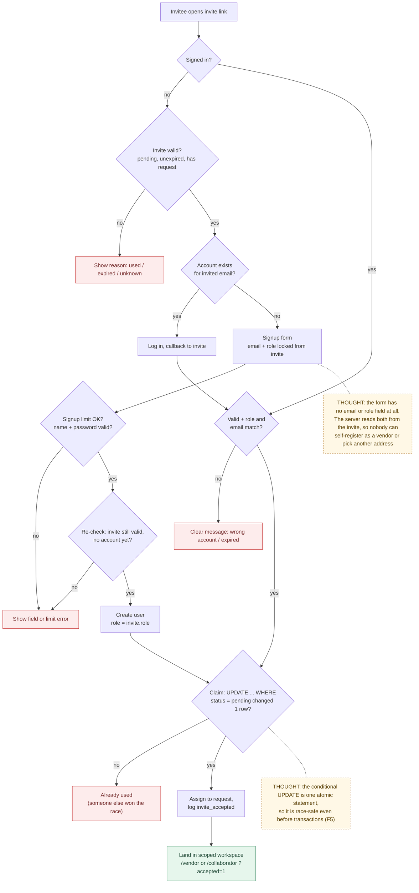
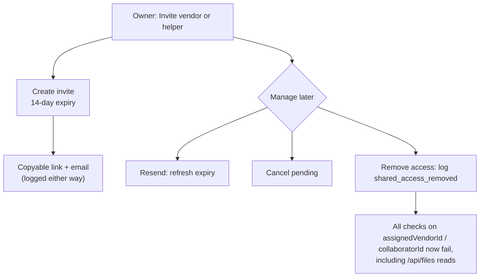

# 05 — Invite and Access

> Map node: `[D] Sharing` on the [system map](../00-overview/system-map.md)
> Roles: owner (invite, resend, cancel, revoke), vendor / collaborator (sign up from invite, accept)
> Findings: **F4 fixed 2026-10-25** (invited people can now create an account from the invite) · **F5 open** (accept is still separate writes, but the claim itself is now race-safe)

## 1. Problem

Homeowners need help from a plumber or a trusted friend, but should not hand
over their whole account. Sharing has to be **one request, one person, one
role**, with an expiry, a clear record of who got access, and a way to take it
back. And it has to work for someone who has **never used TurnFlow**: until
2026-10-25 an invited vendor with no account hit a dead end, so the core loop
only worked with seeded demo accounts (F4).

## 2. Requirements

- **R1** Only the request's owner can invite. There is one pending vendor invite and one pending collaborator invite per request.
- **R2** An invite has an email, a role, a request, and expires **14 days** after it is created or resent.
- **R3** The link is shown to the owner (copyable) and emailed when email is configured.
- **R4** Accepting requires a signed-in account whose **role** and **email** match the invite, and an invite that is pending and unexpired.
- **R5** Accepting assigns the user to the request (vendor → `assignedVendorId`, collaborator → `collaboratorId`) and marks the invite accepted.
- **R6** The owner can resend (refreshes expiry), cancel (pending only), or remove accepted access.
- **R7** Every step logs: `invite_created`, `invite_resent`, `invite_canceled`, `invite_accepted` (with `viaSignup: true` when the account was created from the invite), `shared_access_removed`.
- **R8 ✅** A signed-out visitor with a valid invite and **no account** for the invited email can create one on the invite page. Email and role come from the invite and cannot be changed; then the invite is claimed and they land in their workspace.
- **R9 ✅** A signed-out visitor whose email **already has an account** is sent to log in, and the invite auto-claims afterwards.
- **R10 ✅** An invalid invite (unknown, used, expired, no request) never shows a signup form.
- **R11 ✅** Only one claim can win: two simultaneous accepts cannot both succeed.
- **R12 ✅** Invite signup obeys the same signup rate limit (5 per IP per hour) and password rules as owner signup.

## 3. Inputs / Outputs

| Input | From | Validation |
|---|---|---|
| `requestId`, `email`, role | owner UI | owner of request; email trimmed, lower-cased, non-empty |
| `inviteId` | link `?invite=` / forms | looked up in `invites`; `inviteValidityProblem` |
| session (sign-in path) | Auth.js | `inviteAccountMismatch`: role and email must match |
| `name`, `password` (signup path) | invite signup form | `parseInviteSignupFields`: name ≥ 2, password ≥ 8 with a letter and a number. **No email or role field exists.** |

| Output | To |
|---|---|
| `invites` row (pending → accepted, or deleted on cancel) | Postgres |
| new `users` row (signup path) with `role = invite.role`, `email = invite.email` | Postgres |
| `requests.pending*InviteId` cleared; `assignedVendorId` / `collaboratorId` set | Postgres |
| decision-log rows | Postgres |
| redirect to `/vendor?accepted=1` or `/collaborator?accepted=1` | browser |

## 4. Constraints

- `invites.requestId` is nullable only to break a circular foreign key. In practice it is always set.
- The invite link is the credential: anyone holding it sees the invited email and the request title on the signup screen. That is acceptable because the link was sent to that email, and invite IDs are random UUIDs.
- Signup + claim are separate writes (no transactions on `neon-http`, F5). If the claim loses a race after the account is created, the user is still signed in and the invite page explains the invite was already used.
- One email = one account = one role. An owner's email cannot also be a vendor account; that invite shows the role-mismatch message after login.

## 5. Algorithm

**Create:** check ownership, then create an invite that expires in 14 days. Point the request's pending invite field at it, build the link, email it (logged either way), and log `invite_created`.

**Open the link signed out:**
1. Look up the invite. If it is unknown, used, expired, or has no request, show the reason.
2. If an account already exists for the invited email, redirect to login with the invite as the callback.
3. Otherwise show the signup form: invited email read-only, role from the invite, plus name and password.

**Sign up from the invite:**
1. Validate name and password.
2. Apply the signup rate limit for this IP.
3. Re-check the invite (it may have changed since the page loaded) and that no account exists for its email.
4. Create the user with the invite's email and role.
5. Claim the invite (below).
6. Sign in and land in the role's workspace.

**Open the link signed in (or after login):** check that the invite is valid and that role and email match, then claim it.

**Claim (shared by both paths):**
1. Mark the invite accepted **only if it is still pending**. This is one atomic statement, so if no row changed, someone else already claimed it.
2. Assign the user to the request and clear the pending field.
3. Log `invite_accepted`.

**Revoke:** the owner removes access. Null the assignment field and log `shared_access_removed`. From then on, every check that compares `assignedVendorId` or `collaboratorId` fails, including file reads through `/api/files`.

## 6. Pseudocode

```text
FUNCTION inviteValidityProblem(invite, now) -> problem | null          -- lib/invites/claim.ts
  IF invite is null                THEN RETURN missing
  IF invite.status != pending      THEN RETURN used
  IF invite.expiresAt < now        THEN RETURN expired
  IF invite.requestId is null      THEN RETURN no_request
  RETURN null

FUNCTION signedOutInviteEntry(invite, accountExists, now) -> invalid | login | signup
  problem = inviteValidityProblem(invite, now)
  IF problem THEN RETURN invalid(message[problem])
  RETURN accountExists ? login : signup

FUNCTION acceptInvitePage(inviteId, session)                           -- app/accept-invite/page.tsx
  invite = FIND invites(inviteId)
  IF NOT session THEN
    entry = signedOutInviteEntry(invite, EXISTS users WHERE email = invite.email)
    IF entry = login   THEN REDIRECT /login?callbackUrl=/accept-invite?invite=…
    IF entry = invalid THEN SHOW entry.message
    SHOW InviteSignupForm(email = invite.email (read-only), role = invite.role)
  ELSE
    REQUIRE inviteValidityProblem(invite) = null       ELSE SHOW message
    REQUIRE inviteAccountMismatch(invite, session) = null ELSE SHOW message
    SHOW request summary; AUTO-RUN acceptInviteAction(inviteId)

FUNCTION signupFromInviteAction(inviteId, form) -> error | redirect    -- lib/actions/invites.ts
  REQUIRE parseInviteSignupFields(form.name, form.password) ELSE fieldErrors
  ip = clientIp(headers)
  REQUIRE NOT isRateLimited(SIGNUP_IP, ip) ELSE "Too many attempts..."
  recordAttempt(SIGNUP_IP, ip)
  invite = FIND invites(inviteId)
  REQUIRE inviteValidityProblem(invite) = null ELSE message
  REQUIRE NOT EXISTS users WHERE email = invite.email ELSE "An account already exists... Log in"
  user = WRITE users(email = invite.email, role = invite.role, name, bcrypt(password, 10))
  result = claimInviteForUser(invite, user.id, viaSignup = true)
  signIn(invite.email, password,
         redirectTo = result.ok ? roleHome(invite.role) + "?accepted=1" : "/accept-invite?invite=…")

FUNCTION acceptInviteAction(inviteId, session) -> success | error
  REQUIRE session.role IN {vendor, collaborator}
  invite = FIND invites(inviteId)
  REQUIRE inviteValidityProblem(invite) = null      ELSE message
  REQUIRE inviteAccountMismatch(invite, session) = null ELSE message
  RETURN claimInviteForUser(invite, session.user.id)

FUNCTION claimInviteForUser(invite, userId, viaSignup?) -> success | error   -- not exported
  n = UPDATE invites SET status = accepted, acceptedBy = userId
      WHERE id = invite.id AND status = pending                  -- atomic guard (R11)
  IF n = 0 THEN RETURN error("already been used")
  WRITE requests(invite.requestId): {assignedVendorId | collaboratorId} = userId, clear pending
  LOG decision_log("invite_accepted", { role, email, inviteId, acceptedById, viaSignup? })
  RETURN success
```

## 7. Flowchart

### Invitee path (after F4)



### Owner path



## 8. Implementation

| Step | File | Function |
|---|---|---|
| Invite rules (pure) | `lib/invites/claim.ts` | `inviteValidityProblem`, `inviteAccountMismatch`, `signedOutInviteEntry`, `inviteRoleLabel`, `INVITE_PROBLEM_MESSAGES` |
| Signup field rules (pure) | `lib/auth/forms.ts` | `parseInviteSignupFields` (name + password only) |
| Create / resend / cancel / revoke | `lib/actions/invites.ts` | `createVendorInviteAction`, `createCollaboratorInviteAction`, `resendInviteAction`, `cancelInviteAction`, `removeSharedAccessAction` |
| Accept and invite signup | `lib/actions/invites.ts` | `acceptInviteAction`, `signupFromInviteAction`, internal `claimInviteForUser` |
| Accept page | `app/accept-invite/page.tsx` | signed-out branch (signup / login / invalid), signed-in checks, auto-claim |
| Signup form | `components/InviteSignupForm.tsx` | read-only email, name, password |
| Auto-claim button | `components/AcceptInviteButton.tsx` | |
| Link and form parsing | `lib/invites/links.ts`, `lib/invites/forms.ts` | `buildInviteLink`, `inviteIdFromFormData`, `sharedAccessFromFormData` |
| Owner controls | `components/InviteSection.tsx`, `PendingInviteControls.tsx`, `SharedAccessControls.tsx` | |

## 9. Tests

- **Unit:** `__tests__/invite-claim.test.ts` (validity order; signup only for valid invites with no account; login when an account exists; role and email mismatch; signup schema has no email or role), `__tests__/invite-forms.test.ts`, `__tests__/utils.test.ts`.
- **Browser smoke:**
  - `npm run ux:invite-signup` (new): a brand-new vendor and a brand-new helper sign up from their invite links and land in their workspaces. It checks the created role, the accepted invite, and `viaSignup` in the log.
  - `npm run ux:invite`: existing accounts log in from the invite.
  - `npm run ux:full-loop`: all roles.
- **Verified 2026-10-25** against a local Postgres through the real Neon driver: both invite smokes passed, plus live checks that used, expired and unknown invites show a message instead of a form, and that an existing account goes to login.
- **Not yet covered:** access-removal browser smoke.

## 10. Refinement

| Date | Change |
|---|---|
| 2026-09-09 | Frictionless invite handoff: auto-claim after login, lifecycle logging |
| 2026-09-09 | Invite acceptance smoke |
| 2026-10-25 | **F4 fixed:** signup from invite with email and role locked; shared claim routine; race-safe conditional claim; shared invite rules ([change record](../09-changes/2026-10-25-f4-invite-signup.md)) |
| next | Owner sees "joined via invite" in Account & Sharing; optional magic-link sign-in for helpers |
| next (P2) | **F5:** create-and-claim in one transaction |

## 11. Documentation

- [Change record: F4 invite signup](../09-changes/2026-10-25-f4-invite-signup.md)
- [Build log 2026-10](../07-refinement/build-log/2026-10.md)
- [Requirements matrix: invite rows](../USER_REQUIREMENTS_EVENT_MATRIX.md)
