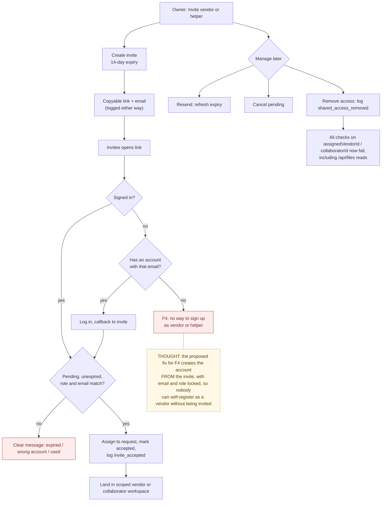

# 05 — Invite and Access

> Map node: `[D] Sharing` on the [system map](../00-overview/system-map.md)
> Roles: owner (invite, resend, cancel, revoke), vendor / collaborator (accept)
> Findings: **F4 open** (invited people cannot create an account) · **F5 open** (accept is three separate writes)

## 1. Problem

Homeowners need help from a plumber or a trusted friend, but should not hand
over their whole account. Sharing has to be **one request, one person, one
role**, with an expiry, a clear record of who got access, and a way to take it
back.

## 2. Requirements

- **R1** Only the request's owner can invite. There is one pending vendor invite and one pending collaborator invite per request.
- **R2** An invite has an email, a role, a request, and expires **14 days** after it is created or resent.
- **R3** The link is shown to the owner (copyable) and emailed when email is configured.
- **R4** Accepting requires a signed-in account whose **role** and **email** match the invite, and an invite that is pending and unexpired.
- **R5** Accepting assigns the user to the request (vendor → `assignedVendorId`, collaborator → `collaboratorId`) and marks the invite accepted.
- **R6** The owner can resend (refreshes expiry), cancel (pending only), or remove accepted access.
- **R7** Every step logs: `invite_created`, `invite_resent`, `invite_canceled`, `invite_accepted`, `shared_access_removed`.
- **R8 (open, F4)** An invited person with no account must be able to create one from the invite.

## 3. Inputs / Outputs

| Input | From | Validation |
|---|---|---|
| `requestId`, `email`, role | owner UI | owner of request; email trimmed, lower-cased, non-empty |
| `inviteId` | link `?invite=` / forms | zod UUID (`lib/invites/forms.ts`) |
| session | Auth.js | role must equal invite role; email must equal invite email |

| Output | To |
|---|---|
| `invites` row (pending → accepted, or deleted on cancel) | Postgres |
| `requests.pending*InviteId`, `assignedVendorId` / `collaboratorId` | Postgres |
| invite email (logged either way) | Resend / notification log |
| decision-log rows | Postgres |

## 4. Constraints

- `invites.requestId` is nullable only to break a circular foreign key. In practice it is always set.
- Invite emails are not verified ownership of the inbox. The match relies on the invitee signing in with that email.
- Public signup creates owners only. **This is the F4 gap:** today vendor and collaborator accounts exist only through seed scripts.

## 5. Algorithm

**Create:** check ownership, then create an invite that expires in 14 days. Point the request's pending invite field at it, build the link, email it (logged either way), and log `invite_created`.

**Accept:** the signed-in user opens `/accept-invite?invite=…`. If signed out, they are sent to login with the link as callback. Check that it exists, is pending, is unexpired, and that role and email match. Assign the user to the request, clear the pending field, mark the invite accepted, and log `invite_accepted`.

**Revoke:** the owner removes access. Null the assignment field and log `shared_access_removed` with who was removed. From then on, every check that compares `assignedVendorId` or `collaboratorId` fails, including file reads through `/api/files`.

## 6. Pseudocode

```text
FUNCTION createInvite(requestId, email, role, session) -> { inviteId, link, emailSent } | error
  REQUIRE session.role = owner
  req = FIND requests(requestId); REQUIRE req.ownerId = me
  email = lower(trim(email)); REQUIRE email != ""
  invite = WRITE invites(owner = me, requestId, role, email, expiresAt = now + 14 days)
  WRITE requests(requestId).pending{Role}InviteId = invite.id
  link = APP_URL + "/accept-invite?invite=" + invite.id
  sent = NOTIFY email(link)                          -- logged even if not sent
  LOG decision_log("invite_created", { role, email, inviteId, expiresAt, emailSent: sent })
  RETURN { inviteId, link, emailSent: sent }

FUNCTION acceptInvite(inviteId, session) -> success | error
  REQUIRE session.role IN {vendor, collaborator}
  invite = FIND invites(inviteId)
  REQUIRE invite                         ELSE "doesn't exist"
  REQUIRE invite.status = pending        ELSE "already used"
  REQUIRE invite.expiresAt >= now        ELSE "expired"
  REQUIRE invite.role = session.role     ELSE "not for a {role} account"
  REQUIRE invite.email = lower(session.email) ELSE "sent to {email}"
  WRITE requests(invite.requestId): assign me to role field, clear pending field   -- write 1
  WRITE invites(inviteId): status = accepted, acceptedBy = me                       -- write 2
  LOG decision_log("invite_accepted", ...)                                          -- write 3 (F5)

FUNCTION removeSharedAccess(requestId, role, session)
  REQUIRE owner of request; REQUIRE someone holds that role
  WRITE requests(requestId).{assignedVendorId | collaboratorId} = null
  LOG decision_log("shared_access_removed", { role, removedUserId, removedUserEmail })

-- PROPOSED (F4, P1): signup from an invite
FUNCTION signupFromInvite(inviteId, name, password)
  invite = valid pending, unexpired invite
  REQUIRE no existing user with invite.email
  user = WRITE users(email = invite.email, role = invite.role, name, bcrypt(password))
  acceptInvite(inviteId, sessionFor(user))
```

## 7. Flowchart



## 8. Implementation

| Step | File | Function |
|---|---|---|
| Create / resend / cancel / revoke / accept | `lib/actions/invites.ts` | `createVendorInviteAction`, `createCollaboratorInviteAction`, `resendInviteAction`, `cancelInviteAction`, `removeSharedAccessAction`, `acceptInviteAction` |
| Link builder | `lib/invites/links.ts` | `buildInviteLink` |
| Form parsing | `lib/invites/forms.ts` | `inviteIdFromFormData`, `sharedAccessFromFormData` |
| Accept page | `app/accept-invite/page.tsx`, `components/AcceptInviteButton.tsx` | page-level checks, then auto-claim |
| Owner controls | `components/InviteSection.tsx`, `PendingInviteControls.tsx`, `SharedAccessControls.tsx` | |

## 9. Tests

- **Unit:** `__tests__/invite-forms.test.ts`, `__tests__/utils.test.ts` (`buildInviteLink`).
- **Smoke:** `npm run ux:invite` (accept from a real link), `npm run ux:full-loop` (all roles).
- **Not yet covered:** access-removal browser smoke (listed as a follow-up in the build log), and the F4 signup flow (not built).

## 10. Refinement

| Date | Change |
|---|---|
| 2026-09-09 | Frictionless invite handoff: auto-claim after login, lifecycle logging |
| 2026-09-09 | Invite acceptance smoke |
| next (P1) | **F4:** signup from an invite, with email and role locked |
| next (P2) | **F5:** accept in one transaction |

## 11. Documentation

- [Build log 2026-09](../07-refinement/build-log/2026-09.md): "Frictionless Invite Handoff", "Invite Acceptance Loop Smoke"
- [Requirements matrix: invite rows](../USER_REQUIREMENTS_EVENT_MATRIX.md)
