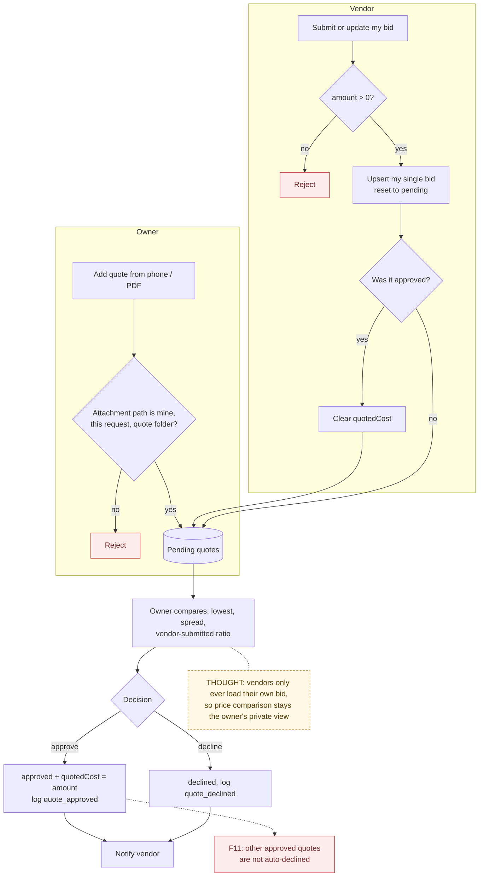

# 06 — Bid and Quote Decision

> Map node: `[E] Quotes and bids` on the [system map](../00-overview/system-map.md)
> Roles: owner (enter quotes, approve/decline/delete), assigned vendor (submit/update own bid)
> Findings: **F11 open** (several quotes can be approved at once) · attachment path checks **fixed** (F1)

## 1. Problem

Homeowners often get two or three prices by phone, text or PDF, then forget
which one they agreed to. The record needs every option side by side, the
owner's decision, and the approved price copied into the request's cost,
without letting one vendor see another vendor's price.

## 2. Requirements

- **R1** The owner can add a quote: vendor name, amount (required), contact, notes, and an optional attachment.
- **R2** The assigned vendor can submit **one** bid per request (amount > 0, availability, scope notes) and update it later.
- **R3** A vendor never sees other quotes or prices. The vendor page only loads quotes where `submittedByVendorId = me`.
- **R4** Approving a quote sets `requests.quotedCost` to its amount and logs `quote_approved`. Declining logs `quote_declined`.
- **R5** If the vendor changes an already-approved bid, it goes back to `pending` and `quotedCost` is cleared.
- **R6** The vendor is notified when their bid is approved or declined.
- **R7** Attachment paths must be the owner's own upload into this request's `quote` folder.

## 3. Inputs / Outputs

| Input | From | Validation |
|---|---|---|
| `vendorName`, `amount`, `vendorContact`, `notes`, `attachmentBlobPath` | owner quote form | name required, amount finite; path validated (type `quote`) |
| `amount`, `availabilityWindow`, `notes` | vendor bid form | amount > 0 |
| `quoteId` | approve / decline / delete buttons | must belong to the request |

| Output | To |
|---|---|
| `quotes` rows (`pending` / `approved` / `declined`) | Postgres |
| `requests.quotedCost` | Postgres |
| `vendor_bid_submitted` / `vendor_bid_updated` / `quote_approved` / `quote_declined` | decision log |
| bid notifications | owner (new bid) / vendor (decision) |

## 4. Constraints

- Quotes are not payments. Nothing is charged; `quotedCost` is a record.
- Approve does not decline the other quotes (**F11**). The owner can end up with two approved quotes, and `quotedCost` reflects the last one approved.

## 5. Algorithm

1. **Owner adds a quote:** check ownership, validate the fields and the attachment path, then insert as `pending`.
2. **Vendor bids:** check they are the assigned vendor and the amount > 0. Upsert their single bid (reset to `pending`). Log submitted or updated. If it had been approved, clear `quotedCost`. Notify the owner.
3. **Owner decides:** approve (set approved, copy the amount into `quotedCost`, log, notify the vendor) or decline (set declined, log, notify the vendor).
4. **Delete:** remove the quote, and its attachment only if the path is in this request's folder.

## 6. Pseudocode

```text
FUNCTION submitVendorBid(requestId, form, session)
  REQUIRE session.role = vendor AND req.assignedVendorId = me
  REQUIRE form.amount > 0
  existing = FIND quotes WHERE requestId AND submittedByVendorId = me
  values = { amount, availability, notes, status: pending, approvedBy: null }
  IF existing THEN UPDATE existing WITH values ELSE WRITE quotes(requestId, values)
  LOG decision_log(existing ? "vendor_bid_updated" : "vendor_bid_submitted", ...)
  IF existing.status = approved THEN WRITE requests(requestId).quotedCost = null
  NOTIFY owner

FUNCTION approveQuote(requestId, quoteId, session)
  REQUIRE owner of request; quote = FIND quotes(quoteId); REQUIRE quote.requestId = requestId
  WRITE quotes(quoteId): status = approved, approvedBy = me, approvedAt = now
  WRITE requests(requestId).quotedCost = quote.amount
  LOG decision_log("quote_approved", { vendorName, amount })
  NOTIFY vendor(decision = approved)                      -- only for vendor-submitted bids
  -- PROPOSED (F11): also SET status = declined ON other approved quotes of this request

FUNCTION createQuote(requestId, form, session)
  REQUIRE owner of request; REQUIRE vendorName AND finite(amount)
  IF form.attachmentBlobPath THEN
    REQUIRE validateRequestUploadPath(path, requestId, uid = me, type = "quote")
  WRITE quotes(..., attachmentUrl = path ? fileUrlForPath(path) : null)
```

## 7. Flowchart



## 8. Implementation

| Step | File | Function |
|---|---|---|
| Owner quotes | `lib/actions/quotes.ts` | `createQuoteAction`, `approveQuoteAction`, `declineQuoteAction`, `deleteQuoteAction` |
| Vendor bid | `lib/actions/vendor-bids.ts` | `submitVendorBidAction` |
| Comparison math (pure) | `lib/bid-review.ts`, `lib/vendor-bid.ts` | review guidance, bid guidance |
| Notification copy (pure) | `lib/vendor-bid-notification.ts` | `vendorBidDecisionNotification` |
| UI | `components/QuoteWorkspace.tsx`, `components/VendorBidPanel.tsx` | |

## 9. Tests

- **Unit:** `__tests__/bid-review.test.ts`, `__tests__/vendor-bid.test.ts`, `__tests__/vendor-bid-notification.test.ts`.
- **Smoke:** `ux:full-loop` (vendor bids, owner approves).
- **Not yet covered:** a server test that a vendor cannot read or approve another vendor's quote.

## 10. Refinement

| Date | Change |
|---|---|
| 2026-08 | Quote workspace, vendor bid flow, decision notifications |
| 2026-09-28 | Attachment path validated server-side (F1 family) |
| next | **F11:** approving one quote declines the others, in one transaction |

## 11. Documentation

- [Vendor lifecycle roadmap](../VENDOR_LIFECYCLE_ROADMAP.md)
- [Requirements matrix: bid rows](../USER_REQUIREMENTS_EVENT_MATRIX.md)
