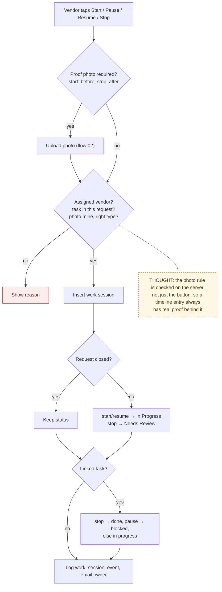
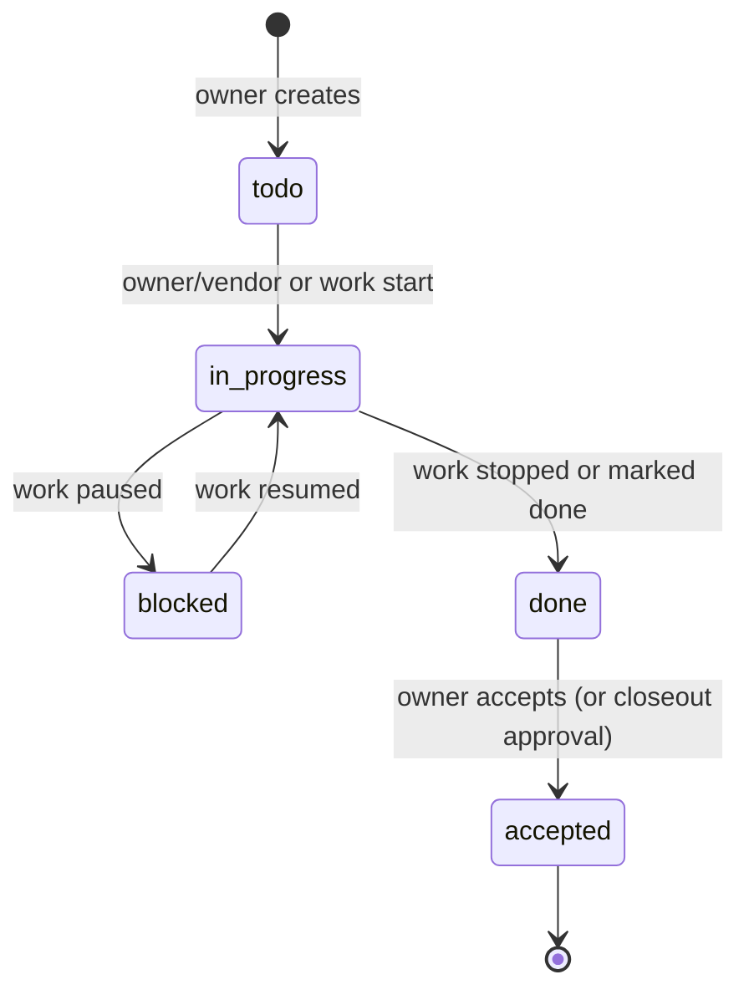

# 07 — Work Sessions and Tasks

> Map node: `[G] Work and tasks` on the [system map](../00-overview/system-map.md)
> Roles: owner (create, cost and accept tasks), assigned vendor (record work events, update task status)
> Findings: **F5 open** (event, status, task and log are separate writes)

## 1. Problem

"He was here Tuesday" is not proof. Owners need to see when work actually
started and stopped, with a photo at each end, and which piece of the scope
it was for. Without that, disputes about time, scope and quality have no
record to settle them.

## 2. Requirements

- **R1** Only the assigned vendor records work events: `started`, `paused`, `resumed`, `stopped`.
- **R2** `started` requires a **before** photo and `stopped` requires an **after** photo, uploaded by that vendor for this request.
- **R3** Events move the request automatically: `started`/`resumed` → `In Progress`, `stopped` → `Needs Review`. Closed requests (`Complete`/`Archived`) never move.
- **R4** An event can be linked to a project task. The task moves with it: `stopped` → done, `paused` → blocked, otherwise in progress.
- **R5** The owner creates tasks (title, expected proof types, estimated cost). The owner or vendor updates task status; only the owner edits cost, accepts done tasks, or deletes.
- **R6** Each event and task change writes a decision-log row, and work events notify the owner.

## 3. Inputs / Outputs

| Input | From | Validation |
|---|---|---|
| `event` | vendor buttons | `isWorkSessionEvent` |
| `notes`, `taskLabel` | vendor form | notes ≤ 500 chars; label normalized |
| `proofPhotoId` | just-uploaded photo (flow 02) | same request, uploaded by me, required type |
| `requestTaskId` | optional | task belongs to this request |

| Output | To |
|---|---|
| `work_sessions` row | Postgres |
| `requests.status` (maybe) | Postgres |
| `request_tasks.status` (maybe) | Postgres |
| `work_session_event` log + owner email | decision log, notification log |

## 4. Constraints

- The proof photo is uploaded first (flow 02), then its ID is passed in. The server re-checks that it is the vendor's own photo of the right type.
- Status side effects follow the same working-state rules as the [status policy](04-request-status-lifecycle.md): they never touch `Complete` or `Archived`.

## 5. Algorithm

1. Require the vendor role, a known event, and that the caller is the assigned vendor.
2. If a task is given, it must belong to this request.
3. Look up the proof requirement for the event. If a photo is required, it must exist, belong to this request, be uploaded by this vendor, and have the right type.
4. Compute the next request status from the event, leaving it alone if closed.
5. Insert the work session. Update the request status if it changed. Update the linked task's status.
6. Log `work_session_event` and notify the owner.

## 6. Pseudocode

```text
PROOF = { started: before (required), stopped: after (required), paused: none, resumed: none }

FUNCTION nextStatusForEvent(event, current) -> status
  IF current IN {Complete, Archived} THEN RETURN current
  IF event IN {started, resumed} THEN RETURN In Progress
  IF event = stopped THEN RETURN Needs Review
  RETURN current

FUNCTION recordWorkSessionEvent(requestId, event, notes, label, proofPhotoId?, taskId?, session)
  REQUIRE session.role = vendor AND isWorkSessionEvent(event)
  req = FIND requests(requestId); REQUIRE req.assignedVendorId = me
  IF taskId THEN task = FIND request_tasks(taskId); REQUIRE task.requestId = requestId
  need = PROOF[event]
  photo = proofPhotoId ? FIND request_photos(proofPhotoId) : null
  IF need.required THEN REQUIRE photo ELSE "Upload the required proof photo first."
  IF photo THEN REQUIRE photo.requestId = requestId AND photo.uploadedBy = me
                         AND (need.type is none OR photo.type = need.type)
  WRITE work_sessions(requestId, vendor = me, event, notes[0..500], taskLabel, photo?, task?)
  next = nextStatusForEvent(event, req.status)
  IF next != req.status THEN WRITE requests(requestId).status = next
  IF task THEN WRITE request_tasks(task).status = (stopped ? done : paused ? blocked : in_progress)
  LOG decision_log("work_session_event", { event, taskLabel, proofPhotoId, from, to })
  NOTIFY owner
```

## 7. Flowchart



### Task lifecycle



## 8. Implementation

| Step | File | Function |
|---|---|---|
| Work events | `lib/actions/work-sessions.ts` | `recordWorkSessionEventAction`, `nextStatusForEvent` |
| Proof rules and labels (pure) | `lib/work-sessions.ts` | `workSessionProofRequirement`, `isWorkSessionEvent` |
| Tasks | `lib/actions/request-tasks.ts` | `createRequestTaskAction`, `updateRequestTaskStatusAction`, `updateRequestTaskCostAction`, `acceptRequestTaskAction`, `deleteRequestTaskAction` |
| Task model (pure) | `lib/project-tasks.ts` | statuses, labels |
| UI | `components/WorkSessionPanel.tsx`, `WorkSessionTimeline.tsx`, `RequestTaskChecklist.tsx` | |

## 9. Tests

- **Unit:** `__tests__/work-sessions.test.ts`, `__tests__/project-tasks.test.ts`.
- **Smoke:** `ux:full-loop` (start with before photo, stop with after photo).
- **Not yet covered:** a server test that a vendor cannot attach another vendor's photo as proof.

## 10. Refinement

| Date | Change |
|---|---|
| 2026-09 | Work sessions with server-gated proof; task checklist with owner acceptance |
| next (P2) | One transaction for event + status + task + log (**F5**) |

## 11. Documentation

- [Vendor lifecycle roadmap](../VENDOR_LIFECYCLE_ROADMAP.md)
- [Status lifecycle](04-request-status-lifecycle.md)
