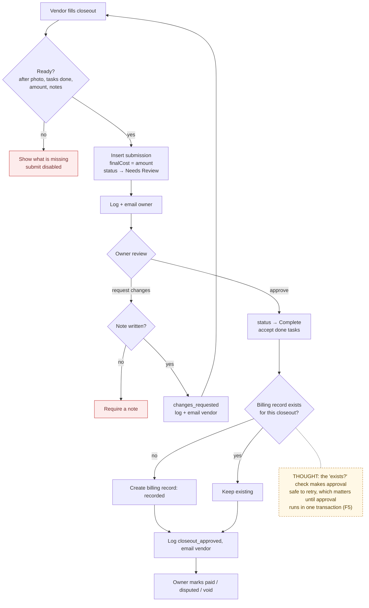

# 08 — Closeout and Billing

> Map node: `[H] Closeout and billing` on the [system map](../00-overview/system-map.md)
> Roles: assigned vendor (submit closeout), owner (approve, request changes, manage billing status)
> Findings: **F5 open** (approval makes up to five separate writes)

## 1. Problem

"Done" means different things to a vendor and an owner. Closeout is the
handoff: the vendor says what was done, what it cost, and shows proof; the
owner accepts it or asks for changes. Approval must leave a durable record of
what was owed, without the app pretending to process payment.

## 2. Requirements

- **R1** Only the assigned vendor submits closeout: completion notes, optional materials notes, final amount.
- **R2** Submit is blocked until it is ready: an after photo, all tasks done (if any exist), a valid final amount, and completion notes.
- **R3** Submitting sets `finalCost` and moves an open request to `Needs Review`. It logs `closeout_submitted` and notifies the owner.
- **R4** Only the owner reviews. `changes_requested` needs a note. `approved` sets `Complete`, copies `finalCost`, accepts remaining done tasks, and creates **one** billing record per closeout.
- **R5** Billing statuses: `recorded`, `paid` (label "Paid outside TurnFlow"), `disputed` (label "Needs review"), `void`, with invoice reference and notes. Only the owner changes them.
- **R6** Every decision is logged (`closeout_approved`, `closeout_changes_requested`, `billing_record_updated`) and the vendor is notified.

## 3. Inputs / Outputs

| Input | From | Validation |
|---|---|---|
| `completionNotes`, `materialsNotes`, `finalAmount` | vendor closeout form | normalized notes; amount parsed |
| `decision`, `reviewNotes` | owner review | `approved` / `changes_requested`; note required for changes |
| billing `status`, `invoiceReference`, `notes` | owner billing panel | status in `BILLING_RECORD_STATUSES` |

| Output | To |
|---|---|
| `closeout_submissions` row (pending → approved / changes_requested) | Postgres |
| `requests.finalCost`, `requests.status` | Postgres |
| `request_tasks.acceptedAt` for done tasks | Postgres |
| `billing_records` row (unique per closeout) | Postgres |
| decision-log rows, notifications | Postgres, email |

## 4. Constraints

- No payment processing. "Paid" means paid outside TurnFlow and is a record only.
- Approval is several writes without a transaction (**F5**). A failure midway could leave `Complete` without a billing row. The billing insert checks for an existing row first, so retrying approval is safe.

## 5. Algorithm

1. **Vendor submits:** check they are assigned. Compute readiness from photos, tasks, amount and notes. If not ready, return what is missing. Insert the submission, set `finalCost` and `Needs Review` (unless closed), log it, and email the owner.
2. **Owner reviews:** check ownership, that the decision is valid, and that the closeout belongs to this request. Changes need a note. Update the submission.
3. **If approved:** set the request `Complete` and `finalCost`, accept the done tasks, and create a billing record if one does not exist for this closeout.
4. Log the decision and email the vendor.
5. **Later:** the owner updates billing status (for example, `paid`), which is logged.

## 6. Pseudocode

```text
FUNCTION submitCloseout(requestId, form, session)
  REQUIRE session.role = vendor AND req.assignedVendorId = me
  notes = normalize(form.completionNotes); amount = parseAmount(form.finalAmount)
  ready = closeoutReadiness(photos(requestId), tasks(requestId), amount, notes)
  REQUIRE amount AND ready.ready ELSE ready.detail
  c = WRITE closeout_submissions(requestId, vendor = me, notes, materials, amount)
  WRITE requests(requestId): finalCost = amount,
        status = (req.status IN {Complete, Archived}) ? req.status : Needs Review
  LOG decision_log("closeout_submitted", { closeoutId, finalAmount, from, to })
  NOTIFY owner

FUNCTION reviewCloseout(requestId, closeoutId, decision, reviewNotes, session)
  REQUIRE session.role = owner AND decision IN {approved, changes_requested}
  REQUIRE req.ownerId = me AND closeout.requestId = requestId
  IF decision = changes_requested THEN REQUIRE reviewNotes != ""
  WRITE closeout_submissions(closeoutId): status = decision, reviewNotes, reviewedBy = me
  IF decision = approved THEN
    WRITE requests(requestId): finalCost = closeout.amount, status = Complete
    WRITE request_tasks WHERE requestId AND status = done AND acceptedAt IS NULL: accepted by me
    IF NOT EXISTS billing_records WHERE closeoutSubmissionId = closeoutId THEN
      WRITE billing_records(requestId, owner, vendor, closeoutId, amount, status = recorded)
  LOG decision_log(decision = approved ? "closeout_approved" : "closeout_changes_requested", ...)
  NOTIFY vendor
  -- PROPOSED (F5): wrap every WRITE above in db.transaction(...)
```

## 7. Flowchart



## 8. Implementation

| Step | File | Function |
|---|---|---|
| Submit / review | `lib/actions/closeout-submissions.ts` | `submitCloseoutAction`, `reviewCloseoutSubmissionAction` |
| Readiness and parsing (pure) | `lib/closeout-submissions.ts` | `closeoutReadiness`, `closeoutReadinessChecks`, `parseCloseoutAmount` |
| Billing | `lib/actions/billing-records.ts`, `lib/billing-records.ts` | `updateBillingRecordAction`, `BILLING_RECORD_STATUSES` |
| UI | `components/CloseoutSubmissionPanel.tsx`, `components/BillingRecordPanel.tsx` | |

## 9. Tests

- **Unit:** `__tests__/closeout-submissions.test.ts`, `__tests__/billing-records.test.ts`.
- **Smoke:** `ux:full-loop` (submit → changes requested → resubmit → approve → paid).
- **Not yet covered:** a partial-failure test for approval (needs transactions first).

## 10. Refinement

| Date | Change |
|---|---|
| 2026-09 | Closeout submissions, billing foundation, revision loop smoke |
| next (P2) | **F5:** switch to the `neon-serverless` driver and wrap approval in `db.transaction` |

## 11. Documentation

- [Build log 2026-09](../07-refinement/build-log/2026-09.md): "Closeout Revision Loop Smoke", "Workspace and Billing Foundation"
- [Requirements matrix: closeout rows](../USER_REQUIREMENTS_EVENT_MATRIX.md)
