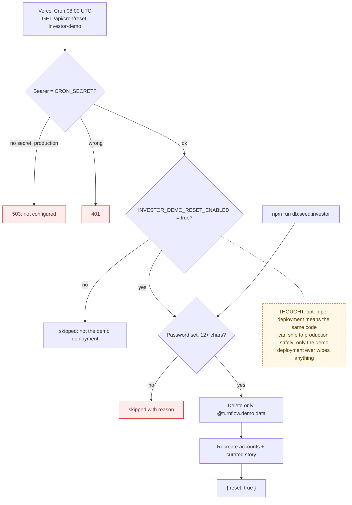

# 09 — Investor Demo Reset (and Cron Protection)

> Map node: `[K] Operations` on the [system map](../00-overview/system-map.md)
> Roles: operator (you), anyone given the demo password, Vercel Cron
> Findings: **F7 fixed** (published demo password) · **F12 (part) fixed** (cron routes open when secret missing)

## 1. Problem

A hosted demo is shared by everyone you show it to. Before 2026-09-28 its
password was printed in the public README. Anyone could sign in as the demo
owner, upload files, change the story, or delete it before your next meeting.
The fix has two parts: keep the password private and rotatable, and rebuild
the demo automatically every night.

## 2. Requirements

- **R1** The demo password comes from `INVESTOR_DEMO_PASSWORD` (12+ characters). It is never hardcoded, printed, or committed.
- **R2** `npm run db:seed:investor` refuses to run without a valid password.
- **R3** A nightly cron can rebuild the demo, but only when `INVESTOR_DEMO_RESET_ENABLED=true` on that deployment, so it can never wipe a database not meant for the demo.
- **R4** The reset touches only the three `@turnflow.demo` accounts and their data.
- **R5** All cron routes require `Authorization: Bearer $CRON_SECRET`. With no secret configured they refuse to run in production (503) and stay open only in local development.
- **R6** Script and cron run the same story code.

## 3. Inputs / Outputs

| Input | From | Validation |
|---|---|---|
| `INVESTOR_DEMO_PASSWORD` | env | set, ≥ 12 characters (`investorDemoPasswordProblem`) |
| `INVESTOR_DEMO_RESET_ENABLED` | env | exactly `"true"` to run |
| `Authorization` header | Vercel Cron | `authorizeCronRequest` |

| Output | To |
|---|---|
| Demo owner, vendor and collaborator, with properties, requests, photos, quotes, tasks, sessions, closeout, billing, vault, reminders, comments, log | Postgres |
| `{ reset: true }` / `{ skipped: true, reason }` / error | cron response |

## 4. Constraints

- The seed uses `data:` SVG placeholders for photos, so a reset never touches Blob storage.
- Vercel Cron schedules are UTC. The demo resets at 08:00 UTC and the reminder digest runs at 13:00 UTC.
- The seed module avoids `server-only` and `lib/db` so the `tsx` script can import it. The caller passes its own database handle.
- The old password is still in git history. It stops working the first time you reseed with a new value.

## 5. Algorithm

1. Authorize the cron call: the bearer must equal `CRON_SECRET`. With no secret set, allow only outside production.
2. If reset is not enabled on this deployment, answer "skipped".
3. If the password is missing or too short, answer "skipped" with the reason (503).
4. Delete everything owned by the three demo accounts, then the accounts themselves.
5. Recreate the accounts with the configured password and rebuild the curated story.

## 6. Pseudocode

```text
FUNCTION authorizeCronRequest(header, env) -> ok | 401 | 503
  secret = trim(env.CRON_SECRET)
  IF secret = "" THEN RETURN (env.NODE_ENV = production) ? 503 : ok
  RETURN header = "Bearer " + secret ? ok : 401

FUNCTION investorDemoPasswordProblem(pw) -> message | null
  IF trim(pw) = ""       THEN RETURN "INVESTOR_DEMO_PASSWORD is not set."
  IF len(trim(pw)) < 12  THEN RETURN "... must be at least 12 characters."
  RETURN null

FUNCTION resetInvestorDemoRoute(request)
  REQUIRE authorizeCronRequest(request.authorization) = ok ELSE 401 / 503
  IF env.INVESTOR_DEMO_RESET_ENABLED != "true" THEN RETURN { skipped }
  problem = investorDemoPasswordProblem(env.INVESTOR_DEMO_PASSWORD)
  IF problem THEN RETURN { skipped, reason: problem } (503)
  resetInvestorDemo(db, env.INVESTOR_DEMO_PASSWORD)
  RETURN { reset: true }

FUNCTION resetInvestorDemo(db, password)
  REQUIRE investorDemoPasswordProblem(password) = null
  FOR EACH demo account IN {owner, vendor, collaborator}
    DELETE its billing, closeouts, sessions, tasks, comments, log, quotes, photos,
           notifications, requests, vault docs, reminders, properties, invites, contacts, profile
    DELETE the user
  CREATE users with bcrypt(password); BUILD curated story
```

## 7. Flowchart



## 8. Implementation

| Step | File | Function |
|---|---|---|
| Story + reset + password check | `lib/demo/investor-seed.ts` | `resetInvestorDemo`, `investorDemoPasswordProblem`, `INVESTOR_DEMO_EMAILS` |
| Manual script | `scripts/seed-investor-demo.ts` | thin wrapper |
| Nightly route | `app/api/cron/reset-investor-demo/route.ts` | `GET` |
| Cron auth (shared) | `lib/cron-auth.ts` | `authorizeCronRequest` (also used by the reminder digest) |
| Schedule | `vercel.json` | `0 8 * * *` |

## 9. Tests

- **Unit:** `__tests__/investor-demo.test.ts` (password rule), `__tests__/cron-auth.test.ts` (exact bearer, fail closed in production, open in dev).
- **Manual:** run `npm run db:seed:investor` against the demo database and sign in with each lane.

## 10. Refinement

| Date | Change |
|---|---|
| 2026-09-03 | Curated investor seed added (password in README) |
| 2026-09-28 | **F7 fixed:** env password, docs scrubbed, nightly reset, cron fail-closed ([change record](../09-changes/2026-09-28-p0-security.md#5-demo-password-and-nightly-reset-f7)) |
| later | Run the demo on its own Neon branch so it never shares a database with real users |

## 11. Documentation

- [P0 rollout runbook: rotate the demo password](../08-operations/p0-rollout-runbook.md)
- [Deployment runbook: demo accounts](../DEPLOYMENT.md)
