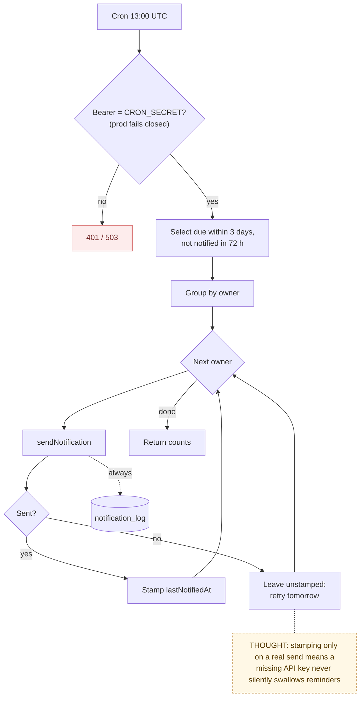

# 10 — Reminders and Notifications

> Map node: `[J] Automation` on the [system map](../00-overview/system-map.md)
> Roles: owner (reminders), system (cron, email)
> Findings: **F12 (part) fixed** (reminder cron now fails closed in production without `CRON_SECRET`)

## 1. Problem

Small maintenance (filters, gutters, smoke detectors) becomes a big repair when
it is forgotten. Separately, owners and vendors need to hear when something
changes, and the owner needs proof an email was attempted even when email is
not set up yet.

## 2. Requirements

- **R1** The owner creates recurring reminders per property with an interval in days, can mark them done (reschedules from today), and can export them to `.ics`.
- **R2** Status: overdue (past due), upcoming (due within 14 days), ok.
- **R3** A daily cron emails each owner **one** digest of reminders overdue or due within **3 days**.
- **R4** A reminder is not re-sent within **72 hours** of its last notification, and `lastNotifiedAt` only moves on a real send.
- **R5** Every email attempt, sent or failed, writes a `notification_log` row. Without `RESEND_API_KEY` the app logs "failed" and keeps working (log-only mode).
- **R6** The owner can trigger a test email from the Notifications page.

## 3. Inputs / Outputs

| Input | From | Validation |
|---|---|---|
| `title`, `intervalDays`, `notes` | reminder form | title required, interval > 0 |
| cron call | Vercel Cron 13:00 UTC | `authorizeCronRequest` |
| `RESEND_API_KEY`, `NOTIFICATIONS_FROM_EMAIL` | env | readiness check |

| Output | To |
|---|---|
| `reminders` rows (`nextDueAt`, `lastNotifiedAt`) | Postgres |
| digest email per owner | Resend |
| `notification_log` row per attempt | Postgres |
| `{ ownersNotified, remindersConsidered }` | cron response |

## 4. Constraints

- Cron granularity is daily. The 72-hour cooldown avoids daily repeat emails for the same overdue item.
- Email is plain text. Links use `APP_URL`.

## 5. Algorithm

1. Authorize the cron call.
2. Select reminders due within 3 days (including overdue) whose last notification is empty or older than 72 hours, joined to their property's owner.
3. Group by owner. Build one line per reminder: "OVERDUE" or "Due soon", with the property label.
4. For each owner, send one email (always logged). If sent, stamp `lastNotifiedAt` on those reminders.
5. Return counts.

## 6. Pseudocode

```text
FUNCTION reminderDigest(request)
  REQUIRE authorizeCronRequest(request.authorization) = ok ELSE 401 / 503
  due = SELECT reminders JOIN properties
        WHERE nextDueAt <= now + 3 days
          AND (lastNotifiedAt IS NULL OR lastNotifiedAt <= now - 72 hours)
  byOwner = GROUP due BY property.ownerId
  FOR EACH (owner, items) IN byOwner
    sent = sendNotification(owner.email, subject = "{n} maintenance reminder(s)", lines(items))
    IF sent THEN WRITE reminders(items).lastNotifiedAt = now
  RETURN { ownersNotified, remindersConsidered: len(due) }

FUNCTION sendNotification(params) -> bool
  IF no recipient THEN LOG notification_log(failed, "No email on record"); RETURN false
  TRY  send via Resend (throws if RESEND_API_KEY missing)
       LOG notification_log(sent); RETURN true
  CATCH e
       LOG notification_log(failed, e.message); RETURN false

FUNCTION markReminderDone(reminder)
  WRITE reminders(reminder).nextDueAt = now + intervalDays
```

## 7. Flowchart



## 8. Implementation

| Step | File | Function |
|---|---|---|
| Digest route | `app/api/cron/reminder-digest/route.ts` | `GET` |
| Cron auth | `lib/cron-auth.ts` | `authorizeCronRequest` |
| Email + log | `lib/email.ts` | `sendNotification` |
| Reminders | `lib/actions/reminders.ts`, `lib/utils.ts` | `createReminderAction`, `markReminderDoneAction`, `reminderStatus`, `.ics` builder |
| Delivery health copy (pure) | `lib/notification-guidance.ts` | |
| Test email | `lib/actions/notifications.ts` | `sendTestNotificationAction` |

## 9. Tests

- **Unit:** `__tests__/notification-guidance.test.ts`, `__tests__/utils.test.ts` (reminder status, ics), `__tests__/cron-auth.test.ts`.
- **Not yet covered:** the digest query against a real database.

## 10. Refinement

| Date | Change |
|---|---|
| 2026-09-09 | Email and cron verification surface, owner test email |
| 2026-09-28 | Cron fails closed in production without a secret |
| later | HTML email templates; per-user notification preferences |

## 11. Documentation

- [Build log 2026-09: Email and Cron Verification Surface](../07-refinement/build-log/2026-09.md)
