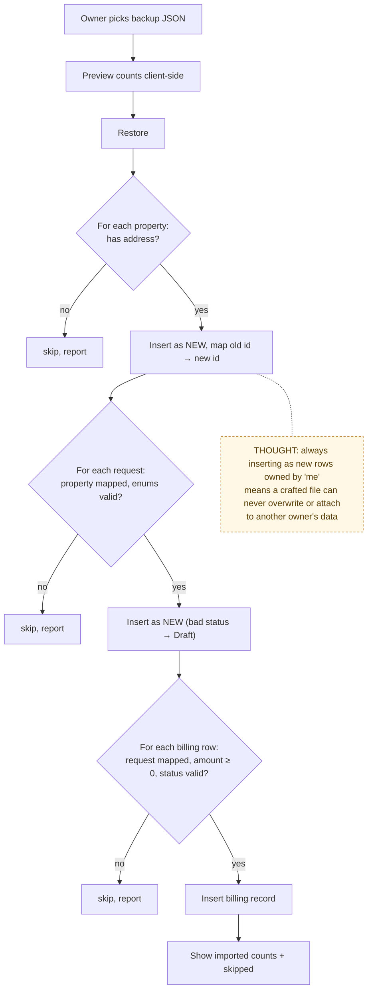

# 11 — Backup, Restore and Exports (History)

> Map node: `[I] History` on the [system map](../00-overview/system-map.md)
> Roles: owner
> Findings: **F8 open** (decision log is deleted along with its request)

## 1. Problem

The promise is "keep your maintenance history after the work is done", even
if you leave the app. That needs portable exports (PDF for people, CSV for
spreadsheets, JSON for machines) and a restore that can never overwrite or
leak into someone else's data.

## 2. Requirements

- **R1** Per-request PDF proof packet; per-property PDF history; CSV history export.
- **R2** JSON backup of the owner's properties, requests and billing records.
- **R3** Restore imports rows as **new** records owned by the signed-in owner. It never overwrites, and IDs in the file are remapped.
- **R4** Restore validates each row (address, title, category, urgency, status, billing amount/status) and reports skipped rows.
- **R5** Preview before restore (client side).
- **R6 (open, F8)** Deleting a request should not erase its decision history.

## 3. Inputs / Outputs

| Input | From | Validation |
|---|---|---|
| backup JSON | file picker | shape parsed client-side; each row re-validated on the server |

| Output | To |
|---|---|
| `{ properties, requests, billingRecords }` JSON | download |
| new rows + `{ imported*, errors[] }` | Postgres, UI |
| PDF / CSV | download (generated in the browser with jsPDF) |

## 4. Constraints

- Restore is row by row without a transaction. Partial imports are possible and reported through `errors`.
- Photos and vault files are not in the JSON backup (only records).
- `decision_log.requestId` is `ON DELETE CASCADE`, so deleting a request removes its audit trail (**F8**).

## 5. Algorithm

1. **Backup:** load the owner's properties, requests and billing records (only their own) and return JSON.
2. **Restore:** ensure the workspace. For each property with an address, insert it as new and remember `oldId → newId`. For each request whose property was mapped and whose enums are valid, insert it as new (unknown status becomes `Draft`) and remember the mapping. For each billing record whose request was mapped with a valid amount and status, insert it.
3. Return counts and skipped labels.

## 6. Pseudocode

```text
FUNCTION restoreBackup(data, session) -> { importedProperties, importedRequests, importedBillingRecords, errors }
  REQUIRE session.role = owner
  ws = ensureDefaultWorkspaceForOwner(me)
  propMap = {}; reqMap = {}; errors = []
  FOR EACH p IN data.properties
    IF trim(p.address) = "" THEN errors += p; CONTINUE
    new = WRITE properties(owner = me, ws, p.address, p.unit, p.nickname)
    IF p.id THEN propMap[p.id] = new.id
  FOR EACH r IN data.requests
    IF propMap[r.propertyId] missing OR r.title = "" OR r.category NOT IN CATS
       OR r.urgency NOT IN URGENCIES THEN errors += r; CONTINUE
    new = WRITE requests(owner = me, ws, propMap[r.propertyId], ...,
                         status = r.status IN STATUSES ? r.status : Draft)
    IF r.id THEN reqMap[r.id] = new.id
  FOR EACH b IN data.billingRecords
    IF reqMap[b.requestId] missing OR amount < 0 OR status invalid THEN errors += b; CONTINUE
    WRITE billing_records(reqMap[b.requestId], owner = me, amount, status, ...)
  RETURN counts, errors

-- PROPOSED (F8): deleteRequest becomes archive (soft delete); decision_log keeps rows
```

## 7. Flowchart



## 8. Implementation

| Step | File | Function |
|---|---|---|
| Backup / restore | `lib/actions/backup.ts` | `getBackupDataAction`, `restoreBackupAction` |
| Preview copy (pure) | `lib/backup-guidance.ts` | `backupPreview`, `backupScopeItems` |
| PDFs | `lib/pdf/proofPacket.ts`, `lib/pdf/propertyHistory.ts` | |
| Property export data | `lib/actions/properties.ts` | `getPropertyRequestsForExportAction` |
| UI | `components/BackupManager.tsx`, `components/ExportHistoryButton.tsx` | |

## 9. Tests

- **Unit:** `__tests__/backup-guidance.test.ts`, `__tests__/decision-log.test.ts` (log copy).
- **Not yet covered:** restore against a real database with malformed rows.

## 10. Refinement

| Date | Change |
|---|---|
| 2026-08 | CSV/JSON backup and restore, PDF proof packets |
| 2026-09 | Billing records in backup and restore |
| next (P2) | **F8:** replace hard delete of requests with archive; restrict `decision_log` to insert-only at the database level |

## 11. Documentation

- [Data model](../03-design/data-model.md) (cascade rules)
