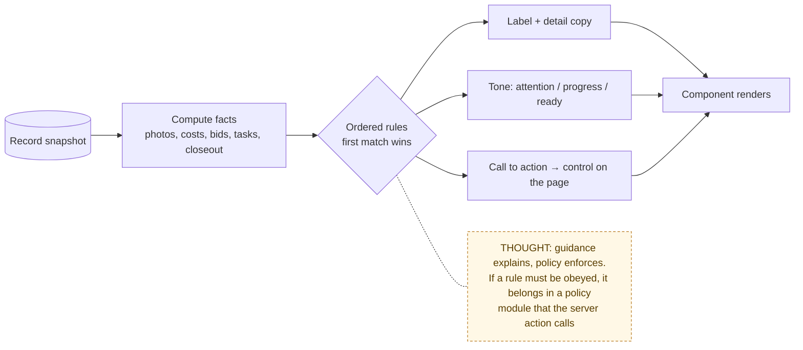

# 12 — Guidance Layer ("What should I do next?")

> Map node: all nodes; this layer reads records and never writes
> Roles: owner, vendor, collaborator
> Findings: **F9** context: most existing unit tests cover this layer

## 1. Problem

A complete record is useless if people don't know the next step. Testers ask
"what happened?" and "what do I do now?". The guidance layer turns raw record
state into a next action, a readiness score, and plain-language copy for every
screen.

## 2. Requirements

- **R1** Pure functions only: same input, same output. No database, no network, no dates unless passed in.
- **R2** Each function takes a record snapshot and returns labels, tones (`attention` / `progress` / `ready`), counts and a call to action.
- **R3** Every helper has unit tests (this is where the 286 original tests live).

## 3. Inputs / Outputs (by module)

| Module | Input | Output | Used on |
|---|---|---|---|
| `lib/owner-readiness.ts` | owner's properties, requests, invites, reminders | setup progress, value metrics, dashboard cards | onboarding, dashboard, properties, vault, calendar, account |
| `lib/request-guidance.ts` | one request + photos + costs | missing completion proof, record value, next action | request detail |
| `lib/request-workflow.ts` | request + quotes, tasks, closeouts, billing, sessions | workflow rail steps (intake → billing) | request detail rail |
| `lib/request-intake.ts` | form fields | intake steps, handoff checks | new request |
| `lib/helper-workspace.ts` | requests shared with a helper | workspace overview, per-card state | vendor, collaborator |
| `lib/vendor-lifecycle.ts` | vendor's assigned requests | lifecycle stage, work queue, next action | vendor portal |
| `lib/vendor-fit.ts`, `lib/vendor-profile.ts` | vendor profile + request category | fit signals | request detail |
| `lib/bid-review.ts`, `lib/vendor-bid.ts` | quotes | comparison metrics, bid guidance | quotes |
| `lib/status-handoff.ts` | role + status + proof | status meaning and reminders | status selects |
| `lib/closeout-submissions.ts` | photos, tasks, amount, notes | closeout readiness checks | closeout panels |
| `lib/comment-guidance.ts`, `lib/notification-guidance.ts`, `lib/backup-guidance.ts` | thread / log / backup | prompts and health copy | comments, notifications, backup |
| `lib/poc-readiness.ts` | env | ready / warning / blocked report | `npm run poc:ready` |

## 4. Constraints

- It must not become a second source of truth. Rules that **enforce** anything live in policy modules (`request-status-policy.ts`, `blob-paths.ts`, `file-access.ts`, `rate-limit-policy.ts`), and the server calls those.
- The guidance layer only **explains**.

## 5. Algorithm (shared shape)

1. Take a snapshot of the record.
2. Compute facts: has an after photo? final cost? vendor? pending bids? overdue reminders?
3. Map the facts to a stage and tone using ordered rules: the first rule that matches wins.
4. Return copy plus a call to action pointing at the control that resolves the gap.

## 6. Pseudocode (example: `vendorNextAction` in `lib/vendor-lifecycle.ts`)

The real function checks these rules in this exact order; the first match wins.

```text
FUNCTION vendorNextAction(request) -> { label, href, tone }
  bid = my quote on this request; session = latest work session
  IF no bid AND status = Needs Quote            THEN RETURN "Bid requested"
  IF bid.status = pending                       THEN RETURN "Waiting on owner approval"
  IF bid.status = declined                      THEN RETURN "Bid needs revision"
  IF missing location / access / contact        THEN RETURN "Ask for job context"
  IF any task blocked                           THEN RETURN "Resolve blocked scope"
  IF status = Scheduled OR (In Progress AND no session) THEN RETURN "Start with proof"
  IF session.event = paused                     THEN RETURN "Resume or close the visit"
  IF session.event IN {started, resumed}        THEN RETURN "Stop with completion proof"
  IF tasks not all done                         THEN RETURN "Update task progress"
  IF no after photo                             THEN RETURN "Add after photo"
  IF no final cost                              THEN RETURN "Share final cost context"
  IF closeout pending                           THEN RETURN "Closeout under owner review"
  IF closeout changes requested                 THEN RETURN "Closeout changes requested"
  IF no closeout OR (Needs Review AND closeout not approved) THEN RETURN "Submit closeout"
  IF done tasks not yet accepted                THEN RETURN "Waiting on task acceptance"
  IF billing disputed                           THEN RETURN "Billing needs context"
  IF billing paid                               THEN RETURN "Job record settled"
  IF billing exists                             THEN RETURN "Billing recorded"
  RETURN "Waiting on owner closeout"
```

## 7. Flowchart



## 8. Implementation

See the table in section 3. Components import these helpers directly. None of
them import `lib/db`.

## 9. Tests

`__tests__/owner-readiness.test.ts` (largest), `helper-workspace`,
`vendor-lifecycle`, `request-guidance`, `request-workflow`, `notification-guidance`,
`bid-review`, `vendor-fit`, `vendor-profile`, `status-handoff`, `comment-guidance`,
`backup-guidance`, `poc-readiness`.

## 10. Refinement

- The layer is large (about 2,300 lines across the biggest modules). Keep new rules small and tested.
- Consider one shared "facts" builder so modules stop recomputing the same booleans.

## 11. Documentation

- [Endpoint experience map](../ENDPOINT_EXPERIENCE_MAP.md): what each screen should make obvious
- [UI/UX review process](../UI_UX_REVIEW.md)
