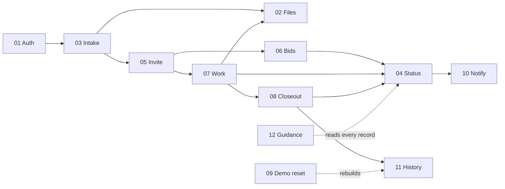

# Core Flow Design Docs

> Chain steps: **Algorithm → Pseudocode → Flowchart**, with the full
> eleven-step loop around each one. Every doc uses the same template
> ([`00-template.md`](00-template.md)), so once you have read one you can scan
> any other in a minute.

## The flows

| # | Flow | Map node | One-line purpose | Key files |
|---|---|---|---|---|
| 01 | [Auth and rate limiting](01-auth-and-rate-limiting.md) | `[A]` | Let the right person in, slow down guessing | `lib/auth/*`, `lib/actions/auth.ts` |
| 02 | [File upload and access](02-file-upload-and-access.md) | `[C]` | Store proof files so only the right people can read or delete them | `app/api/blob-upload`, `app/api/files`, `lib/blob-paths.ts` |
| 03 | [Request intake](03-request-intake.md) | `[B]` | Turn "something is broken" into a structured repair record | `lib/actions/requests.ts`, `components/NewRequestForm.tsx` |
| 04 | [Request status lifecycle](04-request-status-lifecycle.md) | `[F]` | Move a request through its states under strict rules | `lib/request-status-policy.ts` |
| 05 | [Invite and access](05-invite-and-access.md) | `[D]` | Share one request with one person, and take it back | `lib/actions/invites.ts` |
| 06 | [Bid and quote decision](06-bid-and-quote-decision.md) | `[E]` | Collect prices and record the owner's choice | `lib/actions/quotes.ts`, `lib/actions/vendor-bids.ts` |
| 07 | [Work sessions and tasks](07-work-sessions-and-tasks.md) | `[G]` | Prove when work started, paused and stopped | `lib/actions/work-sessions.ts`, `lib/actions/request-tasks.ts` |
| 08 | [Closeout and billing](08-closeout-and-billing.md) | `[H]` | Hand finished work to the owner and record what was owed | `lib/actions/closeout-submissions.ts`, `lib/actions/billing-records.ts` |
| 09 | [Investor demo reset](09-investor-demo-reset.md) | `[K]` | Keep a shared demo clean and its password private | `lib/demo/investor-seed.ts`, `app/api/cron/reset-investor-demo` |
| 10 | [Reminders and notifications](10-reminders-and-notifications.md) | `[J]` | Nudge owners about recurring care, and log every email | `app/api/cron/reminder-digest`, `lib/email.ts` |
| 11 | [Backup, restore and exports](11-backup-restore-and-exports.md) | `[I]` | Let owners take their history with them | `lib/actions/backup.ts`, `lib/pdf/*` |
| 12 | [Guidance layer](12-guidance-layer.md) | all | Compute "what should I do next?" from a record | `lib/*-guidance.ts`, `lib/owner-readiness.ts` |

## How the flows connect



## Pseudocode conventions

```text
FUNCTION name(inputs) -> output
REQUIRE condition ELSE error "message"   -- stop with an error if false
IF condition THEN ... ELSE ... END
FOR EACH item IN list ... END
WRITE table(values)                       -- one database write
LOG decision_log(action, details)         -- one append-only audit row
NOTIFY recipient(subject)                 -- sendNotification, always logged
RETURN value
```
