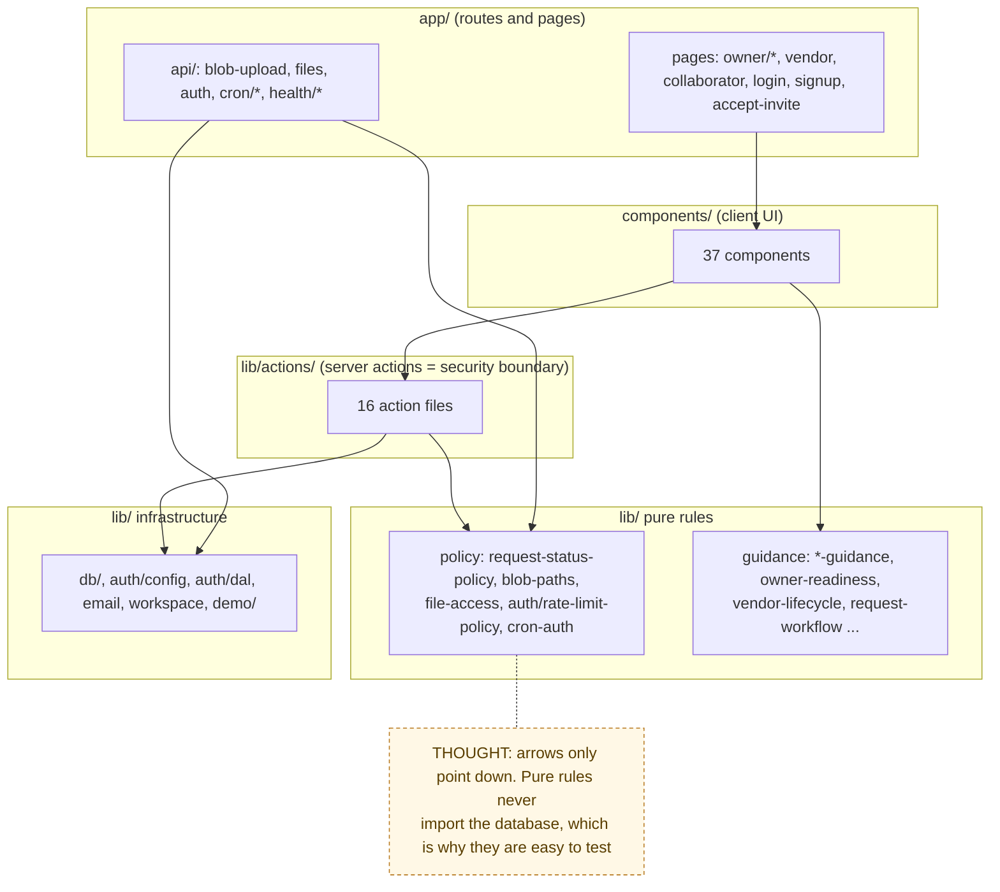

# Code Map

> Chain step: **Implementation**. Which file does what, and which flow and
> map node it belongs to. When you open a file, find it here to see which
> [flow doc](../04-algorithms/README.md) explains it.

## Layers

## By flow

### `[A]` Auth: [flow 01](../04-algorithms/01-auth-and-rate-limiting.md)
| File | Role |
|---|---|
| `lib/auth/config.ts` | Auth.js setup; `authorize()` is the single sign-in gate (rate limits + timing-safe compare) |
| `lib/auth/dal.ts` | `requireRole`, `requireAnyRole`, `roleHome` (the real authorization entry) |
| `lib/auth/rate-limit-policy.ts` | pure limits, keys, IP parsing |
| `lib/auth/rate-limit.ts` | Postgres counter (fails open) |
| `lib/auth/password.ts` | `verifyPasswordTimingSafe` |
| `lib/auth/forms.ts` | signup/profile zod schemas |
| `lib/actions/auth.ts` | `signupAction`, `loginAction`, `logoutAction`, `updateOwnerProfileAction` |
| `proxy.ts` | optimistic redirect by role (not a security boundary) |
| `app/login`, `app/signup`, `components/AuthChrome.tsx` | UI |

### `[C]` Files: [flow 02](../04-algorithms/02-file-upload-and-access.md)
| File | Role |
|---|---|
| `lib/blob-paths.ts` | build, parse and validate paths; scoped-delete checks; `fileUrlForPath`; `blobAccessMode` |
| `lib/file-access.ts` | `canReadUpload` |
| `app/api/blob-upload/route.ts` | upload proxy |
| `app/api/files/route.ts` | authorized reads |
| `lib/blob-upload-client.ts` | browser downscale + POST |
| `lib/actions/vault.ts`, `components/VaultManager.tsx` | property vault |

### `[B]` Intake: [flow 03](../04-algorithms/03-request-intake.md)
| File | Role |
|---|---|
| `lib/actions/requests.ts` | `createRequestAction`, `updateRequestAction`, `recordRequestPhotoAction`, `deleteRequestAction`, `updateCostAction` |
| `lib/actions/properties.ts` | create/delete property, export data |
| `lib/request-intake.ts`, `lib/request-submit.ts` | intake progress, upload result copy |
| `components/NewRequestForm.tsx`, `PropertyForm.tsx`, `RequestCreatedNoticeBanner.tsx` | UI |

### `[F]` Status: [flow 04](../04-algorithms/04-request-status-lifecycle.md)
| File | Role |
|---|---|
| `lib/request-status-policy.ts` | transition table and decision |
| `lib/actions/requests.ts` | `updateRequestStatusAction` |
| `lib/status-handoff.ts`, `components/StatusHandoffGuidance.tsx`, `CompletionWaiverReview.tsx` | copy and owner waiver UI |

### `[D]` Sharing: [flow 05](../04-algorithms/05-invite-and-access.md)
| File | Role |
|---|---|
| `lib/actions/invites.ts` | create, resend, cancel, accept, revoke |
| `lib/invites/links.ts`, `lib/invites/forms.ts` | link builder, form parsing |
| `app/accept-invite/page.tsx`, `components/AcceptInviteButton.tsx`, `InviteSection.tsx`, `PendingInviteControls.tsx`, `SharedAccessControls.tsx`, `CopyableInviteLink.tsx`, `InviteAcceptedBanner.tsx` | UI |

### `[E]` Quotes: [flow 06](../04-algorithms/06-bid-and-quote-decision.md)
| File | Role |
|---|---|
| `lib/actions/quotes.ts`, `lib/actions/vendor-bids.ts` | owner quotes, vendor bid |
| `lib/bid-review.ts`, `lib/vendor-bid.ts`, `lib/vendor-bid-notification.ts` | comparison, guidance, notification copy |
| `components/QuoteWorkspace.tsx`, `VendorBidPanel.tsx` | UI |

### `[G]` Work: [flow 07](../04-algorithms/07-work-sessions-and-tasks.md)
| File | Role |
|---|---|
| `lib/actions/work-sessions.ts`, `lib/work-sessions.ts` | events, proof rules |
| `lib/actions/request-tasks.ts`, `lib/project-tasks.ts` | task checklist |
| `components/WorkSessionPanel.tsx`, `WorkSessionTimeline.tsx`, `RequestTaskChecklist.tsx` | UI |

### `[H]` Closeout: [flow 08](../04-algorithms/08-closeout-and-billing.md)
| File | Role |
|---|---|
| `lib/actions/closeout-submissions.ts`, `lib/closeout-submissions.ts` | submit, review, readiness |
| `lib/actions/billing-records.ts`, `lib/billing-records.ts` | billing status |
| `components/CloseoutSubmissionPanel.tsx`, `BillingRecordPanel.tsx` | UI |

### `[K]` Operations: [flow 09](../04-algorithms/09-investor-demo-reset.md)
| File | Role |
|---|---|
| `lib/demo/investor-seed.ts`, `scripts/seed-investor-demo.ts`, `app/api/cron/reset-investor-demo/route.ts` | demo story and reset |
| `lib/cron-auth.ts` | cron bearer check |
| `app/api/health/route.ts`, `app/api/health/deep/route.ts`, `lib/health.ts` | health |
| `lib/poc-readiness.ts`, `scripts/poc-readiness.ts` | env readiness report |
| `lib/security-headers.ts`, `next.config.ts` | browser security headers |
| `scripts/migrate.ts`, `drizzle/` | migrations |

### `[J]` Automation: [flow 10](../04-algorithms/10-reminders-and-notifications.md)
| File | Role |
|---|---|
| `app/api/cron/reminder-digest/route.ts` | daily digest |
| `lib/email.ts` | `sendNotification` (always logged) |
| `lib/actions/reminders.ts`, `lib/actions/notifications.ts`, `lib/notification-guidance.ts` | reminders, test email, delivery health |
| `components/ReminderManager.tsx`, `app/owner/calendar`, `app/owner/notifications` | UI |

### `[I]` History: [flow 11](../04-algorithms/11-backup-restore-and-exports.md)
| File | Role |
|---|---|
| `lib/actions/backup.ts`, `lib/backup-guidance.ts` | backup, restore, preview |
| `lib/pdf/proofPacket.ts`, `lib/pdf/propertyHistory.ts` | PDFs |
| `components/BackupManager.tsx`, `ExportHistoryButton.tsx`, `DecisionLog.tsx`, `CommentThread.tsx` | UI |
| `lib/actions/comments.ts`, `lib/comment-guidance.ts` | request updates thread |

### All nodes: guidance ([flow 12](../04-algorithms/12-guidance-layer.md)) and shared
| File | Role |
|---|---|
| `lib/owner-readiness.ts`, `lib/helper-workspace.ts`, `lib/vendor-lifecycle.ts`, `lib/request-workflow.ts`, `lib/request-guidance.ts`, `lib/vendor-fit.ts`, `lib/vendor-profile.ts` | "what next" helpers |
| `lib/utils.ts` | enums, costs, completion rule, reminders, `.ics` |
| `lib/workspace.ts`, `lib/workspace-model.ts` | default workspace and billing foundation |
| `lib/db/schema.ts`, `lib/db/index.ts` | schema and lazy DB client |

## Scripts

| Script | npm command | Purpose |
|---|---|---|
| `scripts/seed.ts`, `seed-demo.ts` | `db:seed`, `db:seed:demo` | local demo data |
| `scripts/seed-investor-demo.ts` | `db:seed:investor` | curated demo (needs `INVESTOR_DEMO_PASSWORD`) |
| `scripts/ux-*-smoke.ts` | `ux:public`, `ux:owner`, `ux:owner-flow`, `ux:helper`, `ux:invite`, `ux:full-loop` | browser smoke loops |
| `scripts/screenshot.ts` | `npx tsx scripts/screenshot.ts` | README screenshots |
| `scripts/poc-readiness.ts` | `poc:ready` | env readiness |
| `scripts/migrate.ts` | `db:migrate` | apply migrations |
