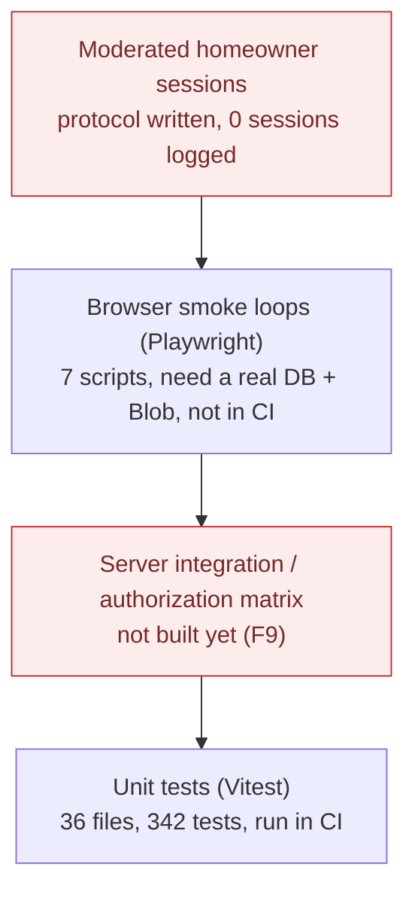
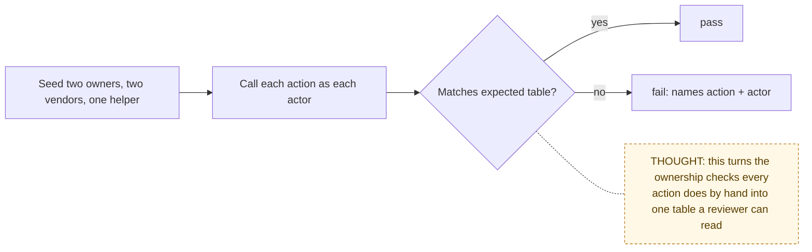

# Test Strategy

> Chain step: **Tests**. What proves each flow works, where the gaps are, and
> the plan to close them. The step-by-step checklists live in the existing
> [QA checklist](../QA_CHECKLIST.md) and [user testing protocol](../USER_TESTING.md).

## The test pyramid today



| Layer | Tool | Runs where | What it proves |
|---|---|---|---|
| Unit | Vitest | CI via `npm run verify` | Pure rules: status policy, path validation, file access, rate-limit math, cron auth, guidance copy, readiness |
| Smoke | Playwright scripts | manually, against local or hosted | Real loops through the UI: signup → request → upload; invite → accept; full owner/vendor/collaborator loop with closeout revision |
| Integration | — | — | **Missing:** calling server actions as the wrong user against a real database |
| Human | [USER_TESTING.md](../USER_TESTING.md) | moderated sessions | Is the next step obvious? **0 sessions logged** |

## Coverage by flow

| Flow | Unit | Smoke | Gap |
|---|---|---|---|
| 01 Auth | rate-limit policy, forms | all smokes sign in | `authorize()` against a DB |
| 02 Files | blob-paths, file-access, readiness | owner-flow upload | `/api/files` with a real session |
| 03 Intake | intake, submit, guidance | owner-flow | cross-owner property rejection |
| 04 Status | **request-status-policy**, status-handoff | full-loop | vendor call against a DB |
| 05 Invite | invite-claim, invite-forms, links | invite, **invite-signup**, full-loop | access-removal smoke |
| 06 Quotes | bid-review, vendor-bid, notification | full-loop | cross-vendor isolation |
| 07 Work | work-sessions, project-tasks | full-loop | foreign proof photo |
| 08 Closeout | closeout-submissions, billing-records | full-loop (revision loop) | partial-failure behavior |
| 09 Demo | investor-demo, cron-auth | manual | — |
| 10 Notify | notification-guidance, utils, cron-auth | — | digest query |
| 11 History | backup-guidance, decision-log | — | malformed restore |
| 12 Guidance | 13 test files | — | — |

## Plan: the authorization matrix (roadmap P3, closes F9)

Run every server action as every relationship to the record, against a real
Postgres started in CI (a service container or a Neon branch):

```text
FOR EACH action IN lib/actions/*
  FOR EACH actor IN {owner, other owner, assigned vendor, unassigned vendor, collaborator, signed out}
    result = CALL action AS actor ON a seeded record
    ASSERT result = EXPECTED[action][actor]      -- allowed, or rejected with no DB change
```



## Commands

```bash
npm run verify        # lint, typecheck, unit tests, audit, drift check, build (CI runs this)
npm test              # unit tests only
npm run ux:full-loop  # full three-role loop against APP_URL (needs DB + Blob + secrets)
npm run poc:ready     # environment readiness, including BLOB_ACCESS
```
