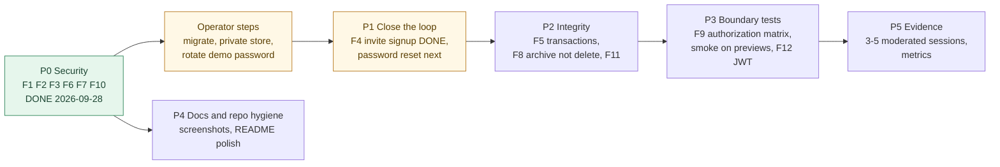

# Findings Register and Roadmap

> Chain step: **Refinement**. Every engineering and security finding from the
> [2026-09-28 repo review](../review/2026-09-28-repo-review.md), its current
> status, and the plan. UX findings stay in [UI_UX_FINDINGS.md](../UI_UX_FINDINGS.md).
> Full analysis of each finding (who it affects, why it matters, the fix, why
> that fix, and alternatives) is in the review ([PDF](../review/2026-09-28-repo-review.pdf)).

## Register

| ID | Severity | Finding | Map node | Status | Where fixed / planned |
|---|---|---|---|---|---|
| F1 | 🔴 Critical | Client-supplied blob paths let any account delete other accounts' files | `[C]` | ✅ Fixed 2026-09-28 | [flow 02](../04-algorithms/02-file-upload-and-access.md), [change record §1](../09-changes/2026-09-28-p0-security.md#1-uploads-and-deletes-f1-f10) |
| F2 | 🔴 Critical | All uploads public forever; revoking access did not revoke files | `[C]` | ✅ Fixed in code · ⏳ operator must switch to a Private store | [flow 02](../04-algorithms/02-file-upload-and-access.md), [runbook step 3](../08-operations/p0-rollout-runbook.md) |
| F3 | 🔴 Critical | Vendors could complete, waive, archive, reopen | `[F]` | ✅ Fixed 2026-09-28 | [flow 04](../04-algorithms/04-request-status-lifecycle.md) |
| F4 | 🔴 Critical (product) | Invited vendors/helpers cannot create an account | `[A]` `[D]` | ✅ Fixed 2026-10-25 (signup from invite, email + role locked) | [flow 05](../04-algorithms/05-invite-and-access.md), [change record](../09-changes/2026-10-25-f4-invite-signup.md) |
| F5 | 🟠 High | Multi-step writes are not atomic | `[D]` `[E]` `[G]` `[H]` | ⏳ Open, P2 | [flow 08](../04-algorithms/08-closeout-and-billing.md) |
| F6 | 🟠 High | No login/signup limits; unknown emails answer faster | `[A]` | ✅ Fixed 2026-09-28 (reset and verification remain P1) | [flow 01](../04-algorithms/01-auth-and-rate-limiting.md) |
| F7 | 🟠 High | Demo password published in README | `[K]` | ✅ Fixed · ⏳ operator must rotate | [flow 09](../04-algorithms/09-investor-demo-reset.md) |
| F8 | 🟠 High | Decision log deleted with its request | `[I]` | ⏳ Open, P2 | [flow 11](../04-algorithms/11-backup-restore-and-exports.md), [data model](../03-design/data-model.md) |
| F9 | 🟠 High | Tests cover guidance, not the server boundary | all | 🟡 Partly fixed: new P0 rules are unit-tested; authorization matrix is P3 | [test strategy](../06-testing/test-strategy.md) |
| F10 | 🟡 Medium | Empty file type skipped the allowlist | `[C]` | ✅ Fixed 2026-09-28 | [flow 02](../04-algorithms/02-file-upload-and-access.md) |
| F11 | 🟡 Medium | Several quotes can be approved at once | `[E]` | ⏳ Open | [flow 06](../04-algorithms/06-bid-and-quote-decision.md) |
| F12 | 🟡 Medium | Small items (see below) | `[A]` `[B]` `[J]` | mixed | below |

**F12 breakdown**

| Item | Status |
|---|---|
| Request edit did not validate category or urgency | ✅ Fixed 2026-09-28 |
| Cron routes open when `CRON_SECRET` is missing | ✅ Fixed 2026-09-28 (production fails closed) |
| Broken reference to a sibling repo's `ARCHITECTURE.md` in `lib/blob-paths.ts` | ✅ Removed 2026-09-28 |
| JWT role never refreshed; no session revocation | ⏳ Open, P3 |
| About 20 MB of PNG screenshots in git, in two folders | ⏳ Open, P4 (move before/after pairs to an archive or LFS) |
| Local seed password default `password123` | ✅ Fixed 2026-10-08: `db:seed` refuses a hosted DB unless `SEED_PASSWORD` is set (12+ chars, not the default) |

## Roadmap

| Phase | Items | Size | Exit criteria |
|---|---|---|---|
| **P0** ✅ | F1, F2 (code), F3, F6, F7, F10, part of F12 | done | 34 test files / 318 tests green, build green |
| **Ops** | run migration 0012; create a Private Blob store; set `BLOB_ACCESS=private`; set `INVESTOR_DEMO_PASSWORD` and reseed | 1 hour | `npm run poc:ready` shows File privacy = ready |
| **P1** | ✅ F4 signup from invite (2026-10-25); ⏳ password reset | 1–2 days left | a brand-new vendor can go from email to bid with no seed script (✅ proven by `ux:invite-signup`) |
| **P2** | F5 `neon-serverless` + `db.transaction`; F8 archive instead of delete, insert-only log; F11 auto-decline | 2 days | approval cannot half-apply; history survives deletion |
| **P3** | F9 authorization matrix in CI; `ux:full-loop` on previews; F12 JWT role refresh | 3 days | every action × actor pair is asserted |
| **P4** | screenshot archive, README polish | 1 day | repo clone under 10 MB of images |
| **P5** | moderated sessions with findings logged | 1–2 weeks | 5 sessions, metrics from [problem.md](../01-problem/problem.md#how-we-will-know-it-is-solved) |
