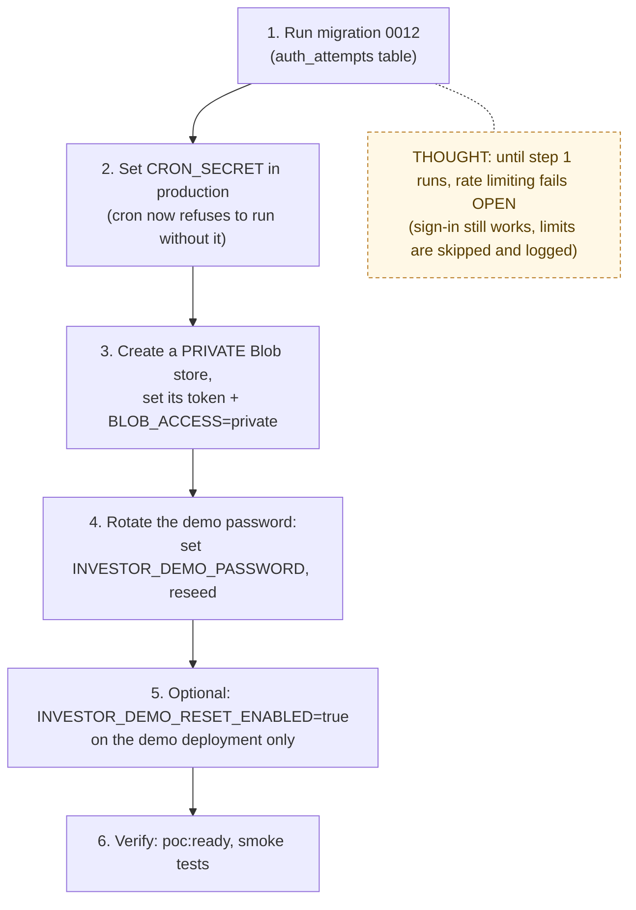

# P0 Security Rollout Runbook

> Operations for the 2026-09-28 security release
> ([change record](../09-changes/2026-09-28-p0-security.md)). The code is safe
> to deploy before these steps; each step turns on one more protection.
> Do them in order.



## 1. Apply the migration

```bash
# with DATABASE_URL pointing at the target (production) database
npm run db:migrate
```

This creates `auth_attempts` and its index. **Until it runs,** login and
signup still work, rate limiting is skipped, and `[rate-limit] check failed`
is logged. Nothing breaks.

## 2. Make sure `CRON_SECRET` is set in production

Vercel → Project → Settings → Environment Variables → `CRON_SECRET` (32+
random characters). Without it, `/api/cron/*` now answers **503** in production
instead of running unauthenticated.

## 3. Switch uploads to private storage (closes F2)

1. Vercel → Storage → **Create Blob store** → access **Private**.
2. Copy its read/write token into `BLOB_READ_WRITE_TOKEN` (Production and Preview).
3. Add `BLOB_ACCESS=private` (since 2026-10-08 this is also the default when the variable is unset).
4. Redeploy.

What happens to existing files: rows created before this release keep their
old absolute public URLs and keep displaying from the old public store. New
uploads go to the private store and are served only through `/api/files`.
Deleting an old record tries to delete its file using the new token. That
fails quietly for files in the old store, so those files stay there. When
you are ready, remove the old public store in Vercel. Optionally copy legacy
files first (a later script).

> ⚠️ Do **not** set `BLOB_ACCESS=private` while the token still points at the
> old **public** store. Uploads would fail with an access-mode error.
>
> ⚠️ Since 2026-10-08 the same failure happens if `BLOB_ACCESS` is simply
> **unset** against a public store, because the default is now `private`.
> Before deploying that change to an environment that still uses the public
> store, set `BLOB_ACCESS=public` there explicitly (or finish this step first).

## 4. Rotate the demo password (closes F7)

The old password is in git history, so treat it as public.

```bash
# .env.local (and Vercel env for the demo deployment)
INVESTOR_DEMO_PASSWORD=<new 12+ character value, shared privately>

npm run db:seed:investor   # rebuilds the demo accounts with the new password
```

## 5. Nightly demo reset (optional)

On the deployment that hosts the demo **only**:
`INVESTOR_DEMO_RESET_ENABLED=true`. The `vercel.json` cron calls
`/api/cron/reset-investor-demo` daily at 08:00 UTC. Everywhere else the route
answers `skipped`.

## 6. Verify

```bash
npm run poc:ready        # expect "File privacy: ready" once BLOB_ACCESS=private
APP_URL=<url> npm run ux:owner-flow   # upload now returns /api/files URLs
APP_URL=<url> npm run ux:full-loop    # vendor sees only working-state status options
```

Manual spot checks:

- As a vendor, the status dropdown shows only Waiting, Scheduled, In Progress and Needs Review.
- Sign in with a wrong password 5 times in a row; the 6th attempt says "Too many attempts".
- Open a photo URL while signed out; you get `401`. Signed in as an unrelated owner, you get `404`.

## Rollback

Every step is config, except the migration, which only adds a table. To roll
back file privacy, point `BLOB_READ_WRITE_TOKEN` back at the public store and
set `BLOB_ACCESS=public` explicitly (since 2026-10-08 an unset value means
`private`, so *unsetting* it no longer rolls back). The code handles both
modes, but `npm run poc:ready` blocks `public` on a hosted `APP_URL`.
Files uploaded while the private store was active stay in that store,
so they will not display after a rollback until you switch back.
