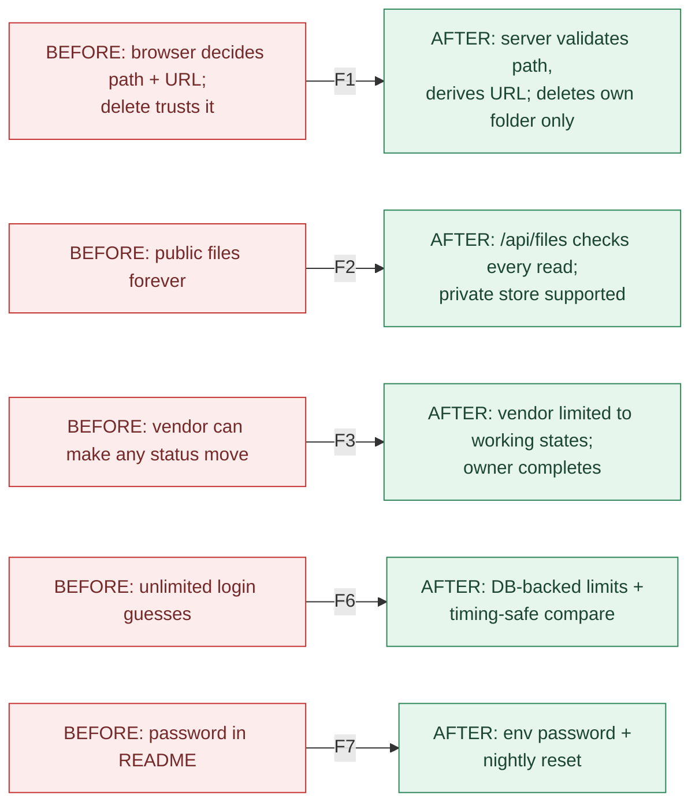
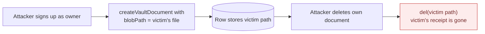
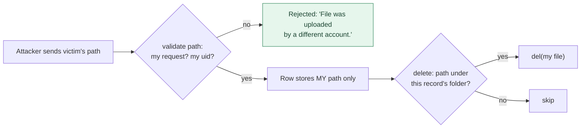
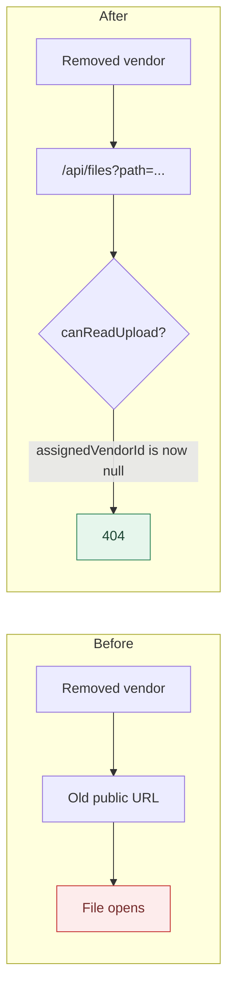
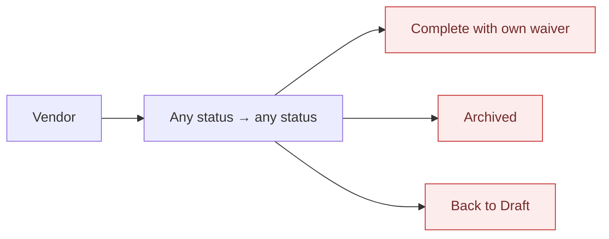
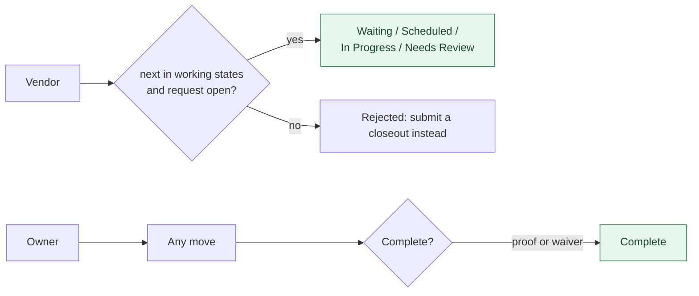
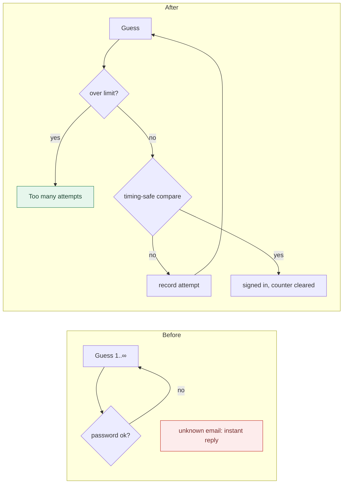
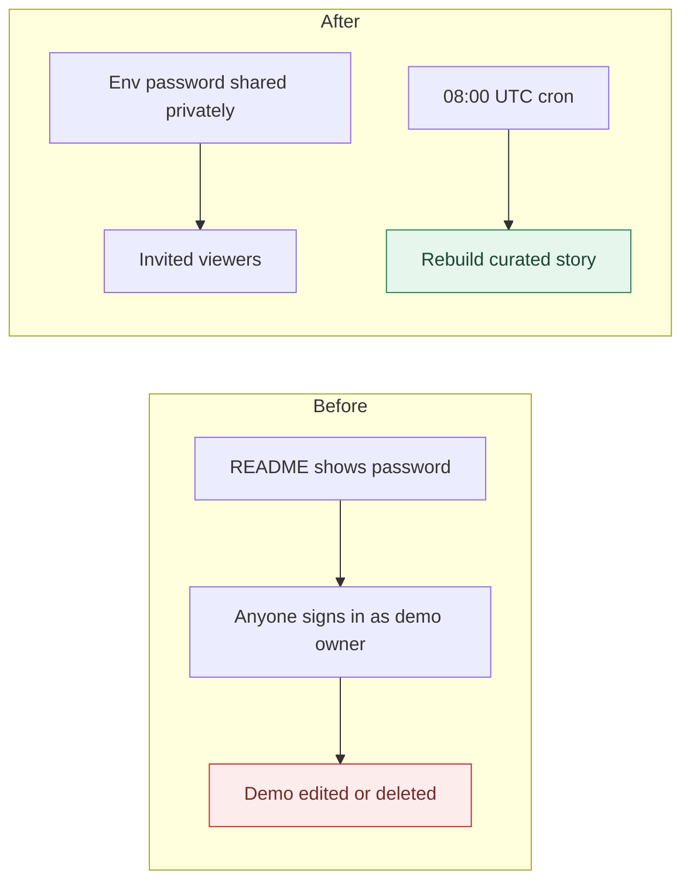

# Change Record: P0 Security (2026-09-28)

> Chain step: **Refinement**. What changed, from **this** to **that**, shown
> as algorithm, pseudocode and flowchart for both sides. Operator steps are
> in the [rollout runbook](../08-operations/p0-rollout-runbook.md).
> Findings closed: **F1, F2 (code), F3, F6, F7, F10**, plus parts of **F12**.

## Summary

| # | Change | Finding | Who was at risk | Before | After |
|---|---|---|---|---|---|
| 1 | Uploads and deletes | F1, F10 | every account holder | server stored whatever path and URL the browser sent, then deleted that path later | server validates the path against record, type and uploader, and derives the URL; deletes only touch the record's own folder |
| 1b | File reads | F2 | homeowners (privacy) | raw public Blob URLs, readable forever by anyone holding one | `/api/files` checks access on every read; private store supported |
| 2 | Status transitions | F3 | homeowners (control) | owner or vendor: any status → any status, vendor could waive | transition table: owner any; vendor only working states; only owner completes, waives, archives, reopens |
| 3 | Login and signup limits | F6 | every account holder | unlimited guesses; unknown email answered faster | 5 per email / 20 per IP per 15 min; 5 signups per IP per hour; timing-safe compare |
| 4 | Cron routes | F12 | operator | open to anyone when `CRON_SECRET` unset | production fails closed (503) |
| 5 | Demo password and reset | F7 | the operator, and investors' trust | password in README and code | env-only password; nightly opt-in reset |

**By the numbers:** 44 files in the code commit (27 modified, 17 added, including the migration snapshot), 6 new test files
(32 tests). The suite went from 28 files / 286 tests to **34 files / 318
tests**, all passing. Lint, typecheck, schema-drift check and production
build all pass. One migration (`0012`) adds one table.



---

## 1. Uploads and deletes (F1, F10)

### Before: algorithm
1. The browser builds a path and uploads the file. The route checks the path *prefix* (at least 4 segments) and stores it **publicly**, with no random suffix. Files with an empty type skip the allowlist.
2. The browser calls `recordRequestPhotoAction(requestId, type, url, blobPath)`, passing **both** the URL and the path.
3. The action checks the user may edit the request, then stores `url` and `blobPath` **exactly as sent**.
4. Later, deleting the request calls `del(blobPath)` on every stored path.

### Before: pseudocode
```text
recordRequestPhoto(requestId, type, url, blobPath):
  REQUIRE me is owner or assigned vendor of requestId
  WRITE request_photos(requestId, type, url, blobPath)        -- trusted from browser

deleteRequest(requestId):
  FOR EACH photo: DEL(photo.blobPath)                          -- could be ANY blob
```

### Before: flowchart (the attack)


### After: algorithm
1. The upload route rejects empty or unknown types. It requires an **exact** path shape (5 or 4 segments, no dot or empty segments), a known type folder, uid = me, and ownership. It stores with the configured access mode and a **random suffix**, and returns `/api/files?path=…`.
2. The browser calls `recordRequestPhotoAction(requestId, type, blobPath)`. There is **no URL parameter**.
3. The action validates the path: same request, same type folder, uploaded by me. It stores `url = fileUrlForPath(blobPath)`.
4. Deletes filter each stored path with `isRequestScopedPath` / `isPropertyScopedPath` before calling `del`.

### After: pseudocode
```text
recordRequestPhoto(requestId, type, blobPath):
  REQUIRE me is owner or assigned vendor of requestId
  REQUIRE type IN {before, after, receipt, other}
  REQUIRE validateRequestUploadPath(blobPath, requestId, uid = me, type)
  WRITE request_photos(requestId, type, url = "/api/files?path=" + encode(blobPath), blobPath)

deleteRequest(requestId):
  FOR EACH photo WHERE isRequestScopedPath(photo.blobPath, requestId): DEL(photo.blobPath)
```

### After: flowchart


**Why this way:** the path already encodes record, type and uploader, so
validating it gives the same guarantee as a new "uploads" table, with no
migration and no extra write per upload. **Files:** `lib/blob-paths.ts`,
`app/api/blob-upload/route.ts`, `lib/actions/{requests,vault,quotes,properties}.ts`,
6 client components. **Tests:** `__tests__/blob-paths.test.ts`.

## 1b. File reads (F2)

| | Before | After |
|---|---|---|
| Stored URL | `https://<store>.public.blob.vercel-storage.com/...` | `/api/files?path=...` |
| Who can open it | anyone with the URL, forever | owner / assigned vendor / collaborator (request); owner (vault), checked on **every** read |
| After access is removed | still opens | 404 |
| Store mode | public only | `BLOB_ACCESS=private` (recommended) or `public` |

```text
BEFORE  readFile(url): RETURN public CDN response                 -- no check at all
AFTER   readFile(path, session):
          REQUIRE session                                         ELSE 401
          record = FIND request/property named by path
          REQUIRE canReadUpload(parse(path), me, record)          ELSE 404
          RETURN GET(path, access = BLOB_ACCESS, token).stream
```



**Files:** `app/api/files/route.ts`, `lib/file-access.ts`, `lib/poc-readiness.ts`.
**Tests:** `__tests__/file-access.test.ts`, `__tests__/poc-readiness.test.ts`.

## 2. Status transitions (F3)

### Before: algorithm and pseudocode
1. The caller must be the owner or assigned vendor, and the status must be one of the eight.
2. If the target is Complete without proof, a waiver reason from **whoever called** is enough.
3. Write the status and log. Even the same status is logged again.

```text
updateStatus(requestId, next, waiver):
  REQUIRE me IN {owner, assigned vendor}
  REQUIRE next IN STATUSES
  IF next = Complete AND NOT proof THEN REQUIRE waiver != ""     -- vendor can waive
  WRITE status = next; LOG status_changed | completion_waived     -- any → any
```



### After: algorithm and pseudocode
1. Same identity check. The role for the decision is owner if the caller owns it, else vendor.
2. `evaluateStatusChange` applies the table: owner → any; vendor → only `{Waiting, Scheduled, In Progress, Needs Review}` from an open request; same status → no-op.
3. `Complete` is owner-only, so the waiver is always the owner's.

```text
updateStatus(requestId, next, waiver):
  REQUIRE me IN {owner, assigned vendor}
  d = evaluateStatusChange(role, current, next, proof, waiver)
  REQUIRE d.ok ELSE d.error
  IF d.noop THEN RETURN
  WRITE status = next; LOG d.logAction
```



**UI change:** the vendor dropdown now lists only legal moves
(`statusOptionsFor`). The vendor waiver dialog is removed, and a line explains
that the owner completes after the closeout. Status errors now show for any
failed change, not only during a waiver.
**Files:** `lib/request-status-policy.ts`, `lib/actions/requests.ts`,
`components/VendorPortal.tsx`, `lib/status-handoff.ts`.
**Tests:** `__tests__/request-status-policy.test.ts`.

## 3. Login and signup limits (F6)

### Before
```text
authorize(email, password):
  user = FIND users(email)
  IF NOT user THEN RETURN null            -- fast path: reveals the email is unknown
  RETURN bcrypt.compare(password, user.hash) ? user : null     -- unlimited attempts
```

### After
```text
authorize(email, password, request):
  ip = clientIp(request)
  IF over(LOGIN_EMAIL 5/15m, email) OR over(LOGIN_IP 20/15m, ip) THEN RETURN null
  user = FIND users(email)
  ok = verifyPasswordTimingSafe(password, user?.hash)      -- dummy compare if no user
  IF NOT ok THEN record(email); record(ip); RETURN null
  clear(email); RETURN user

signup: IF over(SIGNUP_IP 5/60m, ip) THEN "Too many attempts"; record(ip); ...
```



**Why in `authorize()` and not just the form:** Auth.js exposes
`/api/auth/callback/credentials` directly, so a form-only check could be
bypassed. **Why Postgres:** serverless instances share no memory, and this
avoids a new paid dependency. **Why fail open:** a missing table or a DB
hiccup should not lock every user out. **Files:** `lib/auth/{rate-limit-policy,rate-limit,password,config}.ts`,
`lib/actions/auth.ts`, `lib/db/schema.ts`, `drizzle/0012_*`.
**Tests:** `__tests__/rate-limit-policy.test.ts`.

## 4. Cron routes (part of F12)

```text
BEFORE  IF CRON_SECRET set AND header != "Bearer " + secret THEN 401   -- unset → open to all
AFTER   authorizeCronRequest(header):
          IF secret unset THEN RETURN production ? 503 : ok
          RETURN header = "Bearer " + secret ? ok : 401
```

**Files:** `lib/cron-auth.ts`, both cron routes. **Tests:** `__tests__/cron-auth.test.ts`.

## 5. Demo password and nightly reset (F7)

| | Before | After |
|---|---|---|
| Password source | hardcoded in `scripts/seed-investor-demo.ts` | `INVESTOR_DEMO_PASSWORD` env (12+ characters) |
| Published in | README, DEPLOYMENT.md, console output | nowhere (the old one is retired by reseeding) |
| Visitor changes | persist until someone reseeds by hand | wiped nightly when `INVESTOR_DEMO_RESET_ENABLED=true` |
| Code sharing | script only | `lib/demo/investor-seed.ts`, used by the script and the cron |



**Files:** `lib/demo/investor-seed.ts`, `scripts/seed-investor-demo.ts`,
`app/api/cron/reset-investor-demo/route.ts`, `vercel.json`, `README.md`,
`docs/DEPLOYMENT.md`, `.env.local.example`. **Tests:** `__tests__/investor-demo.test.ts`.

## What was NOT changed (on purpose)

- **F4** (invite signup), **F5** (transactions), **F8** (log survives delete), **F11** (auto-decline quotes): these are P1/P2, planned in the [roadmap](../07-refinement/findings-and-roadmap.md).
- Legacy rows with absolute public URLs keep working and were not rewritten.
- Browser smoke scripts were not run in this change: they need the hosted database and Blob store. Run them after the [rollout steps](../08-operations/p0-rollout-runbook.md#6-verify).
