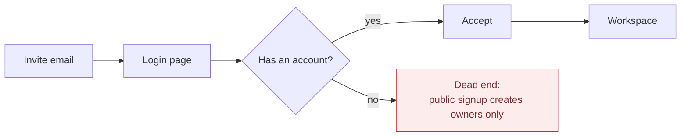
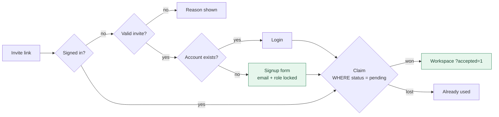

# Change Record: F4 Invite Signup (2026-10-25)

> Chain step: **Refinement**. What changed, from **this** to **that**, as
> algorithm, pseudocode and flowchart. Full design: [flow 05](../04-algorithms/05-invite-and-access.md).
> Finding closed: **F4**, invited vendors and helpers could not create an account.

## Summary

| | Before | After |
|---|---|---|
| Signed-out invitee with no account | Redirected to login → dead end (no vendor/helper signup existed) | Sees "Create your vendor/helper account" on the invite page |
| Email and role of the new account | n/a | Taken from the invite row; the form has no email or role field |
| Signed-out invitee with an account | Login, then auto-claim | Unchanged |
| Invalid invite while signed out | Sent to login first, then told it was invalid | Told immediately; no form |
| Two accepts at once | Both could "succeed" (last write wins) | Conditional claim: exactly one wins |
| Invite rules | Duplicated in the page and the action (messages had drifted) | One pure module, `lib/invites/claim.ts` |
| Who could run the full loop | Only seeded demo accounts | Any real person with an invite |

**By the numbers:**
- 3 new files: `lib/invites/claim.ts`, `components/InviteSignupForm.tsx`, `scripts/ux-invite-signup-smoke.ts`.
- 1 new test file: 11 tests. The suite is now 36 files / 342 tests, all passing.
- No schema change, no migration.

## Before

```text
acceptInvitePage(inviteId, session):
  IF NOT session THEN REDIRECT /login?callbackUrl=…        -- no way to create a vendor account
  ...checks..., auto-accept

acceptInviteAction(inviteId):
  checks (own copies of the messages)
  WRITE requests: assign user                               -- write 1
  WRITE invites: status = accepted                          -- write 2, unconditional
  LOG invite_accepted
```



## After

```text
acceptInvitePage(inviteId, session):
  IF NOT session THEN
    entry = signedOutInviteEntry(invite, accountExists(invite.email))
    invalid -> message · login -> REDIRECT /login · signup -> InviteSignupForm

signupFromInviteAction(inviteId, name, password):
  validate name + password; signup rate limit
  re-check invite; REQUIRE no account for invite.email
  user = WRITE users(email = invite.email, role = invite.role, ...)
  claimInviteForUser(invite, user.id, viaSignup = true)
  signIn -> /vendor or /collaborator ?accepted=1

claimInviteForUser(invite, userId):
  n = UPDATE invites SET accepted WHERE id AND status = pending    -- atomic guard
  IF n = 0 THEN "already used"
  WRITE requests: assign user; LOG invite_accepted
```



## Why this way

| Option | How | Pros | Cons | Chosen? |
|---|---|---|---|---|
| **A. Signup from invite, email + role locked** | form on the accept page; server reads email/role from the invite | only invited people can register as helpers; no spam accounts; reuses accept logic | invitee still sets a password | ✅ |
| B. Magic-link sign-in | email a one-time link for every login | no password; proves inbox ownership | needs reliable email for every login; more moving parts | later, optional |
| C. Public vendor signup with a role picker | `/signup?role=vendor` | simplest | anyone can become a "vendor"; weakens the privacy story | ❌ |

## Verification

1. `npm run verify`: lint, typecheck, 36 files / 342 tests, audit, schema drift, build.
2. Ran the app against a local Postgres 16 behind a minimal Neon-HTTP stand-in, so the **real** `@neondatabase/serverless` driver and all 13 migrations ran unchanged:
   - `npm run ux:invite-signup`: new vendor and new helper sign up from their links and land in their workspaces; the database shows the right role, the accepted invite, and `viaSignup: true`.
   - `npm run ux:invite`: existing accounts still log in from invites.
   - `npm run ux:public`: public pages unchanged.
   - Live checks: used, expired and unknown invites show a message and no form; an existing account is redirected to login.
   - P0 re-checks: the 6th login attempt is blocked even with the right password; `/api/files` answers 401 when signed out.

New screen: [`screenshots/10-invite-signup.png`](../../screenshots/10-invite-signup.png)
