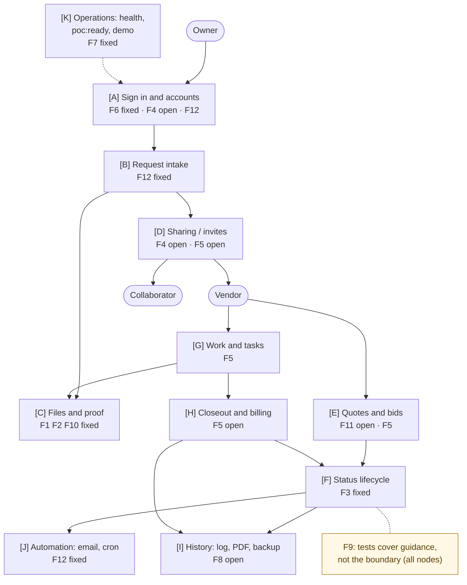
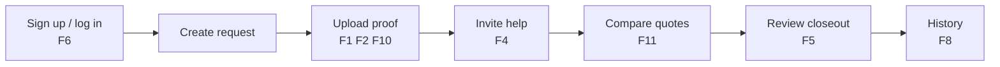
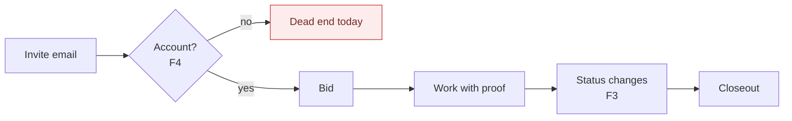
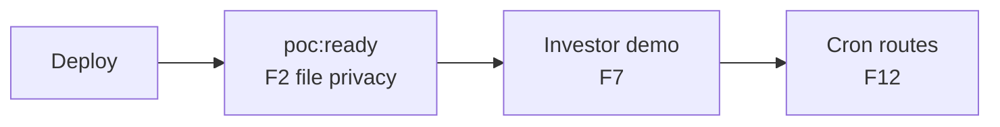
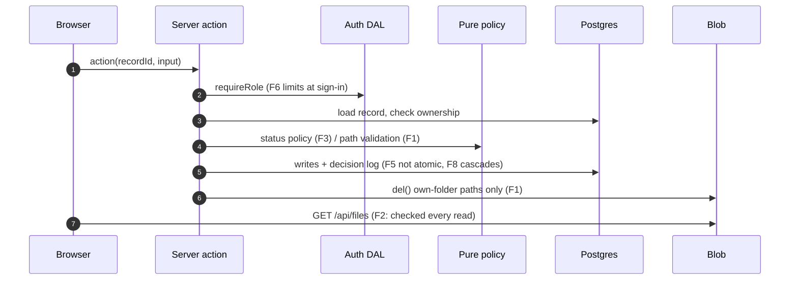
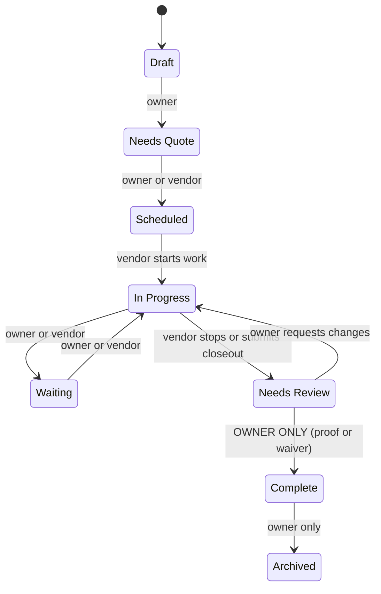
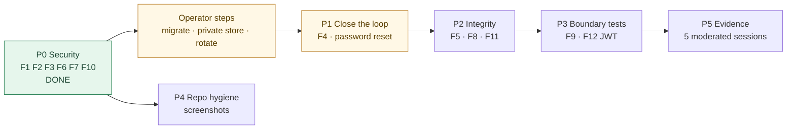

# TurnFlow Home — Repository Review

**Date:** 2026-09-28 · **Scope:** the whole repository, end to end · **Reviewed at:** `main` @ `4c9b4dc` (before fixes); P0 fixes landed on `main` the same day
**Prepared for:** Carlos Sanchez Gonzalez · **Companion docs:** [docs/README.md](../README.md)

---

## How to use this report

This report is built so you can **find anything in the repo from it**:

- Every finding has an ID (**F1–F12**), a **map node** (`[A]`–`[K]`) on the system map below, a **lane** (owner, vendor, collaborator, operator), and exact **file paths**.
- For each finding you get: who it affects, which loop it belongs to, where it sits in the big picture, why it matters, how it was or will be fixed and **why that way**, and **at least two alternative options** with trade-offs.
- Status marks: ✅ fixed on 2026-09-28 · ⏳ open, with its roadmap phase.

| Section | Page topic |
|---|---|
| 1 | What the project is |
| 2 | What is very good and good |
| 3 | The system map (high level → detailed), with every finding pinned |
| 4 | Findings F1–F12 in detail |
| 5 | Plan and status |
| 6 | Investor readiness |
| 7 | Documentation changes made |

---

## 1. What the project is

**TurnFlow Home** is a homeowner-first maintenance workspace. Each property
gets one shared record of repair requests, proof photos, quotes, costs,
decisions, documents and reminders. Vendors and helpers are invited to **one
request at a time** and see only that request.

| Role | What they do |
|---|---|
| **Owner** | sign up, add properties, create requests (safety checklist + photos), invite help, compare quotes, plan tasks, review closeout, record billing, keep a vault, calendar, PDFs and backups |
| **Vendor** | accept an invite, bid, record work sessions with proof, update tasks, submit closeout |
| **Collaborator** | accept an invite, see the shared request, add updates |

**Stack:** Next.js 16 (App Router, Server Actions), Neon Postgres + Drizzle
(13 migrations, 21 tables), Auth.js v5 (credentials, JWT), Vercel Blob,
Resend, Vercel Cron, Vitest, and Playwright smoke scripts. About 25,000 lines
across `app/`, `components/`, `lib/`, `scripts/` and `__tests__/`. This is the
fourth iteration; the first was a Firebase static site.

---

## 2. What is very good and good

**Very good**

1. **Real server-side trust boundary.** Every action follows the same pattern: role check (`lib/auth/dal.ts`), load the record, compare ownership (`ownerId` / `assignedVendorId` / `collaboratorId`). `proxy.ts` is only a fast redirect, and the code comments say so.
2. **Strict verify gate in CI.** `npm run verify` runs lint, typecheck, tests, production dependency audit, schema-drift check and production build.
3. **`poc:ready` checks env var values, not just presence.** It rejects placeholder Blob tokens, and now reports file privacy too.
4. **Audit trail by design.** The decision log plus the [requirements/event matrix](../USER_REQUIREMENTS_EVENT_MATRIX.md) tie each requirement to the event that proves it.
5. **Completion gating is enforced on the server,** not just in the UI.
6. **Honest build log:** 117 entries, each with Changed / Validation / Follow-Up.

**Good**

- Open-redirect guard on login; zod validation on forms.
- Invites expire, match on email and role, and can be resent, canceled or revoked.
- Email falls back to log-only, every attempt is logged, and there is an owner test-email action.
- Deep health endpoint with its own secret.
- Product discipline: "not a property-management platform".
- Browser smoke scripts cover the full three-role loop, including closeout revision.

---

## 3. The system map (high level → detailed)

### 3.1 Level 0 — the whole product, with every finding pinned

### 3.2 Level 1 — lanes (where each finding touches a person)

**Owner lane**

**Vendor lane**

**Operator lane**

### 3.3 Level 2 — one click through the code (where the boundary is)

### 3.4 Level 2 — the request lifecycle after the fix

The full maps, with a flow doc per node, are in
[`docs/00-overview/system-map.md`](../00-overview/system-map.md) and
[`docs/04-algorithms/`](../04-algorithms/README.md).

---

## 4. Findings in detail

Reading key for each finding:
**Who** = people affected · **Loop** = map node and lane · **Big picture** = why it matters for the product · **Fix** = what was done or is planned, and why that way · **Options** = alternatives considered.

### F1 — Any account could delete other accounts' files 🔴 ✅ fixed

| | |
|---|---|
| **Where** | `[C] Files` · `lib/actions/requests.ts` (`recordRequestPhotoAction`, `deleteRequestAction`), `lib/actions/vault.ts`, `lib/actions/quotes.ts`, `lib/actions/properties.ts` |
| **Who** | Every account holder. The attacker only needs a free owner signup and a file path or URL; vendors who worked for several owners already had those. |
| **Loop** | Owner lane: upload proof → delete record. Vendor lane: upload work proof. |
| **Big picture** | Proof is the product. A record whose receipts can vanish is not a record. |
| **Why important** | Silent, permanent data loss, and it cannot be traced back to the attacker in the victim's own log. |

**How it worked:** the browser sent `url` and `blobPath`; the server stored
them as-is; deleting the row called `del(blobPath)`.

**Fix (done):** the server validates every path (exact shape, this record,
this type folder, uploader = me) and **derives** the URL. Deletes only touch
paths under the record's own folder. See
[change record §1](../09-changes/2026-09-28-p0-security.md#1-uploads-and-deletes-f1-f10).

**Why this way:** the path already encodes record, type and uploader, so
validating it gives the same guarantee as new infrastructure, with no
migration, no extra write per upload, and it is testable as a pure function.

| Option | How | Pros | Cons |
|---|---|---|---|
| **A. Path validation (chosen)** | pure validators + scoped deletes | no migration; small diff; unit-testable | depends on path conventions staying stable |
| B. Server-issued upload IDs | `uploads` table; actions accept only an ID | strongest binding; tracks orphans | new table and migration; one extra write per upload |
| C. Never delete blobs; lifecycle cleanup job | stop calling `del()` in actions; nightly job deletes unreferenced blobs | removes the attack entirely | storage grows; needs a job and a listing pass |

### F2 — All uploads were public forever 🔴 ✅ fixed in code (operator step pending)

| | |
|---|---|
| **Where** | `[C] Files` · `app/api/blob-upload/route.ts` (`access: "public"`), components rendering `photo.url` |
| **Who** | Homeowners (photos inside the home, receipts, warranties), plus collaborators and vendors whose uploads are also exposed |
| **Loop** | Every lane that views files. Revoking a vendor did not revoke their saved URLs. |
| **Big picture** | "Share only the right request" is the headline promise, and public files contradict it. |
| **Why important** | Privacy exposure that grows with every upload and cannot be undone for already-leaked URLs. |

**Fix (done in code):** new `/api/files` route checks `canReadUpload` on
**every** read (owner / assigned vendor / collaborator; vault owner-only),
streams with the server token, and answers 404 for both missing and forbidden.
Uploads use `BLOB_ACCESS` (private recommended) and a random suffix;
`poc:ready` warns until it is private. **Operator:** create a Private store
([runbook step 3](../08-operations/p0-rollout-runbook.md)).

**Why this way:** one authorization rule for reads, reusing the same path
parsing as writes. It is config-switchable, so an existing public store keeps
working on deploy day.

| Option | How | Pros | Cons |
|---|---|---|---|
| **A. Private store + authorized proxy route (chosen)** | stream through `/api/files` | access re-checked every read; revocation works | files flow through a function (bandwidth, 4.5 MB response is fine for these sizes) |
| B. Signed, short-lived URLs | presign a GET URL per view (`presignUrl` in @vercel/blob) | CDN-served, cheap | a URL works until it expires, so revocation is delayed |
| C. Keep public, add random suffix only | unguessable names | zero ops work | leaked URLs are still public forever |

### F3 — Vendors could complete, waive, archive or reopen 🔴 ✅ fixed

| | |
|---|---|
| **Where** | `[F] Status` · `lib/actions/requests.ts` `updateRequestStatusAction`; `components/VendorPortal.tsx` |
| **Who** | Homeowners (control, money), vendors (fair and clear rules) |
| **Loop** | Vendor lane: status dropdown and waiver dialog |
| **Big picture** | The owner deciding when work is done **is** the product's trust model. |
| **Why important** | A vendor could mark their own job Complete with their own waiver text, which triggers "done" signals, emails, and a misleading history. |

**Fix (done):** `lib/request-status-policy.ts` is the single transition
table. Owner: any move (Complete needs proof or waiver). Vendor: only
`Waiting / Scheduled / In Progress / Needs Review`, and only while the request
is open. Same-status saves are a no-op. The vendor UI shows only legal moves
and no waiver dialog.

**Why this way:** a pure table can be tested, rendered in docs, and used by
the UI and the server, so they can never disagree.

| Option | How | Pros | Cons |
|---|---|---|---|
| **A. Role-based transition table (chosen)** | pure policy + server enforcement + filtered UI | explicit, testable, documented | owner remains unconstrained (intentional) |
| B. Full state machine for both roles | strict graph for owner too | fewer odd states (e.g. Complete → Draft) | adds owner friction; the owner is the authority |
| C. Remove status control from vendors entirely | status moves only via work sessions / closeout | simplest mental model | vendors lose "Waiting" / "Scheduled" signals they use today |

### F4 — Invited vendors and helpers cannot create an account 🔴 ⏳ open (P1)

| | |
|---|---|
| **Where** | `[A]` + `[D]` · `app/signup/page.tsx` (owners only), `app/accept-invite/page.tsx` (login only), `lib/actions/invites.ts` |
| **Who** | Every real vendor and helper. Seeded demo accounts hide the problem. |
| **Loop** | Vendor and collaborator lanes: the very first step |
| **Big picture** | The core loop (owner → vendor → proof → closeout) cannot start for a real user, so the demo works and the product doesn't. |
| **Why important** | Blocks any real-world POC, and is the first thing an investor's tester would hit. |

**Planned fix:** "Create your vendor account" on `/accept-invite`, with email
locked to the invite and role taken from the invite. Then auto-accept.
Pseudocode is in [flow 05](../04-algorithms/05-invite-and-access.md#6-pseudocode).

**Why this way:** it only lets people register who were actually invited, so
no public vendor signup and no spam accounts, and it reuses the existing
accept logic.

| Option | How | Pros | Cons |
|---|---|---|---|
| **A. Signup from invite, email + role locked (planned)** | new form on accept page | safe, minimal, fits the product | invitee still sets a password |
| B. Magic-link sign-in (passwordless) for helpers | email a one-time link | no password to forget; verifies inbox | needs reliable email (Resend) for every login |
| C. Public vendor signup with role picker | open `/signup?role=vendor` | simple | anyone can become a "vendor"; weakens the privacy story |

### F5 — Multi-step writes are not atomic 🟠 ⏳ open (P2)

| | |
|---|---|
| **Where** | `[D] [E] [G] [H]` · `lib/db/index.ts` uses `drizzle-orm/neon-http` (no interactive transactions); e.g. `reviewCloseoutSubmissionAction` does up to 5 writes |
| **Who** | Owners and vendors when a request fails midway |
| **Loop** | Accept invite, approve quote, work event, closeout approval |
| **Big picture** | "The record is the truth" needs every step to fully apply or not apply at all. |
| **Why important** | A crash can leave `Complete` without a billing record, or an invite accepted without a log row. It is rare but hard to detect. |

**Planned fix:** switch to `drizzle-orm/neon-serverless` (WebSocket Pool) and
wrap multi-write actions in `db.transaction(async (tx) => …)`.

| Option | How | Pros | Cons |
|---|---|---|---|
| **A. neon-serverless Pool + transactions (planned)** | driver swap + wrap actions | real atomicity | WebSocket connections; small refactor |
| B. Neon HTTP batch (`db.batch([...])`) | send the writes as one batch | stays on HTTP | batch is non-interactive, so you can't read-then-write inside it |
| C. Idempotent steps + reconciliation job | make every step safe to retry; a job fixes half states | no driver change | more code, and inconsistency windows remain |

### F6 — No login/signup limits; account existence could be timed 🟠 ✅ fixed

| | |
|---|---|
| **Where** | `[A]` · `lib/auth/config.ts` `authorize()`, `lib/actions/auth.ts` |
| **Who** | Every account holder, and the operator (spam signups) |
| **Loop** | Sign-in and signup, for all lanes |
| **Big picture** | Account takeover exposes addresses, access instructions and receipts. |
| **Why important** | Unlimited password guessing, plus a fast reply for unknown emails that reveals who has an account. |

**Fix (done):** Postgres-backed counters (`auth_attempts`, migration 0012):
5 failed logins per email and 20 per IP per 15 minutes; 5 signups per IP per
hour. They are enforced **inside** `authorize()` (the endpoint can be called
directly) and in the forms. A dummy bcrypt compare equalizes timing. The
limiter fails open if the table is missing. **Still open (P1):** password
reset and email verification.

| Option | How | Pros | Cons |
|---|---|---|---|
| **A. Postgres counter (chosen)** | one table, sliding window | no new vendor; works on serverless | adds DB reads to each login; approximate under bursts |
| B. Upstash Redis / Vercel KV rate limiter | `@upstash/ratelimit` | fast, precise, TTL built in | new paid dependency and secret |
| C. Vercel Firewall / WAF rules | rate-limit `/api/auth/*` at the edge | zero code | plan-dependent; blind to per-email limits |

### F7 — Demo password published 🟠 ✅ fixed (operator step pending)

| | |
|---|---|
| **Where** | `[K]` · was in `README.md`, `docs/DEPLOYMENT.md`, `scripts/seed-investor-demo.ts` |
| **Who** | You (the demo is your pitch) and the investors viewing it |
| **Loop** | Operator lane: the demo |
| **Big picture** | A vandalized demo, or files uploaded by strangers, before a meeting is a reputational risk. |
| **Why important** | Anyone reading the public repo could sign in as the demo owner. |

**Fix (done):** the password comes from `INVESTOR_DEMO_PASSWORD` (12+
characters) and has been removed from all docs. The story moved to
`lib/demo/investor-seed.ts`. An opt-in nightly cron rebuilds the demo.
**Operator:** set a new password and reseed. The old one is in git history.

| Option | How | Pros | Cons |
|---|---|---|---|
| **A. Env password + nightly reset (chosen)** | rotate by env; cron rebuilds | cheap; demo always clean | shared password still shared |
| B. Separate demo database (Neon branch) | demo on its own branch | demo can never touch real data | a second env to manage |
| C. Read-only demo mode | disable writes for `@turnflow.demo` accounts | nothing can be vandalized | viewers can't try the workflow |

### F8 — Decision log deleted along with its request 🟠 ⏳ open (P2)

| | |
|---|---|
| **Where** | `[I] History` · `lib/db/schema.ts` `decision_log.requestId` `ON DELETE CASCADE`; `deleteRequestAction` hard-deletes |
| **Who** | Homeowners (history), and anyone relying on the log to settle a dispute |
| **Loop** | Owner lane: delete request → history |
| **Big picture** | "Keep exportable maintenance history after the work is done" is a headline promise. |
| **Why important** | An "append-only" audit trail that disappears on delete is not an audit trail. |

| Option | How | Pros | Cons |
|---|---|---|---|
| **A. Archive instead of delete (planned)** | `deletedAt` / `Archived`; hide in UI | history kept; reversible | queries must filter archived rows |
| B. Keep log rows, set `requestId` null + snapshot title | `ON DELETE SET NULL` + denormalized fields | real deletes still possible | orphaned rows need their own view |
| C. DB-level insert-only log | revoke UPDATE/DELETE on `decision_log` for the app role | tamper-resistant | still needs A or B for cascades |

### F9 — Tests cover guidance, not the server boundary 🟠 🟡 partly fixed

| | |
|---|---|
| **Where** | all nodes · `__tests__/*` (the original 286 tests import pure `lib/*` helpers only) |
| **Who** | Everyone, indirectly: security regressions would pass CI |
| **Big picture** | CI green should mean "safe to ship". |
| **Why important** | Ownership checks are hand-written in every action; one missed check would not be caught. |

**Done:** the new P0 rules are pure modules with 32 tests (status policy,
paths, file access, rate-limit math, cron auth, demo password). **Planned
(P3):** an authorization matrix, i.e. every action × {owner, other owner,
assigned vendor, unassigned vendor, collaborator, signed out} against a real
Postgres in CI.

| Option | How | Pros | Cons |
|---|---|---|---|
| **A. Authorization matrix vs real Postgres (planned)** | service container or Neon branch in CI | tests the real code path | CI setup work |
| B. Mock the `db` module in unit tests | stub Drizzle queries | fast | mocks drift from reality |
| C. Run `ux:full-loop` on every preview deploy | Playwright in CI | end-to-end | slow; covers happy paths more than attacks |

### F10 — Empty file type skipped the allowlist 🟡 ✅ fixed

**Where:** `[C]` · `app/api/blob-upload/route.ts`. **Who:** homeowners
(anything could be uploaded as "untyped"). **Fix:** an empty type is now
rejected (415). **Options:** (A, chosen) require a declared, allowed type;
(B) sniff magic bytes on the server, which is stronger but costs more code;
(C) force `Content-Type` on serve plus `nosniff`, which is also done now as
defense in depth.

### F11 — Several quotes can be approved at once 🟡 ⏳ open

**Where:** `[E]` · `lib/actions/quotes.ts` `approveQuoteAction`. **Who:**
owners (confusing cost), vendors (mixed signals). **Big picture:** "remember
which one I approved" is job-to-be-done #2. **Options:** (A, planned)
approving declines all other approved or pending quotes in one transaction;
(B) allow multiple approvals but make `quotedCost` the sum (for multi-trade
jobs), which is more flexible and more complex; (C) block approval while
another is approved, which is simple but adds a step.

### F12 — Smaller items

| Item | Where | Who | Status | Options |
|---|---|---|---|---|
| Request edit skipped enum validation | `[B]` `updateRequestAction` | owners | ✅ fixed | A: validate like create (done) · B: shared zod schema for create and edit |
| Cron open when `CRON_SECRET` unset | `[J]` cron routes | operator | ✅ fixed (production 503) | A: fail closed in production (done) · B: also verify Vercel's `x-vercel-cron` header |
| JWT role never refreshed | `[A]` `lib/auth/config.ts` | all | ⏳ P3 | A: re-read role in `jwt()` every N minutes · B: short session lifetime · C: database sessions |
| About 20 MB of PNGs in two folders | repo | contributors, cloners | ⏳ P4 | A: keep the latest set, archive before/after pairs · B: Git LFS · C: host on the website |
| Broken `ARCHITECTURE.md` reference | `lib/blob-paths.ts` | readers | ✅ removed | — |
| Local seed password default | `scripts/seed.ts` | operator | 🟡 `SEED_PASSWORD` override added | A: require it for non-local URLs · B: random password printed once |

---

## 5. Plan and status

| Phase | Status | Size |
|---|---|---|
| P0 security | ✅ done 2026-09-28 (34 test files / 318 tests, build green) | — |
| Operator steps | ⏳ [runbook](../08-operations/p0-rollout-runbook.md) | ~1 hour |
| P1 invite signup + reset | ⏳ | 2–3 days |
| P2 transactions, archive, quotes | ⏳ | 2 days |
| P3 authorization matrix | ⏳ | 3 days |
| P4 hygiene | ⏳ | 1 day |
| P5 moderated sessions | ⏳ | 1–2 weeks |

---

## 6. Investor readiness

**Verdict:** ready to show **engineers and technical advisors** today. It is
**not yet ready** as investment material.

| Needs to be true | Why | Status |
|---|---|---|
| A real vendor can join from an invite | the core loop must work without seed scripts | ⏳ F4 (P1) |
| No critical security findings open | a technical due-diligence reviewer will probe | ✅ P0 done; ⏳ operator steps |
| Clean, private, resettable demo | demo must survive strangers | ✅ code done; ⏳ rotate password |
| Evidence from 5+ real homeowners | traction beats features | ⏳ 0 sessions logged |
| Problem / market / pricing one-pager | investors fund markets, not code | ⏳ start from [problem.md](../01-problem/problem.md) |
| 2-minute three-role demo video | fastest way to show the loop | ⏳ |
| README that pitches in 30 seconds | first impression | ✅ rewritten 2026-09-28 |

---

## 7. Documentation changes made (2026-09-28)

- **New:** `docs/README.md` (start here), `00-overview/system-map.md`, `01-problem/`, `02-requirements/`, `03-design/` (I/O, constraints, ERD), `04-algorithms/` (12 flow docs, each with all 11 steps plus a template), `05-implementation/code-map.md`, `06-testing/test-strategy.md`, `07-refinement/` (findings register, monthly build logs), `08-operations/p0-rollout-runbook.md`, `09-changes/2026-09-28-p0-security.md`, this review.
- **Kept, with banners:** every original doc in `docs/`. Nothing was deleted; `BUILD_LOG.md` is a frozen archive and the split copies are verbatim.
- **README:** rewritten to be short, with the original preserved in `docs/history/README-2026-09-18.md` (demo password redacted).
- **Diagrams:** 50 Mermaid diagrams across the README and docs, all machine-validated (rendered in headless Chromium) before commit.
