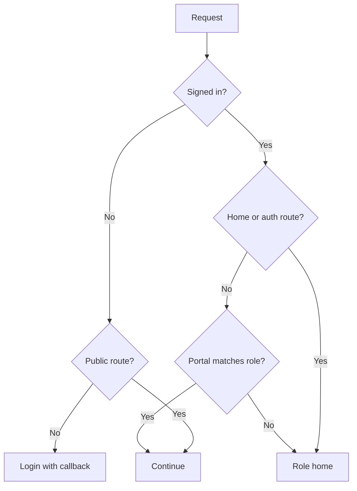
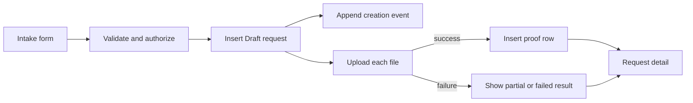
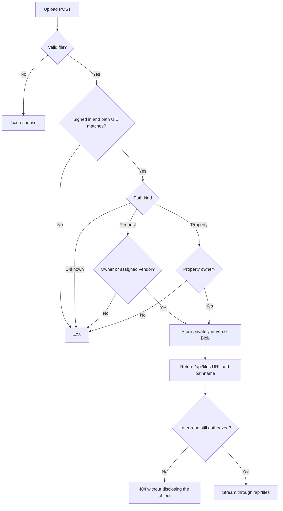
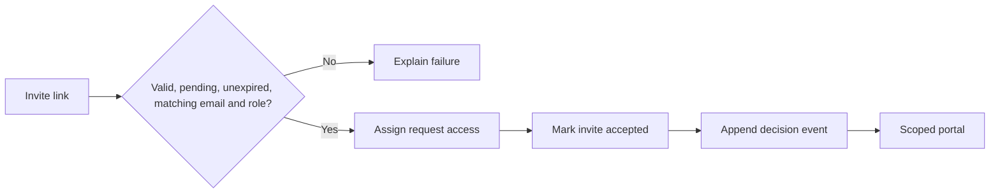
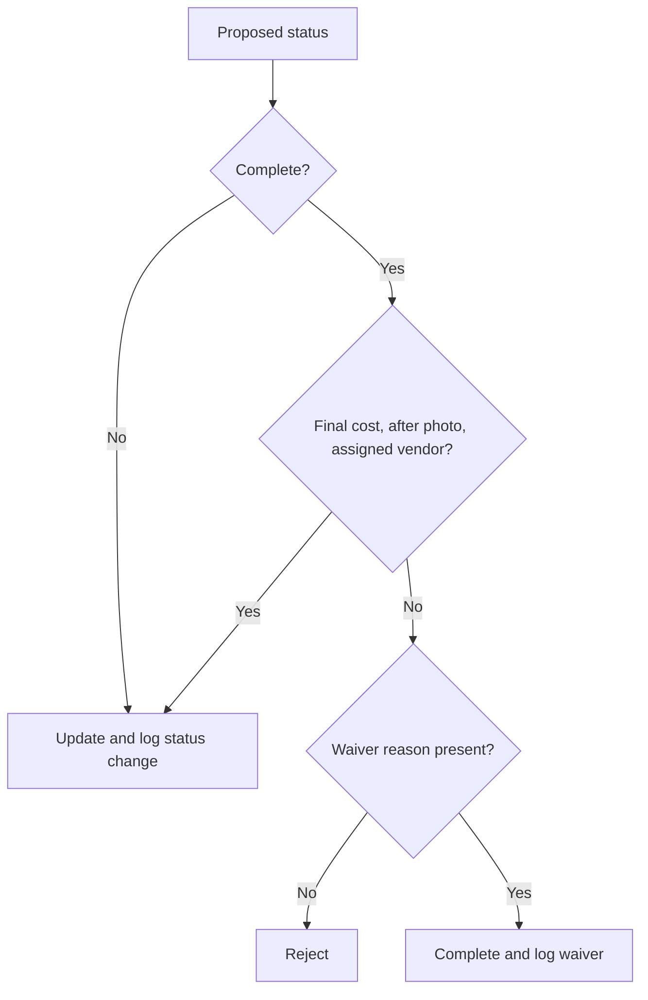
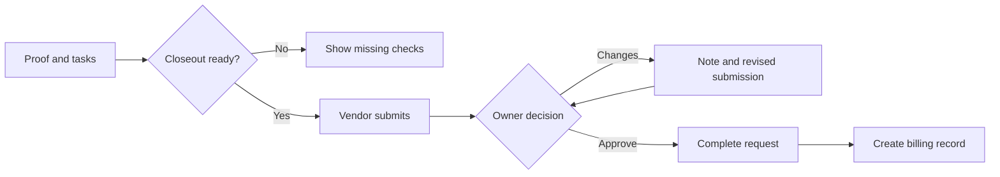
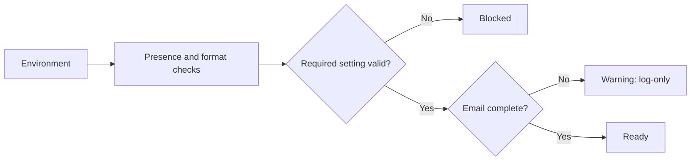

# TurnFlow Home Problems, Algorithms, Pseudocode, and Flowcharts

## 1. Route a user into the correct role workspace

**Problem:** A visitor can be signed out or signed in as an owner, vendor, or collaborator. The app should guide navigation without treating the routing layer as the final security boundary.

**Input:** path, session, role.

**Output:** redirect or continue.

**Rules:** public routes stay available; signed-out users go to login; signed-in users leave login/signup; cross-role portal visits return to the role home.

```text
IF no session AND route is private
  redirect to login with callback URL
ELSE IF session exists AND route is login, signup, or home
  redirect to role home
ELSE IF route belongs to another role
  redirect to role home
ELSE
  continue
```



**Edge cases:** API routes are excluded from proxy matching; every page/action must still re-check the session and resource authorization.

**Files:** `proxy.ts`, `lib/auth/dal.ts`, `lib/auth/config.ts`.

## 2. Create a request and preserve partial progress

**Problem:** Evidence paths need a request ID, but the owner may upload several files and some may fail.

**Input:** validated intake form, queued files.

**Output:** saved request, creation log, zero or more saved proof rows, explicit upload outcome.

```text
validate required fields and enum values
load property
reject unless session owner owns property
ensure owner workspace
insert request as Draft
append request_created event
FOR each queued file
  upload through authenticated server route
  IF upload succeeds
    insert request_photo
  ELSE
    record failure for user feedback
return request detail URL with upload counts
```



**Edge cases:** missing Blob token, unsupported file type, file over about 4 MB, stale property ID, request saved with no successful photos.

**Files:** `components/NewRequestForm.tsx`, `lib/actions/requests.ts`, `lib/blob-upload-client.ts`, `app/api/blob-upload/route.ts`, `lib/request-submit.ts`.

## 3. Authorize a private Blob upload and read path

**Problem:** A client-provided pathname must not let one user write evidence into another owner’s records, and possession of a stored path must not bypass record access on reads.

**Input:** session user, pathname, file.

**Output:** a record-scoped application file URL, an authorized stream, or a safe non-disclosing HTTP error.

```text
require configured storage token
parse multipart form
validate file type and size
require session
parse pathname into request or property scope
require pathname user id equals session user id
IF request scope
  load request
  require owner OR assigned vendor
IF property scope
  load property
  require owner
store as private Blob with authorized path and random suffix
return /api/files URL and pathname

ON file read
  require session
  parse pathname
  load request or property
  require owner, assigned vendor, or accepted collaborator access
  stream the private object with the server token
```



**Edge cases:** storage outage returns 502; missing server configuration returns 503; legacy public URLs can still render during migration; new private objects require a current request/property relationship on every read.

**Files:** `app/api/blob-upload/route.ts`, `app/api/files/route.ts`, `lib/blob-paths.ts`, `lib/file-access.ts`.

## 4. Accept a request-scoped invite

**Problem:** Grant the intended account one role-specific request assignment without exposing the full owner workspace.

**Input:** invite ID, signed-in user.

**Output:** accepted invite and vendor/collaborator assignment.

```text
require vendor or collaborator role
load invite
reject if missing request, expired, already accepted, wrong email, or wrong role
load request and confirm owner/request link
update request assignedVendorId or collaboratorId
mark invite accepted with user and timestamp
append invite_accepted event
revalidate owner and helper views
```



**Edge cases:** role mismatch, email mismatch, canceled/deleted invite, missing request, retry after a partially completed handoff.

**Files:** `app/accept-invite/page.tsx`, `lib/actions/invites.ts`, `lib/invites/forms.ts`.

## 5. Decide whether a request can be completed

**Problem:** Preserve enough evidence for a useful property history without blocking emergency or exceptional work forever.

**Input:** request, photos, proposed status, optional waiver reason.

**Output:** status change plus a normal or waiver decision-log event.

```text
require owner or assigned vendor
evaluate current status, proposed status, and actor role with request-status-policy
reject any forbidden transition
IF proposed status is Complete
  require owner
  missing = final cost OR after photo OR assigned vendor
  IF missing AND waiver reason is blank
    reject
  IF missing
    set status Complete
    append completion_waived with reason
  ELSE
    set status Complete
    append status_changed
ELSE
  set status
  append status_changed
notify owner when status changed
```



**Edge cases:** vendors can move only through working-state transitions; only owners can complete, waive, archive, or reopen; client UI can be bypassed, so the Server Action repeats the pure policy rule; a waived record remains visibly incomplete in guidance.

**Files:** `lib/request-status-policy.ts`, `lib/actions/requests.ts`, `lib/request-guidance.ts`, `components/CompletionWaiverReview.tsx`.

## 6. Move vendor work through closeout and billing recordkeeping

**Problem:** Connect operational proof with the owner’s final acceptance and durable cost history.

**Input:** request state, tasks, proof, final amount, completion notes, owner decision.

**Output:** closeout revision, owner decision, completed request, accepted tasks, and a billing record.

```text
vendor readiness requires assigned vendor, after proof, task completion, final amount, and completion notes
vendor inserts pending closeout revision
owner reviews latest pending revision
IF changes requested
  require review note
  mark revision changes_requested
  log and notify vendor
ELSE IF approved
  mark revision approved
  set request final cost and Complete
  accept remaining done tasks
  create one billing record linked to closeout
  log and notify vendor
```



**Edge cases:** duplicate billing record is prevented by the unique closeout link; billing status tracks external settlement and does not transfer money.

**Files:** `lib/closeout-submissions.ts`, `lib/actions/closeout-submissions.ts`, `lib/billing-records.ts`, `components/CloseoutSubmissionPanel.tsx`.

## 7. Evaluate launch readiness without exposing secrets

**Problem:** Operators need a useful environment report, but logs and health responses must not reveal credential values.

**Input:** environment variable presence and shape.

**Output:** ready, warning, or blocked checks.

```text
check required database, auth, URL, Blob, cron, and health settings by shape
check optional email pairing
never return raw values
block on malformed required configuration
warn when email is intentionally log-only
```



**Files:** `lib/poc-readiness.ts`, `scripts/poc-readiness.ts`, `lib/health.ts`, `app/api/health/deep/route.ts`.
