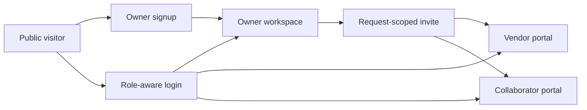

# TurnFlow Home Site Walkthrough

## Experience model

TurnFlow Home has one public entry lane and three authenticated role lanes. Owners hold the durable home record. Vendors receive access to assigned requests. Collaborators receive access to explicitly shared requests. The request is the coordination boundary between those people.

## Public and authentication screens

### `/`

The homepage explains the homeowner-first promise and separates TurnFlow from a property management company. It introduces the record lifecycle and sends a visitor to signup or login. The product screenshot and public-safe copy act as the first trust test.

### `/signup`

Creates an owner account only. `signupAction` validates the form, hashes the password, creates the user, and establishes the default workspace foundation. A new owner lands on `/owner/onboarding`.

### `/login`

Authenticates credentials through Auth.js. The user lands in `/owner/dashboard`, `/vendor`, or `/collaborator` based on the role stored in the session token.

### `/accept-invite`

Validates an invite, its expiry, intended email, role, request link, and acceptance state. A valid signed-in recipient auto-claims it and enters the correct scoped portal. The page also provides understandable failure and retry states.

## Owner workspace

### `/owner/onboarding`

A six-part setup guide turns an empty account into a useful home record: property, request, evidence, shared help, saved history, and recurring care. The screen points to the next unfinished step rather than presenting a blank dashboard.

### `/owner/dashboard`

The dashboard is the owner’s triage surface. Status filters, live counts, care metrics, request signals, communication health, and closeout cues help the owner choose the next record to open.

### `/owner/properties`

Owners add properties and see maintenance activity, document coverage, reminder coverage, and history gaps. Property exports and deletion controls define portability and removal boundaries.

### `/owner/requests/new`

The guided intake captures property, title, category, urgency, location, contact preference, access notes, description, and queued proof. Category-specific safety prompts help the owner capture useful context. The owner can create a first property inline.

Request creation and proof upload happen in separate steps. The Server Action creates the request and decision-log entry. The client then uploads evidence through `/api/blob-upload`, which validates the session, file, path, and record relationship before using private Blob storage. The request stores the authorized application file URL rather than exposing a new raw Blob URL.

### `/owner/requests/[id]`

This is the core product screen. It combines:

- record summary and status handoff;
- scope tasks and owner acceptance;
- estimates, quotes, final cost, and bid decisions;
- vendor and collaborator access;
- before, after, receipt, and context evidence;
- work-session history;
- vendor closeout and owner review;
- billing recordkeeping;
- comments and guided updates;
- append-only decision history;
- PDF proof-packet export.

The workflow rail mirrors the lifecycle from intake through preserved history. Missing closeout evidence stays visible. Marking a request complete without final cost, an after photo, and an assigned vendor requires a written waiver reason that is stored in the decision log.

### `/owner/vault`

Stores receipts, warranties, manuals, invoices, inspection reports, and other property documents. A document can link to a request so the vault remains part of the property history rather than becoming generic storage.

### `/owner/calendar`

Owners create recurring maintenance reminders, see overdue and due-soon states, mark work complete, and export `.ics` calendar data. The daily Vercel cron can send reminder digests when email is configured.

### `/owner/account`

The strongest privacy surface. It shows the owner profile, workspace/billing foundation, open invite links, accepted request access, and removal controls. Removing vendor or collaborator access changes the request assignment and appends a decision-log event.

### `/owner/notifications`

Shows notification attempts and delivery posture. A send can succeed through Resend or fail safely into the log-only fallback. The page includes an owner-triggered delivery test without exposing secret values.

### `/owner/backup`

Exports JSON backup data, previews restore files, performs add-only restore, and exports CSV history. The UI warns about duplicate risk and supports older backups that omit billing records.

## Vendor portal

### `/vendor`

The vendor sees only assigned requests. A queue summary and next-action logic guide the vendor through profile setup, bid submission, owner approval, job context, proof-gated work sessions, task updates, closeout readiness, closeout submission, requested revisions, and read-only billing history.

Key boundaries:

- An assigned vendor can add request photos, comments, status updates, work events, task progress, bids, and closeout submissions.
- Start and stop work events require the expected proof type.
- Closeout remains blocked until completion notes, final amount, after proof, and task readiness satisfy the server checks.
- TurnFlow records billing state but does not process payment.

## Collaborator portal

### `/collaborator`

The collaborator sees only explicitly shared requests. The portal summarizes readiness and lets the helper add useful updates. It does not expose unrelated properties, owner-wide documents, billing management, or other requests.

## Recovery and failure paths

| Failure | User-facing recovery |
|---|---|
| Invalid credentials | Generic sign-in error without account enumeration |
| Expired or mismatched invite | Clear invite state with login/retry guidance |
| Missing property during intake | Create the first property inline |
| Upload configuration missing | Server returns a clear configuration error; request data remains saved |
| File read without request or property access | `/api/files` returns a non-disclosing not-found response instead of streaming the private object |
| Upload too large or unsupported | Specific size/type response and retry guidance |
| Missing completion proof | Add evidence/cost/vendor or record an explicit waiver reason |
| Closeout incomplete | Vendor sees readiness checks before submit |
| Owner requests closeout changes | Review note returns to vendor; vendor submits a new revision |
| Email unavailable | Attempt stays visible in notification history and owner can copy the invite link |
| Restore file invalid | Preview explains missing arrays or format errors before mutation |
